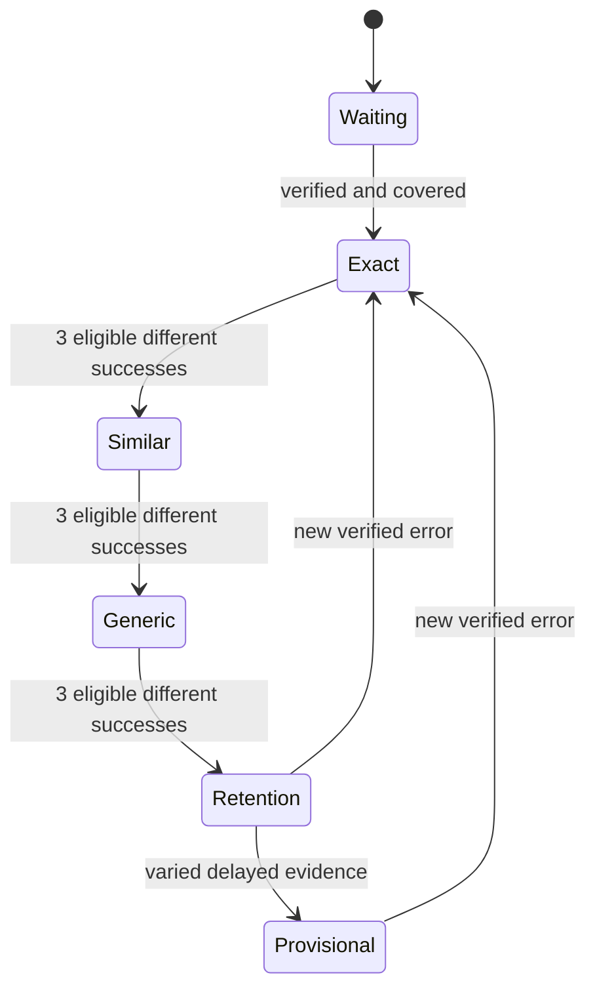

# Pilot v0.1 — Learning Engine Specification

**Status:** Design-only Draft for Claude review, 2026-10-12.
**Base:** `1c24e5b44d62746e2fb776d71215b1f3d779a45a`; Issue #6.
**Authority:** [Pilot scope](PILOT_V0_1_SCOPE.md) and [technical decisions](TECHNICAL_DESIGN_DECISIONS.md). Read with the [functional design](PILOT_CHINESE_FUNCTIONAL_DESIGN.md) and [acceptance cases](PILOT_CHINESE_ACCEPTANCE.md).

Owner confirmed **three different questions correct consecutively** for each Chinese ladder step, as presented with first-attempt/no-answer-revealing-hint eligibility. All additional algorithms, bounds and contracts here are proposed details, pending independent review and owner decisions where needed. No code, schema migration, backend configuration or content batch is delivered.

## 1. Minimal layers and contracts

| Layer | Inputs → outputs | Must not do |
| --- | --- | --- |
| Reviewed content catalogue | Versioned generic groups → validated items/mappings | Read private errors while building bundles; generate runtime questions |
| Subject adapter | Reviewed item + response → objective judgement or ungraded | Fuzzy grade free writing or infer handwriting quality |
| Event store | Validated command → atomic private events/checkpoint | Replace evidence with a last-answer field |
| Chinese evidence reducer | Events + catalogue compatibility + policy → derived ladder/mastery | Treat quest completion, parent opinion or mutable flags as correctness |
| Review planner | Eligible target states + clock + visit budget → bounded mission | Penalize missed days or manufacture independent occasions |
| Quest adapter | Structured completion events → world/resume state | Change objective outcomes or mint learning evidence |
| Persistence/backup adapter | Committed minimal state → pending snapshot request | Merge competing heads or include excluded raw/free-text data |

Keep pure evaluation/reducer/planner functions independent of React, database, network and avatar logic. Pass explicit content and policy versions and an injectable clock. Shared contracts support later subjects; only Chinese gets this personalised ladder and provisional-mastery policy. Do not build a universal authoring system for four small units.

## 2. Proposed reviewed-content contract

| Record | Required fields and invariants |
| --- | --- |
| Group | Stable curriculum-topic `groupId`, version, generic scope/prerequisites, original/licensed provenance, QA batch reference, approved release status |
| Target mapping | Catalogue target identity, supported error types/contrasts, exact/similar/generic pools; no private learner ID |
| Item | Stable `itemId`, version, objective tags, task type, prompt/assets, accepted answers/variants if objective, explanation, hints, stage eligibility |
| Evidence metadata | `equivalenceSetId`, context ID, task-family ID, tested construct, assistance classification, assessment/teaching purpose |
| Revision | Compatibility map with unchanged/compatible/invalidated evidence and rationale; no silent reuse of changed answer keys |

Item IDs are not sufficient independence: cosmetic rewrites, reordered options and the same answer with a new illustration share an equivalence set. Exact items address the recorded target/error type using reviewed generic contrasts, not necessarily the original worksheet question. A complete mapping must have at least three evidence-distinct objective questions at every stage to support the owner rule. Release inventory must additionally allow fresh replacement questions and delayed varied contexts; three questions alone is not a usable repeated-review catalogue. Exact counts per group are release planning, not a new scope requirement.

No example character set is authored in this PR. Content approval follows CONTENT_QA: cross-review, every disputed item reviewed by owner, random 1-in-5 sample of AI-agreed items and batch sign-off. A catalogue validator checks structure/references but cannot attest educational quality, rights or MOE alignment.

## 3. Private record model

| Record | Minimal proposed fields | Interpretation |
| --- | --- | --- |
| Target | Opaque target ID; target kind/text; optional bounded contrast; parent-recorded error type; verification history; catalogue mapping/version | Verification and coverage are independent axes |
| Observation | Opaque observation ID; target ID; fixed-list source type; date; random source-instance/session reference; import receipt ID; verification-event reference | One occurrence per target per established occasion |
| Parent review | Event ID; target/observation reference; accept/uncertain/reject or reclassification; fixed-list review kind; date; revision linkage | No free-text notes in cloud allowlist; provenance is private |
| Presentation | Presentation ID; session ID; target, step, item/version/equivalence/context; local sequence; assistance exposure | Survives pause/resume; retry cannot become a fresh first attempt |
| Attempt | Event ID; presentation ID; attempt number; response category or allowed structured response; objective outcome/ungraded; help exposure; date/time; policy/content version | First and subsequent attempts stay distinguishable |
| Review visit | Visit ID; target; due milestone; evidence eligibility; tested step/context; completion evidence | Missed dates are not fake visits |
| Lesson/quest completion | Event ID; stable quest/lesson ID/version; structured checkpoint | Independent of correctness/mastery |

Each private store/envelope is child-scoped and tied to its authenticated family. IDs are random opaque references, never worksheet hashes. Do not persist original prompts/source questions inside private error records. Generic item references reproduce reviewed feedback from the content catalogue. Target key normalization uses Unicode NFC and boundary whitespace removal; do not auto-convert traditional characters, remove meaningful punctuation or fuzzy-merge similar characters. Exact duplicate targets share an identity; alternate error types retain separate repair tracks and observations.

Import deduplication key: child + source-instance + normalized target + recorded error type. Same worksheet/date in a new batch is still the same occurrence. Multiple wrong appearances within a worksheet aggregate to one occasion and do not inflate recurrence. A genuinely separate worksheet can be independent on the same date, but cannot satisfy mastery's different-day requirement. Local runtime responses use session reference; repeated errors within one session add attempt history, not independent recurrence. Parent source mistakes/reclassification must be correctable by append-only amendment; arbitrary new IDs are not proof of independence.

Proposed event ordering: transactional monotonic local sequence within the primary working history; unique event ID gives retry idempotency. Timestamps support calendar review, not multi-device conflict resolution. Record uncertainty for clock reversals/implausible jumps; do not certify delayed evidence from elapsed wall-clock arithmetic alone. No claim that offline client time proves an actual date.

## 4. Objective attempt semantics

An **eligible success** is a first response to a new evidence presentation, objectively correct against a reviewed answer key, with no answer-revealing help, no recorded adult answer assistance, valid content/policy versions and a distinct equivalence set within the current step-clearing window. Eligibility is recorded behavior, not proof that a child truly worked unaided; unobserved adult assistance cannot be detected.

Replay of neutral instructions/motor support does not invalidate eligibility. Pronunciation, pinyin, examples or hints revealing the tested answer do. Teaching assets and reference solutions never themselves count as assessment. If the answer was shown before the item, that presentation is practice-only. A retry after wrong feedback is valuable correction but not a first-attempt success.

Proposed reset rule: an objectively incorrect first attempt, answer-revealing help or known answer assistance ends the current eligible streak. Ungraded reflection, tracing and pauses do not change the streak. Duplicate/equivalent correct items are neutral, add no success and cannot advance. An equivalent wrong item still breaks the streak. UI reveals feedback after committing the attempt, preventing crash/reload from erasing an error and retrying as new.

Question first-attempt status persists across refresh, app kill and session return; a new presentation ID must not be created solely to evade a previous first attempt. Later reviewed practice may reuse an item, but is explicitly repeated evidence and cannot establish novelty by changing IDs. When catalogue supply is insufficient, keep step uncleared and allow a pause/generic voluntary lesson; no auto-generated question or forced endless retry.

## 5. Chinese derived state and ladder

Eligibility requires parent-verified knowledge error and full reviewed mapping. Possible slip, unclear, presentation-only, uncertain and rejected entries do not prescribe the ladder. Verified unmatched/incomplete entries remain `pending_content`.

`Waiting` includes review/content eligibility; it is not a diagnosis. `Retention` means ladder complete, delayed evidence incomplete. Proposed reducer stores no authoritative `mastered`/`stepCleared` flag: compute from the full compatible event sequence. A cache is expendable and must include input revision hash/policy version; restore rebuilds it. Correctness, verification, quest completion and self-review remain separate output fields.

Three successes can span sessions; a break is not an error. Each step has its own streak. Proposed reset/reopen behavior: incorrect current-stage attempts reset its streak; verified objective failures during a delayed visit or new independent parent-verified knowledge errors start a new repair epoch at Exact. Earlier achievements remain in history and world progress remains intact. In ordinary practice, a failure does not retroactively falsify historical step success. Later reclassification to uncertain/rejected suspends prescription; later reverification reruns compatible evidence rather than assuming clearance.

## 6. Proposed provisional-mastery threshold

For review, require all of the following **within the current repair epoch**:

- All three ladder steps cleared under the owner rule.
- At least three successful delayed-review visits on different calendar dates, with the last at least fourteen days after generic-step clearance.
- Each successful visit has three eligible correct questions, at least two distinct contexts and at least two task families across the retained delayed evidence. Each visit includes at least one evidence-equivalence set not previously answered or revealed in that epoch.
- No later verified error or incompatible/withdrawn evidence; date uncertainty cannot satisfy an independent-day/delay condition until resolved.

These numerical delayed thresholds are **not owner-confirmed**, not a scientific guarantee and not an implementation permission. Claude should critique feasibility/content cost. If inventory lacks varied objective activities, report insufficient evidence, not mastery. Parent self-/work review may be displayed alongside objective evidence but cannot satisfy the automatic threshold. Open handwriting/writing quality never enters it.

Continue low-frequency review after provisional mastery; new verified errors reopen the repair epoch. Child-facing language celebrates practice progress rather than guaranteeing durable knowledge. Parent label must say provisional and expose which evidence is missing.

## 7. Proposed scheduling and bounded selection

Use local calendar dates through an injected clock and configured timezone. Proposed baseline milestones are offsets **1, 3, 7, 14 days after generic-step clearance**, not four intervals added cumulatively. Before ladder completion, resume incomplete repair; do not postpone it until day fourteen. A review visit continues to use only already unlocked stages and emphasizes varied similar/generic tasks after the ladder clears.

One target gets at most one delayed-review visit credit per calendar day. A successful late visit satisfies the oldest outstanding milestone; do not mark multiple missed milestones complete. Retain original schedule for transparency, but schedule the next visit no earlier than the next calendar day. Missed days do not reset progress or create penalties. Weak eligible review starts repair again under §5; a supported correction does not retroactively pass the visit. Interruption retains the presentation and visit; it is not a failed review.

After successful day-fourteen review, proposed low-frequency checks are 30 days, then 60 days after successful review; keep reviewing while provisional and retain a path for voluntary practice. No automatic permanent retirement. Date changes do not create a burst of visits; reversible clock anomalies keep evidence uncertain. Policy changes are versioned and rederived, with parent-visible explanation rather than quietly moving dates.

Proposed priority is deterministic and lexicographic, not a spurious numerical mastery score:

1. Eligible targets with new verified errors or weak delayed evidence.
2. Due delayed-review targets, ordered by greater independent recurrence count, then earlier due date.
3. Incomplete repair tracks, ordered by independent recurrence and verified knowledge-error status.
4. Voluntary generic learning when no prescribed target is eligible.

Tie-break by least recently practised, then stable opaque target ID. Count recurrence from unique established verified occasions, not batches/attempt totals. In an initial intake without recurrence, use verified knowledge errors; do not invent frequency. Within a tier use round-robin exposure so one recurring target cannot monopolize visits. Mission/visit presentation caps from the functional design apply; due overflow waits without punitive debt or a locked adventure.

## 8. Persistence, content update and snapshot interface

Every attempt/import is an atomic transaction covering event and resumable structured state. Failed saves preserve the current response in memory, show unsaved state and prevent progression; a retry uses the same event/presentation ID. Persistent storage failure does not reset the database. Account switch/logout must not expose the previous child's cached private records; exact local retention/purge mechanics require the separate Auth/data-protection design.

Snapshot capture uses a consistent committed revision; pending upload metadata is durable and retries identify the same logical snapshot. Latest successful backup is distinct from latest local revision. No backend write is introduced by this spec. Enforce the current Pilot allowlist; exclude copied worksheet content, strokes, open drafts and local safety copies. Never serialize every IndexedDB store indiscriminately.

On restore, validate schema/size, child ownership, supported content/evidence versions and event uniqueness; atomically replace active working state only through the confirmed parent reauthentication/current-cloud-head/local-safety-copy flow. Rebuild schedule, step clearance and provisional status from retained events. Missing original evidence means missing status, not a surviving flag. Conflicting device progress is not merged or replayed. Failed/cancelled restore preserves the working copy and paused uploads. No-head recovery/pruning/deletion remain exactly as in Pilot scope; this task specifies no owner-only SQL operation.

Content changes with equivalent objectives/keys may retain explicitly reviewed compatible evidence. Changed constructs, answers or compromised items invalidate only affected evidence with a parent-visible notice; keep historical outcome/version. Missing cached versions stop that item while preserving state. Update should activate at a saved boundary, never during an uncommitted attempt. Stale content and service-worker state must not silently create new question identities.

## 9. Design decisions still open

| Proposal/gate | Required next action |
| --- | --- |
| Reset/reopen behavior, caps, calendar anchor and delayed thresholds | Claude critique; owner resolve material trade-offs before implementation |
| Enough reviewed independence sets and delayed contexts | Generic group inventory and human QA; no learner-specific publication |
| Private coverage comparison/proceed gate | Owner procedure in Issue #3; not a numerical pass threshold |
| Actual-target snapshot confidentiality and local retention | Resolve TDD §9 privately as appropriate before real-record handling |
| Local safety-copy recovery/lifetime and owner-only pruning/deletion | Separate backup design before backup implementation PR |
| Auth/RLS/environment identities/device acceptance | Synthetic access tests and target-device verification before real records |

A design review cannot certify legal compliance, actual device behavior, curriculum alignment or learning efficacy. Implementation requires a separately authorized scoped task after review; merge remains per-PR approval.
