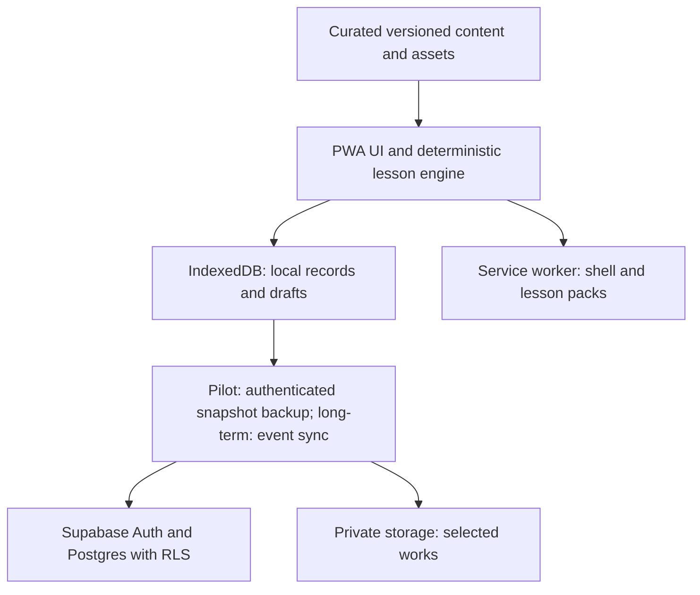

# Turtle Academy — Technical Handoff

> Historical reference. Implementation descriptions reflect their recorded dates and include superseded prototype states. Start from [AGENTS.md](../AGENTS.md), the current [README](../README.md) and code. This file is not a mandatory onboarding checklist.

Updated: 2026-10-11. Audience: Claude, ChatGPT and the project owner.
This repository is public since 2026-10-10. Keep account names, project identifiers and any real learner information out of this document.

This is an onboarding summary and dated implementation snapshot. Technical authority remains in `TECHNICAL_DESIGN_DECISIONS.md`; `FEATURE_SCOPE.md` preserves long-term scope. `PILOT_V0_1_SCOPE.md`, `PILOT_FUNCTIONAL_DESIGN.md` and `PILOT_LEARNING_ENGINE_SPEC.md` together define the Pilot delivery slice. Current code, commits, PRs and check results establish implementation status. This document does not convert planned capabilities into delivered features or select an MVP.

## 1. Start here: source of truth

The original handoff listed these references. Use AGENTS for current task-specific reading:

| Source | Authority |
| --- | --- |
| `docs/AI_COLLABORATION.md` | Shared working protocol for Claude and ChatGPT |
| `docs/TECHNICAL_DESIGN_DECISIONS.md` | Confirmed technical requirements and architecture constraints |
| `docs/FEATURE_SCOPE.md` | Full long-term product and curriculum scope |
| `docs/PILOT_V0_1_SCOPE.md` | Pilot scope and preserved security/release gates |
| `docs/PILOT_FUNCTIONAL_DESIGN.md` | Current consolidated four-subject functional behavior |
| `docs/PILOT_LEARNING_ENGINE_SPEC.md` | Proposed contracts, validation, coverage and acceptance cases |
| `docs/TECHNICAL_HANDOFF.md` | Onboarding summary and dated implementation snapshot |
| `docs/FOUNDATION_SETUP.md` | Setup evidence; check its branch and update date |
| Code, migrations, PRs and Actions runs | What exists, what is proposed, and what was tested |

GitHub is the shared record. Chats are working conversations, not a second untracked architecture register. A later explicit owner decision supersedes an older decision; record it in the relevant GitHub document before relying on it in subsequent work. If a new chat instruction is not yet recorded, identify the discrepancy rather than silently treating the older file as current. Both assistants check current main and relevant work at task start; AGENTS defines the current reading workflow.

Use the name Turtle Academy. Earlier planning chats may mention other working names, repositories or files (for example `docs/MVP_FEATURE_DECISIONS.md`); those are not part of this repository, so do not invent their contents.

## 2. Baseline on 2026-10-10

| Item | State |
| --- | --- |
| Repository | Public; default branch `main`; started from a sanitized, history-free snapshot of earlier private working files. Earlier private branches, PRs and CI runs are not published |
| `main` | Planning documents, collaboration protocol, privacy guard, automatic pull-request privacy check, manual full CI and the frontend foundation shell |
| Frontend validation | Identical code, lockfile and tests passed all checks before the move; public `Foundation checks` run #1 passed on `main` at `30eef37` (reported in Claude's review) |
| Supabase | Separate staging and production projects reported by the owner; no Turtle Academy schema, invitation flow, RLS, private buckets or sync implemented or verified |
| Vercel | Existing account reported by the owner; import, deployment, plan suitability and deployment controls not verified |
| GitHub settings | Public repo protections documented in `FOUNDATION_SETUP.md`: squash-only, protect-main PR/privacy-guard, read-only Actions; periodically reverify |

Never provision, query or modify a backend project merely because a connected tool lists it; verify identity from service metadata first.

## 3. Confirmed product and architectural boundaries

- Original fantasy-adventure educational PWA, with a target 2.5D game presentation. Tablet, desktop and landscape phone are core targets. The current shell does not implement the full game renderer or world.
- Four long-term subjects: Science, Chinese, English and Mathematics. Pilot v0.1 has scoped P2 + P3 coverage for Chinese/Higher Chinese and English, P2-only Mathematics, plus seven selected P3 Science topic areas (see `PILOT_FUNCTIONAL_DESIGN.md`). Curriculum/source verification and editorial review remain necessary.
- No runtime AI: no LLM calls, AI questions, AI grading, OCR grading, AI image interpretation or AI voice processing in the learning app. Claude and ChatGPT are development assistants outside the product runtime.
- Curated, human-reviewed content and deterministic feedback. Free explanations receive curated hints and reference answers after an initial attempt; do not automatically declare them correct.
- Separate story completion, task submission, verified concept mastery and subjective assessments. Attempt counts, finished quests and parent confirmations are not interchangeable with mastery.
- Pilot delivery requires the **Registered-only** subset first (one parent + child); Guest remains explicitly in full long-term scope. Current guest-only foundation code is historical, not the Pilot commitment.
- The full feature scope is not a build list. Only Pilot v0.1 is committed; do not invent phase allocations for anything else.
- Zero incremental paid infrastructure. Separate this budget requirement from any assumptions about free hosting, database, storage, email or bandwidth allowances.
- Keep this project independent from all other applications and their accounts, projects and repositories.

## 4. Target system structure

This diagram describes the intended architecture, not a deployed backend:



Pilot Registered records stay local-first with authenticated Supabase **snapshot backups**, not live per-record sync. Guest (when added later) remains local-only. Full sync and private selected-work storage arrows are future implementation. The service-worker cache stores downloadable app/content files, not a substitute for ownership-controlled learner storage.

| Layer | Responsibility | Current implementation |
| --- | --- | --- |
| React UI and game presentation | Navigation, subject worlds, quests, accessible input, parent views | Small React shell |
| Lesson/content engine | Stable content IDs and versions; concepts, prerequisites, answers, hints and reviewed explanations | One hard-coded generic Science question; no modular engine yet |
| Progress and assessment | Distinct story/submission/mastery evidence; rule-based review scheduling | No domain progress model yet |
| Local persistence | Pilot Registered records and pending backup, draft state and safe schema changes | One Dexie guest-only checkpoint from earlier foundation spike (Pilot upgrade not implemented) |
| Offline delivery | App shell, versioned lesson packs, readiness/download/recovery state | Workbox shell precaching only |
| Pilot backup and server authorization | Authenticated child-scoped snapshot backup, RLS, conflict-safe recovery; full event sync later | Not implemented |
| Private backend and storage | Family-owned records, selected portfolios, parent notes | Not implemented |
| Hosting and CI | Static build delivery, checks and controlled releases | GitHub: automatic privacy check on pull requests, manual full CI; proposed Vercel configuration |

Module boundaries above summarize responsibilities; they do not prescribe an unimplemented directory layout. Do not invent committed migrations, APIs, database tables or server functions.

## 5. Frontend foundation: what Claude can run

```sh
git clone <this repository's URL>
cd turtle-academy
# Use Node 22.21.1 from .nvmrc, with your existing Node manager.
npm ci
npm run dev
```

Pushing branches requires write access granted by the owner; never transfer credentials through chats, Issues or documents.

Versions below describe the current foundation, not a permanent upgrade policy. Always read `package.json`, `.nvmrc` and `package-lock.json` on the branch being worked on.

| Dependency | Pin |
| --- | --- |
| Node | 22.21.1; package engines require Node >=22.12.0 and <23 |
| React / React DOM | 19.3.0 |
| Vite | 8.3.4 |
| TypeScript | 7.0.2 |
| Dexie | 4.4.6 |
| vite-plugin-pwa | 2.0.0 |
| Playwright | 1.64.0 |

Read `src/App.tsx`, `src/storage.ts`, `vite.config.ts`, `tests/foundation.spec.ts`, `vercel.json` and `.github/workflows/foundation.yml` first.

The app has one living/non-living Science example, a Chinese placeholder and original turtle art. Dexie database `turtle-academy-guest-v1` contains a single `checkpoints` store with a `sample` record: schema version, attempt count and last selected answer. Writes use a read/write transaction. Unrecognized records are rejected rather than overwritten. This is a storage spike, not a persistent personalized guest mistake bank.

Database opening is explicit: Dexie `liveQuery` alone may wait without emitting an error when IndexedDB is missing. Preserve the tested unavailable-storage path. The app displays an error and disables answer buttons when saved progress cannot be opened.

Workbox precaches the built shell, uses a navigation fallback and waits for a deliberate update action. Answer saving/storage errors disable that update action. This does not establish safety for every multi-tab update, cache failure or production lesson-pack migration.

Production/offline verification commands:

```sh
python3 scripts/privacy_guard.py
npm audit --audit-level=high
npm run build
npx playwright install chromium
npm run test:e2e
npm run preview
```

Linux CI installs browser system dependencies too. The Vite development server is not the offline acceptance environment; tests use the production build and preview server.

The pre-move validation reported zero dependency vulnerabilities at that time, a 12-entry precache (~335 KiB) and six passing Chromium checks: offline reload/write/reconnection persistence, missing IndexedDB, denied database opening, and three overflow checks (1024×768, 844×390, 390×844). These are not visual acceptance, real-device, Safari or China-network tests.

## 6. Identity, privacy and imports

**Pilot:** manually provisioned Registered parent with password fallback and Google sign-in only after safe staging identity-link verification; invitation codes remain a **full-product** requirement. Pilot has one nickname-only child; multiple child profiles remain long-term; routine parent controls require a 4–6 digit offline-capable PIN stored only as a salted slow hash on device, with growing back-off and online account-password reset; PIN/hash are excluded from snapshots. A PIN alone is not server authorization; Pilot sensitive operations require parent reauthentication. Backend access must enforce authenticated parent/child ownership and RLS.

Guest mode is device-only, with restricted personalization. No cloud sync, persistent personal mistake bank, parent letters or registered-only analytics. Conversion requires parent-reviewed selective import; never silently merge all guest data into an account.

Original worksheets and identifiable handwriting/photos remain outside Git, including ignored folders. A private preparation workflow may produce structured correction candidates; parent/human verification precedes secure import into the authenticated learner bank. Do not bundle private mistake entries into generic lesson JSON. No privileged backend key belongs in browser variables, public PR workflows, test logs or previews.

**Pilot:** Chinese tracing and typed learning answers are excluded; objective selection remains supported and full writing is external. Registered records use snapshot backup under the [Pilot decision register](PILOT_V0_1_SCOPE.md#3-identity-and-protected-backup-policy). **Long term:** drawing drafts, selected private portfolios and per-record outcome sync remain separately scoped; retention/cleanup notices need specification. Voice practice, if added, is transient with no voice archive.

Science journals must distinguish simulated values, actual observations and inferences. Corrections preserve original values, reason and time. Attention/instruction activities cannot diagnose disorders, claim measured attention or guarantee classroom transfer.

## 7. Offline and sync acceptance requirements

Pilot cached lessons must run offline after first online login without external runtime fonts, scripts, images or mandatory APIs. Downloadable pack readiness, sizes and incomplete-download recovery are later full-scope work. Browser storage can be evicted; communicate that limitation.

Pilot backup/recovery policy and tests are in [Pilot §5](PILOT_V0_1_SCOPE.md#5-testing-and-release-gates); cloud-restore-only conflict recovery is decision A, and full sync is deferred. Long-term registered sync requires stable event IDs, transactional persistence, idempotent retries, duplicate detection and reconciliation. Do not use naive last-write-wins for mastery, progress or rewards. Reward issuance must not duplicate during retries. Detailed event schema, account-switch isolation, offline-auth recovery and conflict rules remain design/implementation work.

Test interrupted writes, repeated requests, multi-device conflicts, logout/account switching, stale packs, service-worker replacement, iOS Home Screen and storage eviction before claiming robust offline support. Do not claim indefinite offline authentication validity.

Mainland China connectivity is unverified. Google login and overseas endpoints may be unreachable. Prepare course packs before travel and test actual Chinese networks. An older chat mentioned Cloudflare; the later setup selected Vercel for evaluation. Neither history establishes a deployed China-accessible host or authorizes a second hosting stack.

## 8. CI, deployment and public repository

The `Privacy guard` workflow runs automatically on pull requests and only executes the privacy script. The `Foundation checks` workflow is manual: locked installation, privacy guard, dependency audit, build and Chromium tests, with read-only contents permissions, concurrency cancellation, a timeout and no deployment, secrets or artifacts. A documentation change does not justify rerunning the full browser suite or adding a matrix. Fork PRs must never receive secrets.

Proposed Vercel settings: Vite, repository root, `npm run build`, output `dist`, Node 22. The synthetic shell requires no environment variables. Verify plan suitability, Git auto-deploy controls, preview access, HTTPS, routes, service-worker updates and logs before release. A merge and a deployment are separate actions.

Supabase staging and production are separate projects, not renamed versions of one project. Before accessing either, verify the account, project identity, region and environment from actual service metadata, and keep those details out of this repository. Never reuse another application's resources. Quotas, email recovery, retention/deletion, RLS and cross-family isolation require verification before real users.

This repository is public since 2026-10-10. Every commit, Issue, PR description, comment and CI log can be published and cannot be reliably withdrawn. Keep sensitive originals outside Git, use synthetic fixtures, and review each diff as published material. If anything private is pushed, rotate affected credentials immediately and tell the owner.

## 9. Suggested next implementation task

Propose a scoped implementation task with acceptance criteria for the **Registered-only Pilot**, retaining long-term Guest requirements separately. Establish family/child identity, server authorization, RLS and snapshot contracts before dependent UI work. Resolve the private catalogue-coverage and data-protection gates before the implementation they govern, and define safety-copy recovery and owner-only retention/deletion operations before the backup PR. This is a suggested sequence, not an owner-approved MVP allocation or implementation authorization.

Read the current authoritative documents and active GitHub work before proposing changes. Keep PR-specific review instructions, reviewed SHAs and merge authorization on the relevant PR. Code, service changes, merging and deployment require their separately applicable owner authorization.

Still open: post-Pilot phase allocation, curriculum verification, content/pack and event schemas, secure imports/invitations, RLS/storage tests, registered sync, retention, device acceptance and hosting validation. Recheck the live repository before treating this list as current.

## 10. Evidence and maintenance

This summary combines the two confirmed design documents, earlier setup work and the pre-move validation run. Infrastructure project creation is owner-reported; it is not a direct verification of service configuration. No real learner records are included.

After each merged implementation change, update the setup evidence and any affected handoff sections with the commit/PR/run. Change confirmed architecture and feature scope separately, and only when the owner explicitly changes a decision. Keep dates and branch distinctions visible so a later assistant does not inherit stale claims.

## 2026-10-11 conditional Pilot v0.1 decision handoff

Issue #3 conditionally ratifies documentation only: one pre-provisioned Registered parent and nickname-only child, no Pilot Guest; IndexedDB and child-scoped authenticated Supabase snapshot backup (not full sync); parent-verified private worksheet paste-in; Chinese → Science → Mathematics → English, starting with Chinese + movable hub/companion and backup. Later decisions exclude tracing and expand curriculum scope, as recorded in the consolidated functional design. Pilot details and gates are in PILOT_V0_1_SCOPE.md and CONTENT_QA.md. No code, RLS or service configuration is implemented by this documentation PR.

## 2026-10-14 consolidated documentation handoff

Dated design context: the two specifications replaced earlier narrow-unit and three-consecutive-answer assumptions. No app behavior, backend or reviewed curriculum bank was delivered by that documentation package; the suggested implementation sequence was not coding permission.

## 2026-10-15 consolidated decision handoff

Each subject has persistent X=6–19, default 10. Owner decision 2026-10-18: in the first pilot Chinese may go up to 20 (other subjects stay 6–19). Subject releases use the 75% coverage guideline and recorded owner override: P2 outcomes for Chinese/Higher Chinese, Mathematics and English, and the first two Science topics for initial Science release. P3 Chinese/Higher Chinese and English general practice is unlocked from the start using reviewed available content; P3 mistake imports follow later. Mathematics P3 stays locked in Pilot and needs no Pilot authoring; a post-Pilot teaching flow precedes opening P3. The remaining five Science topics unlock in syllabus order as authored and reviewed. Short-only repair supports all subjects; final transfer is on a later day. One qualifying high-option/matching/ordering first-success OR two distinct low-option first-successes clears a stage; any wrong first response resets low-option partial successes, while passage aggregation remains required. Science's previous-seven-calendar-days exclusion is filler-only; due review prefers fresh items, otherwise reuses the least-recently presented suitable item. Active time includes teaching, stops on pause/background or two minutes idle. PIN-protected timezone changes cannot create extra completion/rewards or earlier review eligibility. Zero-question Science completion has a visible reason and no checkpoint; shortened actual work has deduplicated completion. Snapshot recovery preserves story, suspensions and exposure but excludes local wrong forms/PIN. Earned story and past daily completion survive learning-evidence replay. Read Scope + Functional Design + Learning Engine together. The unresolved data-protection, private coverage/proceed and safety-copy gates remain. No implementation or merge is authorized by this handoff.
