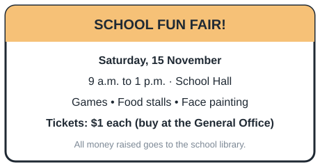
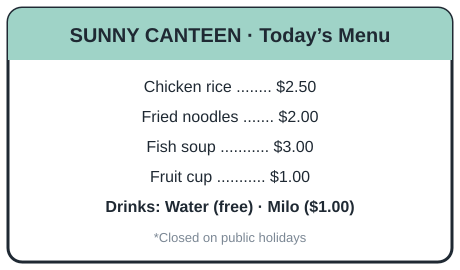
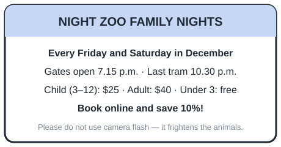
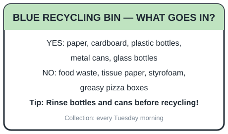

# English pool-001 — review view

Generated from `content/english/pool-001.json`; edit the JSON, not this file. Key = correct answer.

## P2 · Nouns and noun phrases: plurals (regular, -es, -ies, -ves, irregular), collective and uncountable nouns (`el.p2.nouns`)

| ID / stage | Question and options | Key | Hint | Explanation | Leaf → repair route |
| --- | --- | --- | --- | --- | --- |
| el-p2-plural-s-es.q1 / exact (v1) | I have two ______ in my pencil case. 1 erasers; 2 eraser; 3 erasers'; 4 eraseres | erasers | Two means more than one. | More than one eraser: add -s to make "erasers". | `el.p2.leaf.plural-s-es` target `el.p2.plural-s-es` |
| el-p2-plural-s-es.q2 / similar (v1) | There are three ______ on the table. 1 boxes; 2 boxs; 3 boxies; 4 box | boxes | Words ending in -x add -es. | "Box" ends in x, so the plural is "boxes". | `el.p2.leaf.plural-s-es` target `el.p2.plural-s-es` |
| el-p2-plural-s-es.q3 / generic (v1) | Mum bought six ______ of bread for the picnic. 1 loafs; 2 loafes; 3 loaves; 4 loaf | loaves | Some words ending in -f change to -ves. | The plural of "loaf" is "loaves". | `el.p2.leaf.plural-s-es` target `el.p2.plural-s-es` |
| el-p2-plural-irregular.q1 / exact (v1) | The dentist checked all my ______. 1 teeth; 2 tooths; 3 toothes; 4 tooth | teeth | This plural does not add -s. | The plural of "tooth" is "teeth". | `el.p2.leaf.plural-irregular` target `el.p2.plural-irregular` |
| el-p2-plural-irregular.q2 / similar (v1) | Two ______ were waiting at the bus stop. 1 woman; 2 women; 3 womens; 4 womans | women | The plural changes a vowel. | The plural of "woman" is "women". | `el.p2.leaf.plural-irregular` target `el.p2.plural-irregular` |
| el-p2-plural-irregular.q3 / generic (v1) | Three little ______ ran across the kitchen floor. 1 mices; 2 mouses; 3 mice; 4 mouse | mice | Think of the plural of "mouse". | The plural of "mouse" is "mice". | `el.p2.leaf.plural-irregular` target `el.p2.plural-irregular` |
| el-p2-plural-y.q1 / exact (v1) | The farmer picked many ripe ______ from the bushes. 1 berryes; 2 berry; 3 berries; 4 berrys | berries | A consonant before -y: change y to i and add -es. | "Berry" becomes "berries". | `el.p2.leaf.plural-y` target `el.p2.plural-y` |
| el-p2-plural-y.q2 / similar (v1) | The children played with their new ______. 1 toy; 2 toys; 3 toyes; 4 toies | toys | A vowel comes before the y. | With a vowel before y, just add -s: "toys". | `el.p2.leaf.plural-y` target `el.p2.plural-y` |
| el-p2-plural-y.q3 / generic (v1) | We visited two ______ during the school holidays. 1 cityes; 2 citys; 3 cities; 4 city | cities | Look at the letter before the y. | "City" has a consonant before y, so it becomes "cities". | `el.p2.leaf.plural-y` target `el.p2.plural-y` |
| el-p2-collective-uncountable.q1 / exact (v1) | We saw a ______ of fish swimming near the boat. 1 school; 2 flock; 3 herd; 4 pack | school | A group of fish has a special name. | A group of fish is called a school. | `el.p2.leaf.collective-uncountable` target `el.p2.collective-uncountable` |
| el-p2-collective-uncountable.q2 / similar (v2) | Please pour me some ______. 1 a water; 2 an water; 3 waters; 4 water | water | Choose the uncountable noun that can follow “some”. | "Water" is uncountable, so we say "some water". | `el.p2.leaf.collective-uncountable` target `el.p2.collective-uncountable` |
| el-p2-collective-uncountable.q3 / generic (v1) | A ______ of birds flew over our school field. 1 school; 2 herd; 3 bunch; 4 flock | flock | Think of a group of birds. | A group of birds is a flock. | `el.p2.leaf.collective-uncountable` target `el.p2.collective-uncountable` |

## P2 · Determiners: a/an, this/that/these/those, some/any (`el.p2.determiners`)

| ID / stage | Question and options | Key | Hint | Explanation | Leaf → repair route |
| --- | --- | --- | --- | --- | --- |
| el-p2-a-an.q1 / exact (v1) | Ali ate ______ apple at recess. 1 an; 2 some an; 3 the a; 4 a | an | Look at the first sound of "apple". | "Apple" begins with a vowel sound, so we use "an". | `el.p2.leaf.a-an` target `el.p2.a-an` |
| el-p2-a-an.q2 / similar (v1) | She saw ______ owl in the tree. 1 many; 2 a; 3 an; 4 two | an | One owl; "owl" starts with a vowel sound. | Use "an" before a vowel sound: "an owl". | `el.p2.leaf.a-an` target `el.p2.a-an` |
| el-p2-a-an.q3 / generic (v1) | Mum gave me ______ umbrella and a raincoat. 1 an; 2 a; 3 these; 4 some | an | Say "umbrella" aloud. What sound does it start with? | "Umbrella" starts with a vowel sound, so "an umbrella". | `el.p2.leaf.a-an` target `el.p2.a-an` |
| el-p2-this-these.q1 / exact (v1) | ______ shoes are too small for me. 1 This; 2 A; 3 These; 4 That | These | "Shoes" is plural. | Use "these" with plural nouns that are near. | `el.p2.leaf.this-these` target `el.p2.this-these` |
| el-p2-this-these.q2 / similar (v1) | Can you pass me ______ book on the table over there? 1 an; 2 those; 3 these; 4 that | that | One book, far away from you. | Use "that" for one thing that is far. | `el.p2.leaf.this-these` target `el.p2.this-these` |
| el-p2-this-these.q3 / generic (v1) | Look at ______ stars in the night sky! 1 that; 2 this; 3 a; 4 those | those | Many things that are far away. | Use "those" for many things that are far. | `el.p2.leaf.this-these` target `el.p2.this-these` |
| el-p2-some-any.q1 / exact (v2) | Is there ______ milk left in the fridge? 1 an; 2 any; 3 many; 4 a | any | Milk is uncountable. Check which option can come before it in this question. | “Any” fits this question about whether milk is left. “A”, “an” and “many” do not fit before uncountable “milk”. | `el.p2.leaf.some-any` target `el.p2.some-any` |
| el-p2-some-any.q2 / similar (v2) | We do not have ______ bread for breakfast. 1 any; 2 a; 3 many; 4 an | any | The sentence has "not". | “Any” fits this negative sentence. “A”, “an” and “many” do not fit before uncountable “bread”. | `el.p2.leaf.some-any` target `el.p2.some-any` |
| el-p2-some-any.q3 / generic (v1) | Mum bought ______ oranges at the market. 1 some; 2 any; 3 a; 4 an | some | This is a positive statement. | Use "some" in positive statements. | `el.p2.leaf.some-any` target `el.p2.some-any` |

## P2 · Verbs and verb phrases: simple present, simple past (regular/irregular), present continuous (`el.p2.verbs`)

| ID / stage | Question and options | Key | Hint | Explanation | Leaf → repair route |
| --- | --- | --- | --- | --- | --- |
| el-p2-simple-present.q1 / exact (v2) | Complete in the simple present: My brother ______ to school every day. 1 walks; 2 walk; 3 walking; 4 walked | walks | "Every day" tells us it is a habit. | For habits with "he/she/it", use the simple present with -s: "walks". | `el.p2.leaf.simple-present` target `el.p2.simple-present` |
| el-p2-simple-present.q2 / similar (v2) | Complete in the simple present: The sun ______ in the east. 1 rise; 2 rose; 3 rises; 4 rising | rises | This is always true. | Facts use the simple present: "rises". | `el.p2.leaf.simple-present` target `el.p2.simple-present` |
| el-p2-simple-present.q3 / generic (v2) | Complete in the simple present: Every Saturday, Grandma ______ us a story. 1 tells; 2 told; 3 tell; 4 telling | tells | Look for the word showing it happens again and again. | "Every Saturday" shows a habit: "tells". | `el.p2.leaf.simple-present` target `el.p2.simple-present` |
| el-p2-simple-past-regular.q1 / exact (v1) | Yesterday, we ______ our classroom. 1 cleans; 2 cleaning; 3 clean; 4 cleaned | cleaned | "Yesterday" means the past. | Past actions use the past tense: "cleaned". | `el.p2.leaf.simple-past-regular` target `el.p2.simple-past-regular` |
| el-p2-simple-past-regular.q2 / similar (v1) | Last night, Mei ______ her grandmother on the phone. 1 called; 2 calls; 3 calling; 4 call | called | When did it happen? | "Last night" is the past, so "called". | `el.p2.leaf.simple-past-regular` target `el.p2.simple-past-regular` |
| el-p2-simple-past-regular.q3 / generic (v1) | The boys ______ football in the park after school yesterday. 1 play; 2 plays; 3 played; 4 playing | played | Find the time word. | "Yesterday" shows the past: "played". | `el.p2.leaf.simple-past-regular` target `el.p2.simple-past-regular` |
| el-p2-simple-past-irregular.q1 / exact (v1) | I ______ a big fish when we went fishing last week. 1 caught; 2 catched; 3 catch; 4 catches | caught | This verb does not add -ed. | The past tense of "catch" is "caught". | `el.p2.leaf.simple-past-irregular` target `el.p2.simple-past-irregular` |
| el-p2-simple-past-irregular.q2 / similar (v1) | Ben ______ his lunch box at home this morning. 1 forget; 2 forgot; 3 forgets; 4 forgetted | forgot | An irregular past tense. | The past tense of "forget" is "forgot". | `el.p2.leaf.simple-past-irregular` target `el.p2.simple-past-irregular` |
| el-p2-simple-past-irregular.q3 / generic (v1) | We ______ a rainbow after the rain yesterday. 1 saw; 2 seed; 3 seen; 4 see | saw | The past tense of "see" is a short word. | The past tense of "see" is "saw". | `el.p2.leaf.simple-past-irregular` target `el.p2.simple-past-irregular` |
| el-p2-present-continuous.q1 / exact (v1) | Look! The baby is ______. 1 sleeping; 2 sleep; 3 sleeps; 4 slept | sleeping | After "is", use the -ing form. | "Is sleeping" shows an action happening now. | `el.p2.leaf.present-continuous` target `el.p2.present-continuous` |
| el-p2-present-continuous.q2 / similar (v1) | Listen! The birds ______ singing. 1 am; 2 was; 3 are; 4 is | are | "Birds" is plural and it is happening now. | Use "are" with plural subjects: "are singing". | `el.p2.leaf.present-continuous` target `el.p2.present-continuous` |
| el-p2-present-continuous.q3 / generic (v1) | Please be quiet. Dad ______ on the phone now. 1 are talking; 2 talked; 3 is talking; 4 talks | is talking | "Now" shows it is happening at this moment. | Use "is talking" for one person doing something now. | `el.p2.leaf.present-continuous` target `el.p2.present-continuous` |

## P2 · Subject-verb agreement: is/are, has/have, verb -s (`el.p2.sva`)

| ID / stage | Question and options | Key | Hint | Explanation | Leaf → repair route |
| --- | --- | --- | --- | --- | --- |
| el-p2-sva-is-are.q1 / exact (v1) | The apples ______ red and juicy. 1 was; 2 am; 3 is; 4 are | are | Is the subject one or more than one? | "Apples" is plural, so we use "are". | `el.p2.leaf.sva-is-are` target `el.p2.sva-is-are` |
| el-p2-sva-is-are.q2 / similar (v1) | My cat ______ very playful. 1 is; 2 am; 3 are; 4 were | is | "Cat" is one animal. | A singular subject takes "is". | `el.p2.leaf.sva-is-are` target `el.p2.sva-is-are` |
| el-p2-sva-is-are.q3 / generic (v1) | There ______ many children at the playground. 1 am; 2 was; 3 is; 4 are | are | Look at the noun after the blank. | "Children" is plural, so "there are". | `el.p2.leaf.sva-is-are` target `el.p2.sva-is-are` |
| el-p2-sva-has-have.q1 / exact (v1) | Siti ______ a new bicycle. 1 haves; 2 have; 3 has; 4 having | has | Siti is one person. | Use "has" with he, she, it or one person. | `el.p2.leaf.sva-has-have` target `el.p2.sva-has-have` |
| el-p2-sva-has-have.q2 / similar (v1) | We ______ a test tomorrow. 1 has; 2 having; 3 is; 4 have | have | Use the verb that goes with "we". | "We" takes "have". | `el.p2.leaf.sva-has-have` target `el.p2.sva-has-have` |
| el-p2-sva-has-have.q3 / generic (v1) | The dog ______ a long tail and floppy ears. 1 has; 2 have; 3 are; 4 were | has | "Dog" is singular. | Singular subjects take "has". | `el.p2.leaf.sva-has-have` target `el.p2.sva-has-have` |
| el-p2-sva-verb-s.q1 / exact (v1) | The children ______ in the pool every Sunday. 1 swim; 2 swims; 3 is swim; 4 swimming | swim | "Children" is plural. | Plural subjects do not add -s: "swim". | `el.p2.leaf.sva-verb-s` target `el.p2.sva-verb-s` |
| el-p2-sva-verb-s.q2 / similar (v2) | Complete in the simple present: My father ______ the newspaper every morning. 1 read; 2 reads; 3 are read; 4 reading | reads | One person, a habit. | Singular subject in the simple present adds -s: "reads". | `el.p2.leaf.sva-verb-s` target `el.p2.sva-verb-s` |
| el-p2-sva-verb-s.q3 / generic (v1) | Ali and Ben ______ their bikes to the park. 1 ride; 2 rides; 3 riding; 4 is ride | ride | Two people are joined by "and". | Two people make a plural subject: "ride". | `el.p2.leaf.sva-verb-s` target `el.p2.sva-verb-s` |

## P2 · Pronouns: subject, object and possessive (`el.p2.pronouns`)

| ID / stage | Question and options | Key | Hint | Explanation | Leaf → repair route |
| --- | --- | --- | --- | --- | --- |
| el-p2-subject-object-pronoun.q1 / exact (v1) | Mei is my friend. ______ likes to draw. 1 She; 2 He; 3 Her; 4 They | She | Mei is a girl and does the action. | Use "she" for a girl doing the action. | `el.p2.leaf.subject-object-pronoun` target `el.p2.subject-object-pronoun` |
| el-p2-subject-object-pronoun.q2 / similar (v1) | Ben helped Mei and ______ with our project. 1 me; 2 I; 3 mine; 4 my | me | Ben helped someone. Use the word after the action. | After a verb, use "me", not "I". | `el.p2.leaf.subject-object-pronoun` target `el.p2.subject-object-pronoun` |
| el-p2-subject-object-pronoun.q3 / generic (v1) | The puppies were hungry, so Grandpa fed ______. 1 them; 2 they; 3 their; 4 it | them | Who was fed? More than one. | "Them" is used after a verb for more than one. | `el.p2.leaf.subject-object-pronoun` target `el.p2.subject-object-pronoun` |
| el-p2-possessive-pronoun.q1 / exact (v1) | This is my bag. The bag is ______. 1 my; 2 mine; 3 I; 4 me | mine | Which word shows "belongs to me" at the end of a sentence? | "Mine" means "belonging to me". | `el.p2.leaf.possessive-pronoun` target `el.p2.possessive-pronoun` |
| el-p2-possessive-pronoun.q2 / similar (v1) | The children packed ______ bags for the trip. 1 they; 2 their; 3 there; 4 them | their | The bags belong to the children. | "Their" shows something belongs to them. | `el.p2.leaf.possessive-pronoun` target `el.p2.possessive-pronoun` |
| el-p2-possessive-pronoun.q3 / generic (v1) | Is this pencil yours or ______? 1 he; 2 his; 3 him; 4 he's | his | Which word means "belonging to him"? | "His" means "belonging to him". | `el.p2.leaf.possessive-pronoun` target `el.p2.possessive-pronoun` |

## P2 · Adjectives (incl. -er/-est) and -ly adverbs (`el.p2.adjectives-adverbs`)

| ID / stage | Question and options | Key | Hint | Explanation | Leaf → repair route |
| --- | --- | --- | --- | --- | --- |
| el-p2-adjective-choice.q1 / exact (v1) | The ______ elephant drank water from the river. 1 huger than; 2 hug; 3 huge; 4 hugely | huge | Choose a describing word for the elephant. | "Huge" describes the elephant. | `el.p2.leaf.adjective-choice` target `el.p2.adjective-choice` |
| el-p2-adjective-choice.q2 / similar (v1) | Grandma baked a ______ cake for my birthday. 1 delicious; 2 deliciousness; 3 delight; 4 deliciously | delicious | Choose a word that describes the cake. | "Delicious" is an adjective describing the cake. | `el.p2.leaf.adjective-choice` target `el.p2.adjective-choice` |
| el-p2-adjective-choice.q3 / generic (v1) | It was a ______ day, so we stayed indoors. 1 raining; 2 rain; 3 rained; 4 rainy | rainy | Choose a word that describes the day. | "Rainy" describes the day. | `el.p2.leaf.adjective-choice` target `el.p2.adjective-choice` |
| el-p2-adverb-ly.q1 / exact (v1) | The tortoise walked ______ across the road. 1 slowness; 2 slower; 3 slow; 4 slowly | slowly | Describe how it walked. | "Slowly" tells how the tortoise walked. | `el.p2.leaf.adverb-ly` target `el.p2.adverb-ly` |
| el-p2-adverb-ly.q2 / similar (v1) | Please close the door ______ so you do not wake the baby. 1 quietness; 2 quietly; 3 quieter; 4 quiet | quietly | How should the door be closed? | "Quietly" describes how to close the door. | `el.p2.leaf.adverb-ly` target `el.p2.adverb-ly` |
| el-p2-adverb-ly.q3 / generic (v1) | Mei finished her work ______ and went out to play. 1 quick; 2 quickness; 3 quicker; 4 quickly | quickly | The word describes how she finished. | "Quickly" is an adverb describing the action. | `el.p2.leaf.adverb-ly` target `el.p2.adverb-ly` |
| el-p2-comparative.q1 / exact (v1) | A giraffe is ______ than a zebra. 1 tallest; 2 tall; 3 more tall; 4 taller | taller | Two animals are compared. | Comparing two things: add -er, "taller". | `el.p2.leaf.comparative` target `el.p2.comparative` |
| el-p2-comparative.q2 / similar (v1) | Ali is the ______ boy in the class. 1 faster; 2 fastest; 3 fast; 4 most fast | fastest | He is compared with everyone in the class. | Comparing more than two: add -est, "fastest". | `el.p2.leaf.comparative` target `el.p2.comparative` |
| el-p2-comparative.q3 / generic (v1) | Today is ______ than yesterday, so we need our sweaters. 1 coldest; 2 cold; 3 more cold; 4 colder | colder | Two days are compared. | Compare two days with "colder". | `el.p2.leaf.comparative` target `el.p2.comparative` |

## P2 · Prepositions of place and time (`el.p2.prepositions`)

| ID / stage | Question and options | Key | Hint | Explanation | Leaf → repair route |
| --- | --- | --- | --- | --- | --- |
| el-p2-preposition-place.q1 / exact (v2) | The cat crawled into the space between the bed and the floor. It is hiding ______ the bed. 1 of; 2 under; 3 at; 4 on | under | The bed is above the cat. | The cat is below the bed, in the space above the floor, so it is under the bed. | `el.p2.leaf.preposition-place` target `el.p2.preposition-place` |
| el-p2-preposition-place.q2 / similar (v2) | We put the books ______ the shelf. 1 on; 2 between; 3 during; 4 from | on | The books rest on the top surface. | Things resting on a surface use "on". | `el.p2.leaf.preposition-place` target `el.p2.preposition-place` |
| el-p2-preposition-place.q3 / generic (v1) | Mei sat ______ Ali and Ben in class. 1 among; 2 under; 3 into; 4 between | between | There are two people, one on each side. | "Between" is used for something in the middle of two. | `el.p2.leaf.preposition-place` target `el.p2.preposition-place` |
| el-p2-preposition-time.q1 / exact (v2) | School starts ______ 7.30 a.m. 1 in; 2 at; 3 on; 4 since | at | Use this preposition with a clock time. | Use "at" with clock times. | `el.p2.leaf.preposition-time` target `el.p2.preposition-time` |
| el-p2-preposition-time.q2 / similar (v1) | My birthday is ______ Monday. 1 at; 2 on; 3 of; 4 in | on | Use this preposition with days. | Use "on" with days of the week. | `el.p2.leaf.preposition-time` target `el.p2.preposition-time` |
| el-p2-preposition-time.q3 / generic (v2) | We go to the beach ______ the holidays in June. 1 of; 2 on; 3 under; 4 in | in | Use this preposition with months. | Use "in" with months and longer periods. | `el.p2.leaf.preposition-time` target `el.p2.preposition-time` |

## P2 · Conjunctions: and, but, or, because, so (`el.p2.conjunctions`)

| ID / stage | Question and options | Key | Hint | Explanation | Leaf → repair route |
| --- | --- | --- | --- | --- | --- |
| el-p2-and-but-or.q1 / exact (v2) | Choose the joining word that adds both fruits I like: I like apples ______ oranges. 1 but; 2 and; 3 so; 4 or | and | Both are liked. | “And” adds oranges to apples: both fruits are liked. | `el.p2.leaf.and-but-or` target `el.p2.and-but-or` |
| el-p2-and-but-or.q2 / similar (v2) | Choose the joining word that shows the difference between the brothers: Ben is tall ______ his brother is short. 1 and; 2 but; 3 so; 4 or | but | The two ideas are different. | “But” highlights the difference between tall and short. | `el.p2.leaf.and-but-or` target `el.p2.and-but-or` |
| el-p2-and-but-or.q3 / generic (v2) | Only one dish is allowed. Choose the joining word that offers a choice: Would you like rice ______ noodles for lunch? 1 and; 2 or; 3 but; 4 so | or | You choose one of the two. | “Or” offers a choice of one dish: rice or noodles. | `el.p2.leaf.and-but-or` target `el.p2.and-but-or` |
| el-p2-because-so.q1 / exact (v2) | Choose the joining word that gives the reason for being happy: Mei was happy ______ she won the race. 1 or; 2 but; 3 because; 4 so | because | The second part gives the reason. | "Because" gives a reason. | `el.p2.leaf.because-so` target `el.p2.because-so` |
| el-p2-because-so.q2 / similar (v2) | Choose the joining word that introduces the result of the rain: It was raining, ______ we brought our umbrellas. 1 but; 2 because; 3 or; 4 so | so | The second part is the result. | "So" shows a result. | `el.p2.leaf.because-so` target `el.p2.because-so` |
| el-p2-because-so.q3 / generic (v2) | Choose the joining word that gives the reason for drinking water: Ali drank a lot of water ______ he was very thirsty. 1 because; 2 so; 3 or; 4 and so | because | Why did he drink water? | "Because" introduces the reason. | `el.p2.leaf.because-so` target `el.p2.because-so` |

## P2 · Punctuation: capitals, full stops, question and exclamation marks, commas in lists (`el.p2.punctuation`)

| ID / stage | Question and options | Key | Hint | Explanation | Leaf → repair route |
| --- | --- | --- | --- | --- | --- |
| el-p2-capitals-full-stops.q1 / exact (v1) | Which sentence is written correctly? 1 My friend Sam lives in Tampines.; 2 My friend sam lives in tampines.; 3 my friend Sam lives in Tampines.; 4 My friend Sam lives in Tampines | My friend Sam lives in Tampines. | Check the capital letters and the end mark. | Sentences start with a capital letter, names take capitals, and a full stop ends the sentence. | `el.p2.leaf.capitals-full-stops` target `el.p2.capitals-full-stops` |
| el-p2-capitals-full-stops.q2 / similar (v1) | Which word needs a capital letter? "we went to the zoo on saturday." 1 went; 2 saturday; 3 on; 4 zoo | saturday | Days of the week are special names. | Days of the week always begin with a capital letter. | `el.p2.leaf.capitals-full-stops` target `el.p2.capitals-full-stops` |
| el-p2-capitals-full-stops.q3 / generic (v1) | Which sentence is correct? 1 on monday, Mei and i visited Sentosa.; 2 On monday, mei and I visited sentosa.; 3 On Monday, Mei and i visited Sentosa.; 4 On Monday, Mei and I visited Sentosa. | On Monday, Mei and I visited Sentosa. | Look at names, days and the word "I". | Names, days, places and "I" take capital letters. | `el.p2.leaf.capitals-full-stops` target `el.p2.capitals-full-stops` |
| el-p2-question-exclamation.q1 / exact (v1) | Which punctuation mark should end this sentence? "Where is my red pencil" 1 ,; 2 !; 3 ?; 4 . | ? | Is it asking something? | A question ends with a question mark. | `el.p2.leaf.question-exclamation` target `el.p2.question-exclamation` |
| el-p2-question-exclamation.q2 / similar (v1) | Which punctuation mark should end this sentence? "What a beautiful rainbow" 1 .; 2 ?; 3 !; 4 , | ! | It shows strong feeling. | An exclamation ends with an exclamation mark. | `el.p2.leaf.question-exclamation` target `el.p2.question-exclamation` |
| el-p2-question-exclamation.q3 / generic (v1) | Which sentence is punctuated correctly? 1 can you help me carry this box?; 2 Can you help me carry this box!; 3 Can you help me carry this box.; 4 Can you help me carry this box? | Can you help me carry this box? | It is a question that starts with "Can". | A question needs a capital letter and a question mark. | `el.p2.leaf.question-exclamation` target `el.p2.question-exclamation` |
| el-p2-commas-lists.q1 / exact (v1) | Which sentence about packing a bag uses commas correctly? 1 I packed a cap, a bottle and a towel.; 2 I packed, a cap a bottle and a towel.; 3 I packed a cap a bottle and a towel,; 4 I packed a cap a bottle, and a towel. | I packed a cap, a bottle and a towel. | Commas separate items in a list. | Put a comma between items, with "and" before the last item. | `el.p2.leaf.commas-lists` target `el.p2.commas-lists` |
| el-p2-commas-lists.q2 / similar (v1) | Which sentence about the zoo uses commas correctly? 1 We, saw lions tigers and bears.; 2 We saw, lions tigers and bears.; 3 We saw lions, tigers and bears.; 4 We saw lions tigers, and, bears. | We saw lions, tigers and bears. | Look at the list of animals. | Commas go between items in a list. | `el.p2.leaf.commas-lists` target `el.p2.commas-lists` |
| el-p2-commas-lists.q3 / generic (v1) | Which sentence about baking uses commas correctly? 1 Mum, bought eggs flour and sugar to bake a cake.; 2 Mum bought eggs flour, and, sugar to bake a cake.; 3 Mum bought eggs flour and sugar, to bake, a cake.; 4 Mum bought eggs, flour and sugar to bake a cake. | Mum bought eggs, flour and sugar to bake a cake. | Find the list of things she bought. | Separate list items with commas. | `el.p2.leaf.commas-lists` target `el.p2.commas-lists` |

## P2 · Sentence types: statement, question, command, exclamation (`el.p2.sentence-types`)

| ID / stage | Question and options | Key | Hint | Explanation | Leaf → repair route |
| --- | --- | --- | --- | --- | --- |
| el-p2-sentence-type.q1 / exact (v1) | What type of sentence is this? "Please close the window." 1 a command; 2 an exclamation; 3 a statement of fact; 4 a question | a command | It tells someone to do something. | A sentence telling someone to do something is a command. | `el.p2.leaf.sentence-type` target `el.p2.sentence-type` |
| el-p2-sentence-type.q2 / similar (v1) | What type of sentence is this? "The library opens at nine." 1 an exclamation; 2 a statement; 3 a command; 4 a question | a statement | It gives information. | A sentence that gives information is a statement. | `el.p2.leaf.sentence-type` target `el.p2.sentence-type` |
| el-p2-sentence-type.q3 / generic (v1) | Which sentence is a question? 1 I fed the fish.; 2 Did you feed the fish?; 3 What a big fish!; 4 Feed the fish. | Did you feed the fish? | Which one asks for an answer? | It asks something and ends with a question mark. | `el.p2.leaf.sentence-type` target `el.p2.sentence-type` |

## P2 · Vocabulary: synonyms, antonyms, context, word groups, compound words, contractions (`el.p2.vocabulary`)

| ID / stage | Question and options | Key | Hint | Explanation | Leaf → repair route |
| --- | --- | --- | --- | --- | --- |
| el-p2-vocab-meaning.q1 / exact (v1) | Which word means the same as "huge"? 1 enormous; 2 narrow; 3 tiny; 4 quiet | enormous | Huge describes size. | "Enormous" means very big, like "huge". | `el.p2.leaf.vocab-meaning` target `el.p2.vocab-meaning` |
| el-p2-vocab-meaning.q2 / similar (v1) | Which word means the same as "glad"? 1 tired; 2 angry; 3 sad; 4 happy | happy | Glad is a feeling. | "Glad" and "happy" mean the same. | `el.p2.leaf.vocab-meaning` target `el.p2.vocab-meaning` |
| el-p2-vocab-meaning.q3 / generic (v1) | Ben was exhausted after the long walk. What does "exhausted" mean? 1 very cold; 2 very hungry; 3 very tired; 4 very excited | very tired | Think about how you feel after a long walk. | "Exhausted" means very tired. | `el.p2.leaf.vocab-meaning` target `el.p2.vocab-meaning` |
| el-p2-vocab-opposite.q1 / exact (v1) | What is the opposite of "early"? 1 first; 2 soon; 3 late; 4 quick | late | Think of arriving at school. | "Late" is the opposite of "early". | `el.p2.leaf.vocab-opposite` target `el.p2.vocab-opposite` |
| el-p2-vocab-opposite.q2 / similar (v1) | What is the opposite of "empty"? 1 full; 2 open; 3 clean; 4 light | full | Think of a glass of water. | "Full" is the opposite of "empty". | `el.p2.leaf.vocab-opposite` target `el.p2.vocab-opposite` |
| el-p2-vocab-opposite.q3 / generic (v1) | The room was noisy in the morning but __ at night. 1 silent; 2 loud; 3 crowded; 4 bright | silent | Choose the opposite of noisy. | "Silent" is the opposite of "noisy". | `el.p2.leaf.vocab-opposite` target `el.p2.vocab-opposite` |
| el-p2-vocab-context.q1 / exact (v1) | The baby ______ when she was hungry. 1 sang; 2 cried; 3 slept; 4 laughed | cried | What do hungry babies do? | Hungry babies cry. | `el.p2.leaf.vocab-context` target `el.p2.vocab-context` |
| el-p2-vocab-context.q2 / similar (v1) | We need an ______ because it is raining. 1 oven; 2 umbrella; 3 apron; 4 eraser | umbrella | What keeps us dry? | An umbrella keeps us dry in the rain. | `el.p2.leaf.vocab-context` target `el.p2.vocab-context` |
| el-p2-vocab-context.q3 / generic (v1) | The firefighter ______ the cat from the tall tree. 1 painted; 2 chased; 3 borrowed; 4 rescued | rescued | Firefighters help animals in danger. | "Rescued" means saved from danger. | `el.p2.leaf.vocab-context` target `el.p2.vocab-context` |
| el-p2-vocab-word-family.q1 / exact (v1) | Which word belongs with "carrot, cabbage, spinach"? 1 bread; 2 chicken; 3 broccoli; 4 mango | broccoli | All the words are vegetables. | Broccoli is a vegetable. | `el.p2.leaf.vocab-word-family` target `el.p2.vocab-word-family` |
| el-p2-vocab-word-family.q2 / similar (v1) | Which word does NOT belong? "hammer, saw, spanner, pillow" 1 pillow; 2 hammer; 3 spanner; 4 saw | pillow | Three of them are tools. | A pillow is not a tool. | `el.p2.leaf.vocab-word-family` target `el.p2.vocab-word-family` |
| el-p2-vocab-word-family.q3 / generic (v1) | Mei packed her ruler, pencil and eraser into her __. 1 shoe bag; 2 pencil case; 3 lunch box; 4 water bottle | pencil case | Where do stationery items go? | Stationery goes into a pencil case. | `el.p2.leaf.vocab-word-family` target `el.p2.vocab-word-family` |
| el-p2-vocab-compound.q1 / exact (v1) | Which word joins "rain" + "bow"? 1 rainbow; 2 bowrain; 3 rainbowl; 4 raincoat | rainbow | Put the two words together. | "Rain" + "bow" = "rainbow". | `el.p2.leaf.vocab-compound` target `el.p2.vocab-compound` |
| el-p2-vocab-compound.q2 / similar (v1) | Which is a compound word? 1 sunflower; 2 sunny; 3 flowered; 4 flower | sunflower | It is made of two whole words. | "Sun" + "flower" = "sunflower". | `el.p2.leaf.vocab-compound` target `el.p2.vocab-compound` |
| el-p2-vocab-compound.q3 / generic (v1) | We write on the __ in class. 1 white bored; 2 whiteboard; 3 boardwhite; 4 whitebored | whiteboard | Two words joined to name something in class. | "White" + "board" = "whiteboard". | `el.p2.leaf.vocab-compound` target `el.p2.vocab-compound` |
| el-p2-vocab-contractions.q1 / exact (v1) | What is the short form of "do not"? 1 dont'; 2 dnot; 3 do'nt; 4 don't | don't | The apostrophe takes the place of a missing letter. | The o in "not" is replaced: "don't". | `el.p2.leaf.vocab-contractions` target `el.p2.vocab-contractions` |
| el-p2-vocab-contractions.q2 / similar (v1) | What does "we're" stand for? 1 we will; 2 were; 3 we are; 4 we were | we are | The apostrophe replaces a letter. | "We're" is the short form of "we are". | `el.p2.leaf.vocab-contractions` target `el.p2.vocab-contractions` |
| el-p2-vocab-contractions.q3 / generic (v1) | Which is the short form of "could not"? 1 coul'dnt; 2 couldnt; 3 couldn't; 4 could'nt | couldn't | Put the apostrophe where the letter is missing. | "Could not" becomes "couldn't". | `el.p2.leaf.vocab-contractions` target `el.p2.vocab-contractions` |

## P2 · Spelling (incl. common homophones) and editing for grammar (recognition only) (`el.p2.spelling-editing`)

| ID / stage | Question and options | Key | Hint | Explanation | Leaf → repair route |
| --- | --- | --- | --- | --- | --- |
| el-p2-spell-common.q1 / exact (v1) | Which spelling of the word meaning "for the reason that" is correct? 1 because; 2 becos; 3 becuase; 4 beacause | because | Sound it out: be-cause. | The correct spelling is "because". | `el.p2.leaf.spell-common` target `el.p2.spell-common` |
| el-p2-spell-common.q2 / similar (v1) | Which spelling of the word for a person you like to play with is correct? 1 frend; 2 friennd; 3 friend; 4 freind | friend | Remember the rule "i before e" for this word. | The correct spelling is "friend". | `el.p2.leaf.spell-common` target `el.p2.spell-common` |
| el-p2-spell-common.q3 / generic (v2) | The writer means the sandy place beside the sea. Which word needs correcting? “We built a sandcastle at the beech.” 1 beech; 2 built; 3 sandcastle; 4 the | beech | Find the word that should name the seaside place. | “Beech” names a tree. The sandy place beside the sea is spelt “beach”. | `el.p2.leaf.spell-common` target `el.p2.spell-common` |
| el-p2-spell-homophones.q1 / exact (v1) | I can ______ the waves crashing on the shore. 1 heer; 2 here; 3 hear; 4 hair | hear | This word is about using your ears. | "Hear" means to listen with your ears. | `el.p2.leaf.spell-homophones` target `el.p2.spell-homophones` |
| el-p2-spell-homophones.q2 / similar (v1) | The children put ______ shoes on the rack. 1 there; 2 their; 3 they're; 4 thier | their | The shoes belong to the children. | "Their" shows ownership. | `el.p2.leaf.spell-homophones` target `el.p2.spell-homophones` |
| el-p2-spell-homophones.q3 / generic (v1) | I ate ______ slices of pizza. 1 tow; 2 to; 3 two; 4 too | two | This word is a number. | "Two" is the number 2. | `el.p2.leaf.spell-homophones` target `el.p2.spell-homophones` |
| el-p2-edit-grammar.q1 / exact (v1) | Which word is wrong? "Yesterday, I go to the park with my sister." 1 Yesterday; 2 sister; 3 go; 4 park | go | Look for the time word. | "Yesterday" needs the past tense "went". | `el.p2.leaf.edit-grammar` target `el.p2.edit-grammar` |
| el-p2-edit-grammar.q2 / similar (v1) | Which word is wrong? "The dogs barks loudly at night." 1 night; 2 dogs; 3 barks; 4 loudly | barks | Is the subject one or many? | "Dogs" is plural, so it should be "bark". | `el.p2.leaf.edit-grammar` target `el.p2.edit-grammar` |
| el-p2-edit-grammar.q3 / generic (v1) | Which word should replace the wrong word? "She have a red bag." 1 has; 2 had have; 3 haves; 4 having | has | Which verb goes with "she"? | "She has" is correct. | `el.p2.leaf.edit-grammar` target `el.p2.edit-grammar` |

## P2 · Word order and sequencing events (`el.p2.sentence-organisation`)

| ID / stage | Question and options | Key | Hint | Explanation | Leaf → repair route |
| --- | --- | --- | --- | --- | --- |
| el-p2-word-order.q1 / exact (v1) | Arrange the words: "is / the / cat / sleeping" 1 Is the sleeping cat.; 2 The sleeping is cat.; 3 Sleeping the cat is.; 4 The cat is sleeping. | The cat is sleeping. | Start with who is doing it. | Subject + verb: "The cat is sleeping." | `el.p2.leaf.word-order` target `el.p2.word-order` |
| el-p2-word-order.q2 / similar (v1) | Arrange the words: "to / we / beach / went / the" 1 Went we to the beach.; 2 We went to the beach.; 3 We the beach went to.; 4 To the beach went we. | We went to the beach. | Who did it? What did they do? Where? | Who + action + place: "We went to the beach." | `el.p2.leaf.word-order` target `el.p2.word-order` |
| el-p2-word-order.q3 / generic (v1) | Which sentence is in the correct order? 1 Fish fresh Mum bought at the market.; 2 Mum fresh fish bought at the market.; 3 At the market fresh bought Mum fish.; 4 Mum bought fresh fish at the market. | Mum bought fresh fish at the market. | Who + action + what + where. | "Mum bought fresh fish at the market." is in the correct order. | `el.p2.leaf.word-order` target `el.p2.word-order` |
| el-p2-sequence-events.q1 / exact (v1) | Which comes FIRST when making a sandwich? 1 Cut the sandwich in half.; 2 Eat the sandwich.; 3 Put the second slice on top.; 4 Take out two slices of bread. | Take out two slices of bread. | Think about what you need to start. | You need bread first. | `el.p2.leaf.sequence-events` target `el.p2.sequence-events` |
| el-p2-sequence-events.q2 / similar (v1) | Which word shows the last step? 1 Next; 2 Finally; 3 First; 4 Then | Finally | It tells us the steps are ending. | "Finally" introduces the last step. | `el.p2.leaf.sequence-events` target `el.p2.sequence-events` |
| el-p2-sequence-events.q3 / generic (v1) | Put in order: (A) He brushed his teeth. (B) He woke up. (C) He went to school. 1 A, B, C; 2 B, C, A; 3 C, B, A; 4 B, A, C | B, A, C | What happens first in the morning? | He woke up, brushed his teeth, then went to school. | `el.p2.leaf.sequence-events` target `el.p2.sequence-events` |

## P2 · Connectors, sensory details and showing feelings (selection, not free writing) (`el.p2.writing-foundations`)

| ID / stage | Question and options | Key | Hint | Explanation | Leaf → repair route |
| --- | --- | --- | --- | --- | --- |
| el-p2-connectors.q1 / exact (v1) | ______, Ali packed his bag. Then he put on his shoes. 1 At last; 2 First; 3 Finally; 4 In the end | First | This is the beginning of the steps. | "First" starts a sequence. | `el.p2.leaf.connectors` target `el.p2.connectors` |
| el-p2-connectors.q2 / similar (v1) | We ate dinner. ______, we watched a movie. 1 Firstly; 2 Once upon a time; 3 After that; 4 Before | After that | This shows what happened next. | "After that" shows the next event. | `el.p2.leaf.connectors` target `el.p2.connectors` |
| el-p2-connectors.q3 / generic (v1) | The race was long. ______, Mei crossed the finish line. 1 Once; 2 Before; 3 First; 4 At last | At last | This tells us something finally happened after a long time. | "At last" shows something happened after waiting. | `el.p2.leaf.connectors` target `el.p2.connectors` |
| el-p2-sense-details.q1 / exact (v1) | Which sentence tells how something SMELLS? 1 The cookies were on a blue plate.; 2 The cookies crunched loudly.; 3 The kitchen was filled with the sweet smell of cookies.; 4 The cookies were round and brown. | The kitchen was filled with the sweet smell of cookies. | Look for the sense of smell. | It describes a smell. | `el.p2.leaf.sense-details` target `el.p2.sense-details` |
| el-p2-sense-details.q2 / similar (v1) | Which sentence tells how something SOUNDS? 1 The rain felt cold.; 2 The thunder rumbled across the sky.; 3 The sky was dark grey.; 4 The air smelled fresh. | The thunder rumbled across the sky. | Look for a sound word. | "Rumbled" describes a sound. | `el.p2.leaf.sense-details` target `el.p2.sense-details` |
| el-p2-sense-details.q3 / generic (v1) | Which detail makes "The park was nice." more interesting? 1 It was a park.; 2 The park was there.; 3 I went.; 4 Colourful flowers swayed in the gentle breeze. | Colourful flowers swayed in the gentle breeze. | Choose the detail that helps the reader picture the park. | It adds what we can see and feel. | `el.p2.leaf.sense-details` target `el.p2.sense-details` |
| el-p2-feelings.q1 / exact (v1) | Mei lost her favourite toy. How did she most likely feel? 1 excited; 2 proud; 3 upset; 4 bored | upset | How would you feel? | Losing something you like makes you upset. | `el.p2.leaf.feelings` target `el.p2.feelings` |
| el-p2-feelings.q2 / similar (v1) | Which sentence SHOWS that Ben was nervous? 1 Ben wore a shirt.; 2 Ben was a boy.; 3 Ben walked on stage.; 4 Ben's hands shook as he walked on stage. | Ben's hands shook as he walked on stage. | Look for a body clue. | Shaking hands show nervousness. | `el.p2.leaf.feelings` target `el.p2.feelings` |
| el-p2-feelings.q3 / generic (v1) | After winning the competition, Siti jumped up and down and cheered. How did she feel? 1 frightened; 2 thrilled; 3 sleepy; 4 angry | thrilled | What do jumping and cheering show? | Jumping and cheering show she was thrilled. | `el.p2.leaf.feelings` target `el.p2.feelings` |

## P2 · Short-passage comprehension: details, sequence, vocabulary in context, feelings, simple inference (`el.p2.comprehension`)

**Material `el-p2-read-tree` · The Tree House** (passage)

> Every Saturday, Ravi and his grandfather worked on a tree house in the backyard. Grandfather measured the wood, and Ravi passed him the nails. They painted the walls green so that the tree house would blend in with the leaves.
> 
> One afternoon, dark clouds rolled in and the wind began to howl. Grandfather quickly covered the unfinished roof with a plastic sheet. "We must keep the wood dry," he said.
> 
> The next week, the sun was shining again. Ravi hammered in the last nail and climbed up the ladder. From the window, he could see the whole street. "This is the best place in the world," he whispered.

**Material `el-p2-read-hen` · Lost at the Market** (passage)

> Mei and her mother went to the wet market on Sunday morning. It was crowded and noisy. Mei stopped to look at a tank of crabs. When she turned around, her mother was gone.
> 
> Mei felt her heart beat faster. Then she remembered what her mother had told her: "If you get lost, stay where you are and ask a shopkeeper for help." Mei went to the fruit stall next to her and told the auntie what had happened.
> 
> The auntie made an announcement with her loudspeaker. A few minutes later, Mei's mother came running. She hugged Mei tightly and thanked the auntie with a bag of rambutans.

**Material `el-p2-read-snail` · Garden Snails** (passage)

> Snails are small animals that carry their homes on their backs. A snail's shell is hard and keeps its soft body safe. When a snail is frightened, it pulls its body inside the shell.
> 
> Snails move very slowly on one large, flat foot. They leave a shiny, slimy trail behind them. The slime helps them to glide over rough ground without getting hurt.
> 
> Snails like damp places. You can often find them in gardens after it rains. They eat leaves, flowers and fruit, which is why some gardeners do not like them.

**Material `el-p2-read-kite` · The Kite Festival** (passage)

> Last June, my class went to a kite festival at the park. The sky was full of kites of every shape: dragons, fish, butterflies and even a giant octopus with long, wavy legs.
> 
> Our teacher, Mr Lim, gave each group a kite to fly. My group's kite was a red eagle. At first, it kept crashing to the ground because there was hardly any wind. We waited patiently under a tree.
> 
> When a strong breeze came, we ran across the field and the eagle soared high above us. Everyone cheered. It was the best school outing I have ever had.

| ID / stage | Question and options | Key | Hint | Explanation | Leaf → repair route |
| --- | --- | --- | --- | --- | --- |
| el-p2-read-tree.q1 (v1) | When did Ravi and his grandfather work on the tree house? 1 every Saturday; 2 only once; 3 every evening; 4 every Sunday | every Saturday | Look at the first sentence. | The passage says they worked on it every Saturday. | `el.p2.leaf.read-detail` repairs via `el.p2.read-detail` |
| el-p2-read-tree.q2 (v1) | Why did they paint the walls green? 1 because Ravi was hungry; 2 because green was the only paint; 3 so it would look like the sky; 4 so that the tree house would blend in with the leaves | so that the tree house would blend in with the leaves | Find the words "so that". | They wanted it to blend in with the leaves. | `el.p2.leaf.read-reason` repairs via `el.p2.read-reason` |
| el-p2-read-tree.q3 (v1) | What did Grandfather do when the wind began to howl? 1 He took the tree house down.; 2 He finished the roof.; 3 He covered the roof with a plastic sheet.; 4 He painted the roof. | He covered the roof with a plastic sheet. | Read the second paragraph. | He covered the unfinished roof with a plastic sheet. | `el.p2.leaf.read-detail` repairs via `el.p2.read-detail` |
| el-p2-read-tree.q4 (v1) | Why did Grandfather want to keep the wood dry? 1 so that it would float; 2 so that it would turn green; 3 so that it would be cooler; 4 so that the rain would not spoil the wood | so that the rain would not spoil the wood | Think about what rain does to wood. | He covered it to protect the wood from the rain. | `el.p2.leaf.read-reason` repairs via `el.p2.read-reason` |
| el-p2-read-tree.q5 (v1) | How did Ravi feel when he looked out of the window? 1 very happy; 2 angry; 3 bored; 4 frightened | very happy | Read what he whispered. | "The best place in the world" shows he was very happy. | `el.p2.leaf.read-feelings` repairs via `el.p2.read-feelings` |
| el-p2-read-hen.q1 (v1) | Where did Mei and her mother go? 1 to the wet market; 2 to school; 3 to the supermarket; 4 to the zoo | to the wet market | Read the first sentence. | They went to the wet market. | `el.p2.leaf.read-detail` repairs via `el.p2.read-detail` |
| el-p2-read-hen.q2 (v1) | What made Mei stop? 1 a fruit stall; 2 her mother's call; 3 a loud announcement; 4 a tank of crabs | a tank of crabs | What was she looking at? | She stopped to look at a tank of crabs. | `el.p2.leaf.read-detail` repairs via `el.p2.read-detail` |
| el-p2-read-hen.q3 (v1) | "Mei felt her heart beat faster." This shows that Mei was ___. 1 bored; 2 proud; 3 scared; 4 sleepy | scared | How do you feel when you are lost? | A fast heartbeat shows she was scared. | `el.p2.leaf.read-feelings` repairs via `el.p2.read-feelings` |
| el-p2-read-hen.q4 (v1) | What did Mei do after she remembered her mother's advice? 1 She asked the auntie at the fruit stall for help.; 2 She went home alone.; 3 She ran around the market.; 4 She started crying loudly. | She asked the auntie at the fruit stall for help. | Read the second paragraph. | She told the fruit stall auntie what had happened. | `el.p2.leaf.read-sequence` repairs via `el.p2.read-sequence` |
| el-p2-read-hen.q5 (v2) | How did Mei's mother thank the auntie? 1 She gave her a hug.; 2 She gave her some crabs.; 3 She gave her a bag of rambutans.; 4 She sang her a song. | She gave her a bag of rambutans. | Read the last sentence. | She thanked the auntie with a bag of rambutans. | `el.p2.leaf.read-detail` repairs via `el.p2.read-detail` |
| el-p2-read-snail.q1 (v1) | What keeps a snail's soft body safe? 1 the leaves; 2 its foot; 3 its slime; 4 its hard shell | its hard shell | Read the first paragraph. | The hard shell keeps its soft body safe. | `el.p2.leaf.read-detail` repairs via `el.p2.read-detail` |
| el-p2-read-snail.q2 (v1) | What does a snail do when it is frightened? 1 It pulls its body inside its shell.; 2 It eats leaves.; 3 It leaves a trail.; 4 It runs away quickly. | It pulls its body inside its shell. | Find the word "frightened". | It hides inside its shell. | `el.p2.leaf.read-detail` repairs via `el.p2.read-detail` |
| el-p2-read-snail.q3 (v1) | How does the slime help a snail? 1 It makes the shell hard.; 2 It helps the snail see.; 3 It keeps the snail dry.; 4 It helps the snail glide over rough ground. | It helps the snail glide over rough ground. | Read the second paragraph. | The slime helps it glide without getting hurt. | `el.p2.leaf.read-reason` repairs via `el.p2.read-reason` |
| el-p2-read-snail.q4 (v1) | When are you most likely to find snails in a garden? 1 only at noon; 2 in a dry desert; 3 after it rains; 4 on a hot, dry afternoon | after it rains | Snails like damp places. | Snails come out in damp places, often after rain. | `el.p2.leaf.read-detail` repairs via `el.p2.read-detail` |
| el-p2-read-snail.q5 (v1) | Why do some gardeners not like snails? 1 Snails are noisy.; 2 Snails make holes in walls.; 3 Snails eat their plants.; 4 Snails bite people. | Snails eat their plants. | What do snails eat? | Snails eat leaves, flowers and fruit. | `el.p2.leaf.read-reason` repairs via `el.p2.read-reason` |
| el-p2-read-kite.q1 (v1) | When did the class go to the kite festival? 1 last June; 2 last Sunday; 3 next June; 4 yesterday | last June | Look at the first sentence. | They went last June. | `el.p2.leaf.read-detail` repairs via `el.p2.read-detail` |
| el-p2-read-kite.q2 (v1) | Which kite had long, wavy legs? 1 the dragon; 2 the octopus; 3 the fish; 4 the eagle | the octopus | Find the words "wavy legs". | The giant octopus had long, wavy legs. | `el.p2.leaf.read-detail` repairs via `el.p2.read-detail` |
| el-p2-read-kite.q3 (v1) | Why did the eagle kite keep crashing at first? 1 Mr Lim held it down.; 2 There was hardly any wind.; 3 The kite was broken.; 4 It was raining. | There was hardly any wind. | Read the second paragraph. | There was hardly any wind. | `el.p2.leaf.read-reason` repairs via `el.p2.read-reason` |
| el-p2-read-kite.q4 (v1) | What does "soared" mean in the passage? 1 stayed still; 2 flew high; 3 fell down; 4 tore apart | flew high | The eagle went "high above us". | "Soared" means flew high in the air. | `el.p2.leaf.read-word-meaning` repairs via `el.p2.read-word-meaning` |
| el-p2-read-kite.q5 (v1) | How did the writer feel about the outing? 1 It was frightening.; 2 It was boring.; 3 It was the best outing ever.; 4 It was too hot. | It was the best outing ever. | Read the last sentence. | The writer says it was the best school outing ever. | `el.p2.leaf.read-feelings` repairs via `el.p2.read-feelings` |
| el-p2-read-detail.q1 / exact (v1) | Tom has a little brown dog called Max. Every evening, Tom takes Max for a walk in the park near his flat. Max likes to chase the pigeons there.  Where does Tom take Max for a walk? 1 to the pet shop; 2 to school; 3 to the beach; 4 to the park near his flat | to the park near his flat | Find the sentence that tells you about the walk. | The passage says Tom takes Max for a walk "in the park near his flat". | `el.p2.leaf.read-detail` target `el.p2.read-detail` |
| el-p2-read-detail.q2 / similar (v1) | Aisha’s class planted sunflower seeds in small pots. They put the pots on the window ledge so the seeds would get sunlight. Aisha watered her pot every morning.  When did Aisha water her pot? 1 once a week; 2 every evening; 3 only on Fridays; 4 every morning | every morning | Look for the word "watered". | The last sentence says Aisha watered her pot every morning. | `el.p2.leaf.read-detail` target `el.p2.read-detail` |
| el-p2-read-detail.q3 / generic (v1) | The school bus was late on Monday because of a long jam on the road. The pupils waited at the gate with their teacher, Mrs Rao. When the bus came, everyone cheered.  Who waited with the pupils? 1 the bus driver; 2 Mrs Rao; 3 their parents; 4 the principal | Mrs Rao | Find the sentence about waiting at the gate. | The pupils waited at the gate with their teacher, Mrs Rao. | `el.p2.leaf.read-detail` target `el.p2.read-detail` |
| el-p2-read-reason.q1 / exact (v1) | Lina wore her raincoat and boots to school. The sky was dark and grey, and her father said it would rain soon.  Why did Lina wear her raincoat? 1 because she was going swimming; 2 because it would rain soon; 3 because her raincoat was new; 4 because it was hot | because it would rain soon | What did her father say about the weather? | The sky was dark and her father said it would rain soon, so she wore her raincoat. | `el.p2.leaf.read-reason` target `el.p2.read-reason` |
| el-p2-read-reason.q2 / similar (v1) | Ken put his ice cream in the freezer as soon as he got home. He did not want it to melt before dinner.  Why did Ken put his ice cream in the freezer? 1 so that it would not melt; 2 so that it would get warm; 3 so that his sister could eat it; 4 so that it would turn into juice | so that it would not melt | Read the second sentence again. | Ken did not want his ice cream to melt before dinner. | `el.p2.leaf.read-reason` target `el.p2.read-reason` |
| el-p2-read-reason.q3 / generic (v1) | The class had to stay indoors during recess. There was lightning outside, and the teachers said it was not safe to play in the field.  Why did the class stay indoors? 1 The field was closed for painting.; 2 It was too hot.; 3 There was lightning outside.; 4 They wanted to watch a film. | There was lightning outside. | What did the teachers say was not safe? | There was lightning, so it was not safe to play in the field. | `el.p2.leaf.read-reason` target `el.p2.read-reason` |
| el-p2-read-feelings.q1 / exact (v1) | Sam’s tower of blocks fell down just before he finished it. He stamped his feet and threw a block on the floor.  How did Sam feel? 1 happy; 2 proud; 3 sleepy; 4 angry | angry | What did Sam do with his feet and the block? | Stamping his feet and throwing a block show that Sam was angry. | `el.p2.leaf.read-feelings` target `el.p2.read-feelings` |
| el-p2-read-feelings.q2 / similar (v1) | When Nora saw her birthday cake, her eyes opened wide and she clapped her hands. "It’s a unicorn!" she shouted.  How did Nora feel? 1 sad; 2 excited; 3 bored; 4 scared | excited | Look at what Nora did with her eyes and hands. | Wide eyes, clapping and shouting happily show that Nora was excited. | `el.p2.leaf.read-feelings` target `el.p2.read-feelings` |
| el-p2-read-feelings.q3 / generic (v1) | On his first day at the new school, Jun stood alone at the gate. He held his bag tightly and looked down at his shoes.  How did Jun most likely feel? 1 excited; 2 proud; 3 nervous; 4 angry | nervous | What do his hands and eyes tell you? | Standing alone, holding his bag tightly and looking down show that Jun felt nervous. | `el.p2.leaf.read-feelings` target `el.p2.read-feelings` |
| el-p2-read-sequence.q1 / exact (v1) | First, Dad put the rice into the pot. Next, he washed the rice with water. Then he switched on the rice cooker.  What did Dad do after he washed the rice? 1 He switched on the rice cooker.; 2 He ate the rice.; 3 He bought more rice.; 4 He put the rice into the pot. | He switched on the rice cooker. | Look for the word that comes after "Next". | The word "Then" shows that switching on the rice cooker came after washing the rice. | `el.p2.leaf.read-sequence` target `el.p2.read-sequence` |
| el-p2-read-sequence.q2 / similar (v1) | Mia woke up early. She brushed her teeth and then put on her uniform. After breakfast, she walked to school with her brother.  What did Mia do just before she put on her uniform? 1 She went back to sleep.; 2 She ate breakfast.; 3 She brushed her teeth.; 4 She walked to school. | She brushed her teeth. | Find the words "put on her uniform". | Mia brushed her teeth "and then" put on her uniform. | `el.p2.leaf.read-sequence` target `el.p2.read-sequence` |
| el-p2-read-sequence.q3 / generic (v1) | The caterpillar ate leaves for many days. Then it made a hard case around itself. Two weeks later, a butterfly came out of the case.  What happened last? 1 The butterfly laid eggs.; 2 The caterpillar made a hard case.; 3 The caterpillar ate leaves.; 4 A butterfly came out of the case. | A butterfly came out of the case. | Look for words that show time, like "then" and "later". | "Two weeks later" shows that the butterfly coming out happened last. | `el.p2.leaf.read-sequence` target `el.p2.read-sequence` |
| el-p2-read-word-meaning.q1 / exact (v1) | The puppy was so tiny that it could fit in Ali’s hand.  What does "tiny" mean? 1 very fast; 2 very loud; 3 very small; 4 very old | very small | What fits in a hand? | The puppy could fit in a hand, so "tiny" means very small. | `el.p2.leaf.read-word-meaning` target `el.p2.read-word-meaning` |
| el-p2-read-word-meaning.q2 / similar (v1) | After the long race, Wei was exhausted. He lay down on the grass and closed his eyes.  What does "exhausted" mean? 1 very happy; 2 very cold; 3 very hungry; 4 very tired | very tired | What did Wei do after the race? | He lay down and closed his eyes after a long race, so "exhausted" means very tired. | `el.p2.leaf.read-word-meaning` target `el.p2.read-word-meaning` |
| el-p2-read-word-meaning.q3 / generic (v1) | The old door creaked when Grandma pushed it open. It made a long, squeaky sound.  What does "creaked" mean in this sentence? 1 made a squeaky sound; 2 broke into pieces; 3 shut very quickly; 4 changed colour | made a squeaky sound | Read the next sentence for a clue. | The next sentence says it made a long, squeaky sound. | `el.p2.leaf.read-word-meaning` target `el.p2.read-word-meaning` |

## P2 · Grammar cloze passages (`el.p2.grammar-cloze`)

**Material `el-p2-cloze-picnic` · Grammar cloze: A Picnic** (cloze)

> Last Sunday, my family (1) to the beach for a picnic. My sister and I (2) sandcastles near the water. Mum brought (3) sandwiches and a big bottle of juice. After lunch, Dad (4) us how to fly a kite. We were tired (5) happy when we went home.

**Material `el-p2-cloze-pet` · Grammar cloze: My Pet Rabbit** (cloze)

> I have a pet rabbit named Snowy. She (1) white fur and long ears. Every morning, I (2) her carrots and fresh water. Snowy likes to hop (3) the garden. She is the (4) pet in the world! I love (5) very much.

| ID / stage | Question and options | Key | Hint | Explanation | Leaf → repair route |
| --- | --- | --- | --- | --- | --- |
| el-p2-cloze-picnic.q1 (v1) | (1) 1 go; 2 going; 3 went; 4 goes | went | The story happened last Sunday. | "Last Sunday" needs the past tense "went". | `el.p2.leaf.simple-past-irregular` repairs via `el.p2.simple-past-irregular` |
| el-p2-cloze-picnic.q2 (v1) | (2) 1 build; 2 built; 3 building; 4 builds | built | Use the past tense. | The past tense of "build" is "built". | `el.p2.leaf.simple-past-irregular` repairs via `el.p2.simple-past-irregular` |
| el-p2-cloze-picnic.q3 (v1) | (3) 1 any; 2 an; 3 a; 4 some | some | This is a positive statement about many sandwiches. | Use "some" in positive statements. | `el.p2.leaf.some-any` repairs via `el.p2.some-any` |
| el-p2-cloze-picnic.q4 (v1) | (4) 1 teached; 2 taught; 3 teaches; 4 teach | taught | An irregular past tense. | The past tense of "teach" is "taught". | `el.p2.leaf.simple-past-irregular` repairs via `el.p2.simple-past-irregular` |
| el-p2-cloze-picnic.q5 (v1) | (5) 1 but; 2 or; 3 because; 4 so | but | Tired and happy are different feelings. | "But" joins contrasting ideas. | `el.p2.leaf.and-but-or` repairs via `el.p2.and-but-or` |
| el-p2-cloze-pet.q1 (v1) | (1) 1 are; 2 has; 3 having; 4 have | has | Snowy is one rabbit. | Singular subject: "has". | `el.p2.leaf.sva-has-have` repairs via `el.p2.sva-has-have` |
| el-p2-cloze-pet.q2 (v1) | (2) 1 gave; 2 gives; 3 give; 4 giving | give | This is a habit and the subject is "I". | "I give" is the simple present for a habit. | `el.p2.leaf.simple-present` repairs via `el.p2.simple-present` |
| el-p2-cloze-pet.q3 (v1) | (3) 1 of; 2 around; 3 on; 4 at | around | She moves all over the garden. | "Hop around the garden" shows movement in many directions. | `el.p2.leaf.preposition-place` repairs via `el.p2.preposition-place` |
| el-p2-cloze-pet.q4 (v1) | (4) 1 most cutest; 2 cutest; 3 cute; 4 cuter | cutest | She is compared with all pets. | Comparing with many: "cutest". | `el.p2.leaf.comparative` repairs via `el.p2.comparative` |
| el-p2-cloze-pet.q5 (v1) | (5) 1 she; 2 his; 3 her; 4 hers | her | After the verb "love", use the object pronoun. | "Her" is used after a verb. | `el.p2.leaf.subject-object-pronoun` repairs via `el.p2.subject-object-pronoun` |

## P2 · Vocabulary cloze passages (`el.p2.vocab-cloze`)

**Material `el-p2-cloze-library` · Vocabulary cloze: A Trip to the Library** (cloze)

> On Friday, our class visited the (1). The librarian showed us how to find books on the (2). I (3) a book about dinosaurs. We had to be very (4) so that others could read. I will (5) the book next week.

| ID / stage | Question and options | Key | Hint | Explanation | Leaf → repair route |
| --- | --- | --- | --- | --- | --- |
| el-p2-cloze-library.q1 (v1) | (1) 1 library; 2 kitchen; 3 hospital; 4 garage | library | Where do you find many books and a librarian? | A librarian works in a library. | `el.p2.leaf.vocab-context` repairs via `el.p2.vocab-context` |
| el-p2-cloze-library.q2 (v1) | (2) 1 plates; 2 shelves; 3 roads; 4 clouds | shelves | Where are books kept? | Books are kept on shelves. | `el.p2.leaf.vocab-context` repairs via `el.p2.vocab-context` |
| el-p2-cloze-library.q3 (v1) | (3) 1 buried; 2 painted; 3 borrowed; 4 cooked | borrowed | You take a library book home for a while. | We borrow books from a library. | `el.p2.leaf.vocab-context` repairs via `el.p2.vocab-context` |
| el-p2-cloze-library.q4 (v1) | (4) 1 noisy; 2 quiet; 3 loud; 4 messy | quiet | Others are reading. | Libraries need quiet. | `el.p2.leaf.vocab-context` repairs via `el.p2.vocab-context` |
| el-p2-cloze-library.q5 (v1) | (5) 1 lose; 2 eat; 3 return; 4 throw | return | Library books must go back. | We return borrowed books. | `el.p2.leaf.vocab-context` repairs via `el.p2.vocab-context` |

## P2 · Visual text comprehension: posters, menus, notices (`el.p2.visual-text`)

**Material `el-p2-visual-fair` · Visual text: School Fun Fair poster** (visual_text)

> SCHOOL FUN FAIR!
> Date: Saturday, 15 November
> Time: 9 a.m. to 1 p.m.
> Place: School Hall
> Games • Food stalls • Face painting
> Tickets: $1 each (buy at the General Office)
> All money raised goes to the school library.

**Material `el-p2-visual-menu` · Visual text: Canteen menu** (visual_text)

> SUNNY CANTEEN — Today's Menu
> Chicken rice ........ $2.50
> Fried noodles ....... $2.00
> Fish soup ........... $3.00
> Fruit cup .......... $1.00
> Drinks: Water (free), Milo ($1.00)
> *Closed on public holidays

| ID / stage | Question and options | Key | Hint | Explanation | Leaf → repair route |
| --- | --- | --- | --- | --- | --- |
| el-p2-visual-fair.q1 (v1) | Where is the fun fair held? 1 in the General Office; 2 in the School Hall; 3 in the library; 4 in the canteen | in the School Hall | Look at "Place". | The poster says the School Hall. | `el.p2.leaf.visual-find` repairs via `el.p2.visual-find` |
| el-p2-visual-fair.q2 (v1) | How long does the fun fair last? 1 9 hours; 2 1 hour; 3 13 hours; 4 4 hours | 4 hours | Count from 9 a.m. to 1 p.m. | 9 a.m. to 1 p.m. is 4 hours. | `el.p2.leaf.visual-use` repairs via `el.p2.visual-use` |
| el-p2-visual-fair.q3 (v1) | Where can you buy tickets? 1 at the General Office; 2 at the food stalls; 3 at the School Hall; 4 at the library | at the General Office | Look at the ticket line. | Tickets are sold at the General Office. | `el.p2.leaf.visual-find` repairs via `el.p2.visual-find` |
| el-p2-visual-fair.q4 (v1) | What is the money used for? 1 face paint; 2 the canteen; 3 the school library; 4 new games | the school library | Read the last line. | All money raised goes to the school library. | `el.p2.leaf.visual-find` repairs via `el.p2.visual-find` |
| el-p2-visual-menu.q1 (v1) | Which food costs the most? 1 fish soup; 2 chicken rice; 3 fried noodles; 4 fruit cup | fish soup | Compare the prices. | Fish soup costs $3.00, the most. | `el.p2.leaf.visual-find` repairs via `el.p2.visual-find` |
| el-p2-visual-menu.q2 (v1) | Which drink is free? 1 water; 2 soup; 3 Milo; 4 fruit cup | water | Look at the drinks line. | Water is free. | `el.p2.leaf.visual-find` repairs via `el.p2.visual-find` |
| el-p2-visual-menu.q3 (v1) | Ali buys fried noodles and a fruit cup. How much does he pay? 1 $4.00; 2 $3.00; 3 $3.50; 4 $2.00 | $3.00 | Add the two prices. | $2.00 + $1.00 = $3.00. | `el.p2.leaf.visual-use` repairs via `el.p2.visual-use` |
| el-p2-visual-menu.q4 (v1) | When is the canteen closed? 1 at recess; 2 on public holidays; 3 every day; 4 on Mondays | on public holidays | Read the note with the star. | It is closed on public holidays. | `el.p2.leaf.visual-find` repairs via `el.p2.visual-find` |
| el-p2-visual-find.q1 / exact (v1) | CLASS 2B BIRTHDAY PARTY Date: Friday, 7 March Time: 2 p.m. Place: Classroom 2B Bring: a small snack to share  What should pupils bring? 1 a small snack to share; 2 a balloon; 3 their parents; 4 a present | a small snack to share | Find the line that starts with "Bring". | The notice says to bring a small snack to share. | `el.p2.leaf.visual-find` target `el.p2.visual-find` |
| el-p2-visual-find.q2 / similar (v1) | SWIMMING CLASS Day: every Wednesday Time: 4 p.m. to 5 p.m. Place: Community Pool Remember your swimming cap!  On which day is the swimming class? 1 every day; 2 Friday; 3 Monday; 4 Wednesday | Wednesday | Find the line that starts with "Day". | The notice says the class is every Wednesday. | `el.p2.leaf.visual-find` target `el.p2.visual-find` |
| el-p2-visual-find.q3 / generic (v1) | LOST! A blue water bottle with a cat sticker. If you find it, please return it to Ms Ong in the staff room.  Where should the bottle be returned? 1 to the library; 2 to Ms Ong in the staff room; 3 to the canteen; 4 to the school gate | to Ms Ong in the staff room | Read the last line. | The notice asks you to return it to Ms Ong in the staff room. | `el.p2.leaf.visual-find` target `el.p2.visual-find` |
| el-p2-visual-use.q1 / exact (v1) | ICE CREAM CART Cup: $1.50 Cone: $2.00 Extra topping: 50 cents  How much is a cone with one extra topping? 1 $1.50; 2 $2.00; 3 $2.50; 4 $3.00 | $2.50 | Add the price of a cone and one topping. | A cone is $2.00 and one topping is 50 cents. $2.00 + 50 cents = $2.50. | `el.p2.leaf.visual-use` target `el.p2.visual-use` |
| el-p2-visual-use.q2 / similar (v1) | PLAYGROUND OPENING HOURS Open: 7 a.m. to 7 p.m. Closed for cleaning: every Monday, 9 a.m. to 11 a.m.  Can Ravi play there on Monday at 10 a.m.? 1 Yes, it is open all day.; 2 No, it is closed for cleaning then.; 3 No, it is closed every day.; 4 Yes, because it opens at 7 a.m. | No, it is closed for cleaning then. | Check the line about cleaning. | On Mondays it is closed from 9 a.m. to 11 a.m., and 10 a.m. is in that time. | `el.p2.leaf.visual-use` target `el.p2.visual-use` |
| el-p2-visual-use.q3 / generic (v1) | BOOK SALE Story books: $2 each Comics: $1 each  Lily buys 2 story books and 1 comic. How much does she pay? 1 $3; 2 $5; 3 $6; 4 $4 | $5 | Find the cost of the story books first. | 2 story books cost $4 and 1 comic costs $1. $4 + $1 = $5. | `el.p2.leaf.visual-use` target `el.p2.visual-use` |

## P3 · Tenses: past continuous, future with will, irregular past, tense consistency (`el.p3.tenses`)

| ID / stage | Question and options | Key | Hint | Explanation | Leaf → repair route |
| --- | --- | --- | --- | --- | --- |
| el-p3-past-continuous.q1 / exact (v1) | I ______ my homework when the lights went out. 1 did; 2 were doing; 3 was doing; 4 am doing | was doing | One action was going on when another happened. | Use "was doing" for an action in progress in the past. | `el.p3.leaf.past-continuous` target `el.p3.past-continuous` |
| el-p3-past-continuous.q2 / similar (v1) | The children ______ in the field when it started to rain. 1 were playing; 2 play; 3 was playing; 4 are playing | were playing | "Children" is plural; the action was in progress. | "Were playing" is past continuous for a plural subject. | `el.p3.leaf.past-continuous` target `el.p3.past-continuous` |
| el-p3-past-continuous.q3 / generic (v1) | While Mum ______ dinner, the phone rang. 1 is cooking; 2 was cooking; 3 were cooking; 4 cooks | was cooking | "While" tells us an action was in progress. | "Was cooking" shows the action in progress in the past. | `el.p3.leaf.past-continuous` target `el.p3.past-continuous` |
| el-p3-future-will.q1 / exact (v1) | Tomorrow, we ______ the Science Centre. 1 visits; 2 were visiting; 3 visited; 4 will visit | will visit | "Tomorrow" is the future. | Use "will" + verb for the future. | `el.p3.leaf.future-will` target `el.p3.future-will` |
| el-p3-future-will.q2 / similar (v2) | Next year, my brother ______ to secondary school. 1 has gone; 2 went; 3 going; 4 will go | will go | When will it happen? | “Will go” is the future form that fits here. “Has gone” and “went” refer to the past; “going” needs a helping verb. | `el.p3.leaf.future-will` target `el.p3.future-will` |
| el-p3-future-will.q3 / generic (v1) | If it rains, we ______ indoors. 1 were staying; 2 stayed; 3 will stay; 4 stays | will stay | What will happen in the future if it rains? | The result in the future uses "will". | `el.p3.leaf.future-will` target `el.p3.future-will` |
| el-p3-irregular-past.q1 / exact (v1) | Mei ______ a letter to her pen pal last week. 1 written; 2 wrote; 3 write; 4 writed | wrote | Irregular past tense of "write". | The past tense of "write" is "wrote". | `el.p3.leaf.irregular-past` target `el.p3.irregular-past` |
| el-p3-irregular-past.q2 / similar (v1) | The glass fell and ______ into pieces. 1 breaked; 2 break; 3 broken; 4 broke | broke | Irregular past of "break". | The past tense of "break" is "broke". | `el.p3.leaf.irregular-past` target `el.p3.irregular-past` |
| el-p3-irregular-past.q3 / generic (v1) | Ben ______ across the finish line first. 1 running; 2 ran; 3 run; 4 runned | ran | Irregular past tense. | The past tense of "run" is "ran". | `el.p3.leaf.irregular-past` target `el.p3.irregular-past` |
| el-p3-tense-consistency.q1 / exact (v1) | Ali opened the door and ______ inside. 1 walking; 2 will walk; 3 walked; 4 walks | walked | Keep the same tense as "opened". | Both actions are in the past: "walked". | `el.p3.leaf.tense-consistency` target `el.p3.tense-consistency` |
| el-p3-tense-consistency.q2 / similar (v1) | Every morning, Grandpa wakes up early and ______ the plants. 1 watered; 2 watering; 3 waters; 4 water | waters | Keep the same tense as "wakes". | Both verbs are simple present: "waters". | `el.p3.leaf.tense-consistency` target `el.p3.tense-consistency` |
| el-p3-tense-consistency.q3 / generic (v1) | The bell rang and the pupils ______ to the canteen. 1 hurry; 2 hurries; 3 hurried; 4 are hurrying | hurried | Match the tense of "rang". | Keep the past tense: "hurried". | `el.p3.leaf.tense-consistency` target `el.p3.tense-consistency` |

## P3 · Subject-verb agreement: each/everyone/neither, there is/are, intervening phrases (`el.p3.sva`)

| ID / stage | Question and options | Key | Hint | Explanation | Leaf → repair route |
| --- | --- | --- | --- | --- | --- |
| el-p3-sva-each-everyone.q1 / exact (v1) | Each of the boys ______ a water bottle. 1 have; 2 were; 3 are having; 4 has | has | "Each" means one at a time. | "Each" is singular, so "has". | `el.p3.leaf.sva-each-everyone` target `el.p3.sva-each-everyone` |
| el-p3-sva-each-everyone.q2 / similar (v1) | Everyone in the class ______ excited about the trip. 1 is; 2 be; 3 were; 4 are | is | "Everyone" is treated as singular. | "Everyone" takes a singular verb: "is". | `el.p3.leaf.sva-each-everyone` target `el.p3.sva-each-everyone` |
| el-p3-sva-each-everyone.q3 / generic (v1) | Neither of the twins ______ tea. 1 like; 2 likes; 3 were like; 4 are liking | likes | "Neither of" takes a singular verb. | "Neither of the twins likes" is correct. | `el.p3.leaf.sva-each-everyone` target `el.p3.sva-each-everyone` |
| el-p3-sva-there.q1 / exact (v2) | There ______ two umbrellas at the door right now. 1 are; 2 was; 3 has; 4 is | are | How many umbrellas? "Right now" tells you the time. | "Two umbrellas" is plural and "right now" is the present, so we use "are". | `el.p3.leaf.sva-there` target `el.p3.sva-there` |
| el-p3-sva-there.q2 / similar (v1) | There ______ many fish in the pond last year. 1 has; 2 was; 3 is; 4 were | were | Plural noun, past time. | "Many fish" is plural and it was last year: "were". | `el.p3.leaf.sva-there` target `el.p3.sva-there` |
| el-p3-sva-there.q3 / generic (v1) | There ______ some milk in the jug. 1 are; 2 were; 3 is; 4 have | is | "Milk" cannot be counted. | Uncountable nouns take "is". | `el.p3.leaf.sva-there` target `el.p3.sva-there` |
| el-p3-sva-together.q1 / exact (v1) | The teacher, together with her pupils, ______ planting trees. 1 were; 2 have; 3 are; 4 is | is | The main subject is "the teacher". | The subject is "the teacher" (singular), so "is". | `el.p3.leaf.sva-together` target `el.p3.sva-together` |
| el-p3-sva-together.q2 / similar (v1) | A box of crayons ______ on the table. 1 were; 2 is; 3 are; 4 have | is | What is on the table: the box or the crayons? | The subject is "a box", so "is". | `el.p3.leaf.sva-together` target `el.p3.sva-together` |
| el-p3-sva-together.q3 / generic (v1) | The children in the hall ______ singing. 1 is; 2 was; 3 has; 4 are | are | Who is singing? | The subject "children" is plural: "are". | `el.p3.leaf.sva-together` target `el.p3.sva-together` |

## P3 · Reflexive pronouns and relative pronouns who/which/whose (`el.p3.pronouns`)

| ID / stage | Question and options | Key | Hint | Explanation | Leaf → repair route |
| --- | --- | --- | --- | --- | --- |
| el-p3-reflexive.q1 / exact (v1) | Ben hurt ______ while climbing the tree. 1 himself; 2 him; 3 hisself; 4 herself | himself | He hurt the same person who climbed. | Use "himself" when the subject does the action to himself. | `el.p3.leaf.reflexive` target `el.p3.reflexive` |
| el-p3-reflexive.q2 / similar (v1) | We made the cake ______. 1 ourself; 2 us; 3 ourselves; 4 themselves | ourselves | No one helped "we". | "Ourselves" goes with "we". | `el.p3.leaf.reflexive` target `el.p3.reflexive` |
| el-p3-reflexive.q3 / generic (v1) | The cat cleaned ______ after eating. 1 itself; 2 himselves; 3 its; 4 itselves | itself | The cat cleaned the cat. | "Itself" refers back to the cat. | `el.p3.leaf.reflexive` target `el.p3.reflexive` |
| el-p3-relative-who-which.q1 / exact (v1) | The girl ______ won the race is my cousin. 1 which; 2 whom; 3 who; 4 whose | who | It refers to a person. | Use "who" for people. | `el.p3.leaf.relative-who-which` target `el.p3.relative-who-which` |
| el-p3-relative-who-which.q2 / similar (v1) | This is the bag ______ I bought yesterday. 1 who; 2 which; 3 whose; 4 whom | which | It refers to a thing. | Use "which" for things. | `el.p3.leaf.relative-who-which` target `el.p3.relative-who-which` |
| el-p3-relative-who-which.q3 / generic (v1) | The man ______ car was stolen called the police. 1 whose; 2 who; 3 which; 4 whom | whose | The car belongs to the man. | "Whose" shows belonging. | `el.p3.leaf.relative-who-which` target `el.p3.relative-who-which` |

## P3 · Prepositions of movement and fixed preposition phrases (`el.p3.prepositions`)

| ID / stage | Question and options | Key | Hint | Explanation | Leaf → repair route |
| --- | --- | --- | --- | --- | --- |
| el-p3-preposition-movement.q1 / exact (v2) | The cat leapt high enough to clear the fence and landed on the other side. It jumped ______ the fence. 1 of; 2 at; 3 over; 4 under | over | It passed above the top of the fence. | The cat cleared the top and landed on the other side, so it jumped over the fence. | `el.p3.leaf.preposition-movement` target `el.p3.preposition-movement` |
| el-p3-preposition-movement.q2 / similar (v1) | We walked ______ the tunnel to reach the other side. 1 on; 2 at; 3 through; 4 over | through | From one end inside to the other end. | "Through" means from one end to the other inside something. | `el.p3.leaf.preposition-movement` target `el.p3.preposition-movement` |
| el-p3-preposition-movement.q3 / generic (v1) | The boy dived ______ the swimming pool. 1 out; 2 onto; 3 into; 4 at | into | He moved from outside to inside the water. | "Into" shows movement to the inside. | `el.p3.leaf.preposition-movement` target `el.p3.preposition-movement` |
| el-p3-preposition-phrases.q1 / exact (v1) | Ali is afraid ______ spiders. 1 of; 2 with; 3 from; 4 at | of | This adjective is always followed by the same word. | We say "afraid of". | `el.p3.leaf.preposition-phrases` target `el.p3.preposition-phrases` |
| el-p3-preposition-phrases.q2 / similar (v1) | Mei is good ______ drawing. 1 for; 2 on; 3 in; 4 at | at | Fixed phrase: good ___ something. | We say "good at". | `el.p3.leaf.preposition-phrases` target `el.p3.preposition-phrases` |
| el-p3-preposition-phrases.q3 / generic (v2) | The children were excited ______ the school camp. 1 between; 2 about; 3 into; 4 under | about | Fixed phrase: excited ___ something. | We say "excited about". | `el.p3.leaf.preposition-phrases` target `el.p3.preposition-phrases` |

## P3 · Conjunctions: although, when/while/before/after, if/unless (`el.p3.conjunctions`)

| ID / stage | Question and options | Key | Hint | Explanation | Leaf → repair route |
| --- | --- | --- | --- | --- | --- |
| el-p3-although.q1 / exact (v2) | ______ it was raining heavily, the match did not stop. The players kept going. 1 Because; 2 So; 3 Unless; 4 Although | Although | Rain usually stops a match. Was that what happened? | Heavy rain would usually stop a match, but it did not. "Although" joins two ideas that are surprising together. | `el.p3.leaf.although` target `el.p3.although` |
| el-p3-although.q2 / similar (v2) | Ben finished the race ______ he had hurt his ankle. He limped across the finish line. 1 unless; 2 because; 3 so; 4 although | although | Did his hurt ankle help him finish, or make it harder? | A hurt ankle makes running harder, yet Ben still finished. "Although" shows this contrast. | `el.p3.leaf.although` target `el.p3.although` |
| el-p3-although.q3 / generic (v2) | ______ she was very tired, Mei still helped her mother wash the dishes. 1 Although; 2 So; 3 Because; 4 Since | Although | The word "still" is a clue. | Being tired would make her want to rest, but she still helped. "Although" shows the contrast. | `el.p3.leaf.although` target `el.p3.although` |
| el-p3-when-while-before.q1 / exact (v2) | Wash your hands ______ you eat, so that germs do not get onto your food. 1 after; 2 unless; 3 before; 4 while | before | Which must happen first to keep germs off your food? | To keep germs off your food, you wash your hands first, before you eat. | `el.p3.leaf.when-while-before` target `el.p3.when-while-before` |
| el-p3-when-while-before.q2 / similar (v2) | The phone rang ______ I was still in the shower, so I missed the call. 1 while; 2 so; 3 before; 4 unless | while | The two things happened at the same time. | "Still in the shower" tells us the call came during the shower, so "while" is correct. | `el.p3.leaf.when-while-before` target `el.p3.when-while-before` |
| el-p3-when-while-before.q3 / generic (v2) | We went home ______ the movie ended, so we did not miss the ending. 1 while; 2 before; 3 although; 4 after | after | They saw the ending. Which happened first? | They did not miss the ending, so the movie ended first and they went home after it. | `el.p3.leaf.when-while-before` target `el.p3.when-while-before` |
| el-p3-unless-if.q1 / exact (v1) | You will be late ______ you hurry. 1 because; 2 and; 3 unless; 4 if | unless | It means "if you do not". | "Unless" means "if not". | `el.p3.leaf.unless-if` target `el.p3.unless-if` |
| el-p3-unless-if.q2 / similar (v1) | ______ you water the plant, it will grow well. 1 But; 2 Although; 3 If; 4 Unless | If | Watering leads to growing. | "If" gives a condition. | `el.p3.leaf.unless-if` target `el.p3.unless-if` |
| el-p3-unless-if.q3 / generic (v1) | The dog will not bite ______ you pull its tail. 1 because; 2 if; 3 so; 4 unless | unless | It bites only if its tail is pulled. | "Unless" means "except if". | `el.p3.leaf.unless-if` target `el.p3.unless-if` |

## P3 · Comparatives/superlatives (more/most, irregular), quantifiers, adverbs of frequency (`el.p3.adjectives-adverbs`)

| ID / stage | Question and options | Key | Hint | Explanation | Leaf → repair route |
| --- | --- | --- | --- | --- | --- |
| el-p3-comparative-more-most.q1 / exact (v1) | This puzzle is ______ than the one we did yesterday. 1 difficultest; 2 difficulter; 3 most difficult; 4 more difficult | more difficult | Long adjectives use a helping word. | Two-plus-syllable adjectives use "more": "more difficult". | `el.p3.leaf.comparative-more-most` target `el.p3.comparative-more-most` |
| el-p3-comparative-more-most.q2 / similar (v1) | She is the ______ singer in the choir. 1 talenteder; 2 more talented; 3 talentedest; 4 most talented | most talented | Compared with everyone. | Use "most" for the top of a group. | `el.p3.leaf.comparative-more-most` target `el.p3.comparative-more-most` |
| el-p3-comparative-more-most.q3 / generic (v1) | My painting is ______ than my brother's. 1 gooder; 2 more good; 3 better; 4 best | better | Irregular comparative of "good". | "Good" becomes "better" when comparing two. | `el.p3.leaf.comparative-more-most` target `el.p3.comparative-more-most` |
| el-p3-quantifiers.q1 / exact (v1) | How ______ apples did you buy? 1 many; 2 much; 3 little; 4 any much | many | "Apples" can be counted. | Use "many" for countable nouns. | `el.p3.leaf.quantifiers` target `el.p3.quantifiers` |
| el-p3-quantifiers.q2 / similar (v1) | There is too ______ salt in the soup. 1 many; 2 much; 3 few; 4 several | much | "Salt" cannot be counted. | Use "much" for uncountable nouns. | `el.p3.leaf.quantifiers` target `el.p3.quantifiers` |
| el-p3-quantifiers.q3 / generic (v1) | Only a ______ pupils came to school during the storm. 1 less; 2 little; 3 few; 4 much | few | "Pupils" can be counted. | "A few" is used with countable nouns. | `el.p3.leaf.quantifiers` target `el.p3.quantifiers` |
| el-p3-adverb-frequency.q1 / exact (v1) | Which word shows how often? "Mei always reads before bed." 1 bed; 2 before; 3 reads; 4 always | always | It tells how often she does it. | "Always" is an adverb of frequency. | `el.p3.leaf.adverb-frequency` target `el.p3.adverb-frequency` |
| el-p3-adverb-frequency.q2 / similar (v1) | Ali is never late; he ______ arrives on time. 1 always; 2 rarely; 3 seldom; 4 never | always | If he is never late, he... | Never late means he always arrives on time. | `el.p3.leaf.adverb-frequency` target `el.p3.adverb-frequency` |
| el-p3-adverb-frequency.q3 / generic (v1) | It ______ snows in Singapore. 1 never; 2 always; 3 often; 4 usually | never | Think about Singapore's weather. | It never snows in Singapore. | `el.p3.leaf.adverb-frequency` target `el.p3.adverb-frequency` |

## P3 · Apostrophes for possession, speech marks, commas after clauses (`el.p3.punctuation`)

| ID / stage | Question and options | Key | Hint | Explanation | Leaf → repair route |
| --- | --- | --- | --- | --- | --- |
| el-p3-apostrophe-possession.q1 / exact (v1) | Which shows a bone belonging to one dog? 1 the dogs bone; 2 the dog's bone; 3 the do'gs bone; 4 the dogs' bone (one dog) | the dog's bone | One dog owns the bone. | For one owner, add 's: "the dog's bone". | `el.p3.leaf.apostrophe-possession` target `el.p3.apostrophe-possession` |
| el-p3-apostrophe-possession.q2 / similar (v1) | Which is correct for the toys of many children? 1 the childrens toys; 2 the children toy's; 3 the childrens' toys; 4 the children's toys | the children's toys | "Children" is already plural. | Plural nouns not ending in s add 's. | `el.p3.leaf.apostrophe-possession` target `el.p3.apostrophe-possession` |
| el-p3-apostrophe-possession.q3 / generic (v1) | Which shows a room shared by three girls? 1 the girls' room (shared by three girls); 2 the girls room; 3 the girls's room; 4 the girl's room (shared by three girls) | the girls' room (shared by three girls) | Plural ending in s: where does the apostrophe go? | Add only an apostrophe after the s for plural owners. | `el.p3.leaf.apostrophe-possession` target `el.p3.apostrophe-possession` |
| el-p3-speech-marks.q1 / exact (v1) | Which sentence with a suggestion is punctuated correctly? 1 "Let's go to the park" said Mei.; 2 "Let's go to the park, said Mei."; 3 "Let's go to the park," said Mei.; 4 Let's go to the park, "said Mei." | "Let's go to the park," said Mei. | The spoken words go inside the speech marks with a comma. | Speech marks surround the spoken words, and a comma comes before the closing mark. | `el.p3.leaf.speech-marks` target `el.p3.speech-marks` |
| el-p3-speech-marks.q2 / similar (v1) | Which sentence with a question in speech is punctuated correctly? 1 Ben asked, "Where is my cap"?; 2 Ben asked "Where is my cap?; 3 Ben asked, "Where is my cap?"; 4 Ben asked, Where is my cap? | Ben asked, "Where is my cap?" | The question mark belongs to the spoken words. | The question mark goes inside the speech marks. | `el.p3.leaf.speech-marks` target `el.p3.speech-marks` |
| el-p3-speech-marks.q3 / generic (v1) | Which sentence with a warning shout is punctuated correctly? 1 "Watch out" shouted the lifeguard!; 2 "Watch out!" Shouted the lifeguard.; 3 "Watch out!" shouted the lifeguard.; 4 Watch out! "shouted the lifeguard." | "Watch out!" shouted the lifeguard. | Where does the exclamation mark go? | The exclamation mark is inside the speech marks; "shouted" is not capitalised. | `el.p3.leaf.speech-marks` target `el.p3.speech-marks` |
| el-p3-commas-clauses.q1 / exact (v1) | Which sentence about the rain uses a comma correctly? 1 After the rain stopped, we went outside.; 2 After the rain stopped we, went outside.; 3 After the rain, stopped we went outside.; 4 After, the rain stopped we went outside. | After the rain stopped, we went outside. | A comma comes after the opening time phrase. | Put a comma after the introductory clause. | `el.p3.leaf.commas-clauses` target `el.p3.commas-clauses` |
| el-p3-commas-clauses.q2 / similar (v1) | Which sentence uses commas correctly? 1 Yes I, will help you.; 2 Yes I will, help you.; 3 Yes I will help, you.; 4 Yes, I will help you. | Yes, I will help you. | Where does the pause come? | Use a comma after "Yes" or "No" at the start. | `el.p3.leaf.commas-clauses` target `el.p3.commas-clauses` |
| el-p3-commas-clauses.q3 / generic (v1) | Which sentence about the shop uses a comma correctly? 1 Although it was late the shop, was still open.; 2 Although, it was late the shop was still open.; 3 Although it was, late the shop was still open.; 4 Although it was late, the shop was still open. | Although it was late, the shop was still open. | A comma comes after the "although" part. | Put a comma after the clause starting with "although". | `el.p3.leaf.commas-clauses` target `el.p3.commas-clauses` |

## P3 · Vocabulary: synonyms, antonyms, context, phrasal verbs, word forms, simple idioms (`el.p3.vocabulary`)

| ID / stage | Question and options | Key | Hint | Explanation | Leaf → repair route |
| --- | --- | --- | --- | --- | --- |
| el-p3-vocab-synonym.q1 / exact (v1) | Which word is closest in meaning to "brave"? 1 timid; 2 lazy; 3 courageous; 4 careless | courageous | Think of a hero. | "Courageous" means brave. | `el.p3.leaf.vocab-synonym` target `el.p3.vocab-synonym` |
| el-p3-vocab-synonym.q2 / similar (v1) | Which word is closest in meaning to "rapidly"? 1 quickly; 2 quietly; 3 slowly; 4 carefully | quickly | Think of speed. | "Rapidly" means quickly. | `el.p3.leaf.vocab-synonym` target `el.p3.vocab-synonym` |
| el-p3-vocab-synonym.q3 / generic (v1) | The weary traveller sat down to rest. Which word means "weary"? 1 tired; 2 lost; 3 hungry; 4 happy | tired | Why did he need to rest? | "Weary" means very tired. | `el.p3.leaf.vocab-synonym` target `el.p3.vocab-synonym` |
| el-p3-vocab-antonym.q1 / exact (v1) | What is the opposite of "ancient"? 1 old; 2 broken; 3 modern; 4 huge | modern | Ancient means very old. | "Modern" is the opposite of "ancient". | `el.p3.leaf.vocab-antonym` target `el.p3.vocab-antonym` |
| el-p3-vocab-antonym.q2 / similar (v1) | What is the opposite of "generous"? 1 selfish; 2 polite; 3 kind; 4 rich | selfish | A generous person shares. | "Selfish" is the opposite of "generous". | `el.p3.leaf.vocab-antonym` target `el.p3.vocab-antonym` |
| el-p3-vocab-antonym.q3 / generic (v1) | The first task was simple, but the second was __. 1 easy; 2 plain; 3 complicated; 4 short | complicated | Choose the opposite of simple. | "Complicated" contrasts with "simple". | `el.p3.leaf.vocab-antonym` target `el.p3.vocab-antonym` |
| el-p3-vocab-context.q1 / exact (v1) | The magician made the rabbit ______ into thin air. 1 repair; 2 gather; 3 appear; 4 vanish | vanish | The rabbit could not be seen anymore. | "Vanish" means disappear. | `el.p3.leaf.vocab-context` target `el.p3.vocab-context` |
| el-p3-vocab-context.q2 / similar (v1) | The firefighters ______ everyone from the burning building. 1 admired; 2 decorated; 3 invited; 4 evacuated | evacuated | They moved people out to safety. | "Evacuated" means moved people away from danger. | `el.p3.leaf.vocab-context` target `el.p3.vocab-context` |
| el-p3-vocab-context.q3 / generic (v1) | Ben was ______ when he forgot his lines on stage. 1 embarrassed; 2 relieved; 3 confident; 4 delighted | embarrassed | How do you feel when you make a mistake in front of others? | "Embarrassed" fits forgetting lines on stage. | `el.p3.leaf.vocab-context` target `el.p3.vocab-context` |
| el-p3-vocab-phrasal.q1 / exact (v1) | "Please look after your sister." What does "look after" mean? 1 search for; 2 look behind; 3 look like; 4 take care of | take care of | What do older siblings do? | "Look after" means take care of. | `el.p3.leaf.vocab-phrasal` target `el.p3.vocab-phrasal` |
| el-p3-vocab-phrasal.q2 / similar (v1) | "The fire alarm went off." What does "went off" mean? 1 broke down; 2 started ringing; 3 went away; 4 was switched off | started ringing | An alarm makes a sound. | "Went off" here means started ringing. | `el.p3.leaf.vocab-phrasal` target `el.p3.vocab-phrasal` |
| el-p3-vocab-phrasal.q3 / generic (v1) | Mei had to ______ the meaning of the word in a dictionary. 1 look up; 2 look after; 3 look down; 4 look out | look up | You find a word in a dictionary. | "Look up" means find information. | `el.p3.leaf.vocab-phrasal` target `el.p3.vocab-phrasal` |
| el-p3-vocab-word-form.q1 / exact (v1) | The ______ of the new library was exciting. 1 openly; 2 opened; 3 open; 4 opening | opening | You need a noun after "The". | "Opening" is the noun form. | `el.p3.leaf.vocab-word-form` target `el.p3.vocab-word-form` |
| el-p3-vocab-word-form.q2 / similar (v1) | She answered the question ______. 1 correct; 2 corrects; 3 correctly; 4 correction | correctly | Describe how she answered. | "Correctly" is the adverb. | `el.p3.leaf.vocab-word-form` target `el.p3.vocab-word-form` |
| el-p3-vocab-word-form.q3 / generic (v1) | The magic show was full of ______. 1 surprisingly; 2 surprise it; 3 surprising; 4 surprises | surprises | After "full of", use a noun. | "Surprises" is a plural noun. | `el.p3.leaf.vocab-word-form` target `el.p3.vocab-word-form` |
| el-p3-vocab-idiom-simple.q1 / exact (v1) | "It's raining cats and dogs." What does this mean? 1 Animals are falling.; 2 Pets are playing outside.; 3 It is raining very heavily.; 4 It is a little drizzle. | It is raining very heavily. | It is a saying, not real animals. | The saying means it is raining heavily. | `el.p3.leaf.vocab-idiom-simple` target `el.p3.vocab-idiom-simple` |
| el-p3-vocab-idiom-simple.q2 / similar (v1) | "Ali was over the moon about his results." How did Ali feel? 1 very tired; 2 very sad; 3 confused; 4 very happy | very happy | Being "over the moon" is a happy saying. | It means extremely happy. | `el.p3.leaf.vocab-idiom-simple` target `el.p3.vocab-idiom-simple` |
| el-p3-vocab-idiom-simple.q3 / generic (v1) | "Mei has butterflies in her stomach before her exam." What does this mean? 1 She is hungry.; 2 She ate insects.; 3 She feels nervous.; 4 She feels sleepy. | She feels nervous. | Think of how you feel before an exam. | The saying means feeling nervous. | `el.p3.leaf.vocab-idiom-simple` target `el.p3.vocab-idiom-simple` |

## P3 · Editing for spelling, grammar and homophones (recognition only) (`el.p3.editing`)

| ID / stage | Question and options | Key | Hint | Explanation | Leaf → repair route |
| --- | --- | --- | --- | --- | --- |
| el-p3-edit-spelling.q1 / exact (v1) | Which spelling of the word meaning "very pretty" is correct? 1 beautiful; 2 beautifull; 3 beutiful; 4 beautyful | beautiful | Remember "beau" at the start. | The correct spelling is "beautiful". | `el.p3.leaf.edit-spelling` target `el.p3.edit-spelling` |
| el-p3-edit-spelling.q2 / similar (v1) | Which spelling of the word meaning "apart" is correct? 1 separete; 2 saparate; 3 seperate; 4 separate | separate | Remember: there is "a rat" in the middle of the word. | The correct spelling is "separate". | `el.p3.leaf.edit-spelling` target `el.p3.edit-spelling` |
| el-p3-edit-spelling.q3 / generic (v1) | Which word is spelt wrongly? "The brave knight recieved a golden shield." 1 brave; 2 knight; 3 shield; 4 recieved | recieved | Remember "i before e except after c". | The correct spelling is "received". | `el.p3.leaf.edit-spelling` target `el.p3.edit-spelling` |
| el-p3-edit-grammar.q1 / exact (v1) | Which word is wrong? "Each of the pupils have a library card." 1 have; 2 pupils; 3 Each; 4 card | have | "Each" is singular. | It should be "Each of the pupils has a library card." | `el.p3.leaf.edit-grammar` target `el.p3.edit-grammar` |
| el-p3-edit-grammar.q2 / similar (v1) | Which word is wrong? "She has went to the market already." 1 has; 2 She; 3 already; 4 went | went | After "has", use the past participle. | It should be "has gone". | `el.p3.leaf.edit-grammar` target `el.p3.edit-grammar` |
| el-p3-edit-grammar.q3 / generic (v1) | Which word is wrong? "There is many books on the shelf." 1 shelf; 2 books; 3 is; 4 There | is | "Books" is plural. | It should be "There are many books". | `el.p3.leaf.edit-grammar` target `el.p3.edit-grammar` |
| el-p3-edit-homophone.q1 / exact (v1) | The wind ______ the leaves off the tree. 1 blewed; 2 blew; 3 blow; 4 blue | blew | Past tense of blow. | "Blew" is the past tense of "blow"; "blue" is a colour. | `el.p3.leaf.edit-homophone` target `el.p3.edit-homophone` |
| el-p3-edit-homophone.q2 / similar (v1) | I cannot ______ for the holidays to start! 1 weight; 2 waight; 3 wate; 4 wait | wait | This word means to stay until something happens. | "Wait" means to stay until something happens; "weight" is how heavy something is. | `el.p3.leaf.edit-homophone` target `el.p3.edit-homophone` |
| el-p3-edit-homophone.q3 / generic (v1) | ______ going to the zoo tomorrow? 1 Who'se; 2 Who's; 3 Whos; 4 Whose | Who's | It means "Who is". | "Who's" is short for "who is". | `el.p3.leaf.edit-homophone` target `el.p3.edit-homophone` |

## P3 · Sentence combining with because/so, although, who/which, before/after, either/neither (`el.p3.synthesis`)

| ID / stage | Question and options | Key | Hint | Explanation | Leaf → repair route |
| --- | --- | --- | --- | --- | --- |
| el-p3-combine-because.q1 / exact (v2) | Ali missed the bus. This made him late. Which sentence uses “because” to explain why he was late? 1 Ali missed the bus although he was late.; 2 Ali was late so he missed the bus because.; 3 Because Ali was late he missed the bus.; 4 Ali was late because he missed the bus. | Ali was late because he missed the bus. | Which event caused the other? | Missing the bus caused him to be late. | `el.p3.leaf.combine-because` target `el.p3.combine-because` |
| el-p3-combine-because.q2 / similar (v2) | Mei studied hard. As a result, she did well in the test. Join the ideas using “so”. 1 So Mei studied hard she did well.; 2 Mei studied hard, so she did well in the test.; 3 Mei studied hard so, she did well.; 4 Mei did well in the test, so she studied hard. | Mei studied hard, so she did well in the test. | "So" introduces the result. | The result (doing well) comes after "so". | `el.p3.leaf.combine-because` target `el.p3.combine-because` |
| el-p3-combine-because.q3 / generic (v2) | Rain made the road slippery. Which sentence begins with “The road” and uses “because” to give the reason? 1 The road was slippery although it had rained.; 2 The road was slippery because it had rained.; 3 The road had rained because it was slippery.; 4 The road was slippery so it had rained. | The road was slippery because it had rained. | What made the road slippery? | The rain caused the slippery road. | `el.p3.leaf.combine-because` target `el.p3.combine-because` |
| el-p3-combine-although.q1 / exact (v2) | Combine: "It was late. The children were still awake." Use "Although". 1 Although it was late, but the children were still awake.; 2 It was late although, the children were still awake.; 3 Although it was late, the children were still awake.; 4 Although it was late the children, were still awake. | Although it was late, the children were still awake. | Start with the surprising condition. | "Although it was late" comes first, followed by a comma. | `el.p3.leaf.combine-although` target `el.p3.combine-although` |
| el-p3-combine-although.q2 / similar (v2) | Combine: "Ben is young. He can swim very well." Use "although". 1 Ben can swims very well although he is young.; 2 Ben although young can, swim very well.; 3 Ben can swim very well although he is young.; 4 Although Ben is young, but he can swim very well. | Ben can swim very well although he is young. | What is surprising? | Swimming well is surprising for someone young. | `el.p3.leaf.combine-although` target `el.p3.combine-although` |
| el-p3-combine-although.q3 / generic (v2) | Which sentence uses “although” to show that we found a seat despite the crowd? 1 Although we found a seat, the shop was crowded so.; 2 Because the shop was crowded, we found a seat.; 3 Although the shop was crowded, we found a seat.; 4 The shop was crowded so we found a seat. | Although the shop was crowded, we found a seat. | The ideas contrast. | "Although" shows the contrast. | `el.p3.leaf.combine-although` target `el.p3.combine-although` |
| el-p3-combine-who-which.q1 / exact (v1) | Combine: "I have a friend. She plays the violin." Use "who". 1 I have a friend who plays the violin.; 2 Who plays the violin I have a friend.; 3 I have a friend who she plays the violin.; 4 I have a friend which plays the violin. | I have a friend who plays the violin. | "Who" replaces "she". | "Who" joins the clauses and replaces "she". | `el.p3.leaf.combine-who-which` target `el.p3.combine-who-which` |
| el-p3-combine-who-which.q2 / similar (v1) | Combine: "This is the book. I borrowed it yesterday." Use "which". 1 This is the book which I borrowed yesterday.; 2 Which I borrowed yesterday this is the book.; 3 This is the book who I borrowed yesterday.; 4 This is the book which I borrowed it yesterday. | This is the book which I borrowed yesterday. | "Which" replaces "it". | Remove "it" because "which" replaces it. | `el.p3.leaf.combine-who-which` target `el.p3.combine-who-which` |
| el-p3-combine-who-which.q3 / generic (v1) | Combine: "The boy is my cousin. He won the prize." Use "who". 1 The boy which won the prize is my cousin.; 2 The boy who he won the prize is my cousin.; 3 Who won the prize the boy is my cousin.; 4 The boy who won the prize is my cousin. | The boy who won the prize is my cousin. | Put the "who" clause right after "the boy". | "Who won the prize" describes the boy. | `el.p3.leaf.combine-who-which` target `el.p3.combine-who-which` |
| el-p3-combine-before-after.q1 / exact (v1) | Combine: "Mei finished her homework. Then she watched TV." Use "after". 1 After Mei watched TV, she finished her homework.; 2 After, Mei finished her homework she watched TV.; 3 Mei finished her homework after she watched TV.; 4 After Mei had finished her homework, she watched TV. | After Mei had finished her homework, she watched TV. | Which happened first? | Homework came first, so it follows "after". | `el.p3.leaf.combine-before-after` target `el.p3.combine-before-after` |
| el-p3-combine-before-after.q2 / similar (v1) | Combine: "Brush your teeth. Then go to bed." Use "before". 1 Before brush your teeth go to bed.; 2 Go to bed before you brush your teeth.; 3 Brush your teeth after you go to bed before.; 4 Brush your teeth before you go to bed. | Brush your teeth before you go to bed. | Brushing comes first. | Brushing happens before going to bed. | `el.p3.leaf.combine-before-after` target `el.p3.combine-before-after` |
| el-p3-combine-before-after.q3 / generic (v2) | The guests arrived first. Then we served dinner. Join the ideas without changing their order. Begin with “Before”. 1 Before the guests arrived, we served dinner.; 2 Before, the guests arrived we served dinner.; 3 Before we served dinner, the guests arrived.; 4 Before we served dinner the guests, arrived. | Before we served dinner, the guests arrived. | The guests came first. | Dinner was served after the guests arrived. | `el.p3.leaf.combine-before-after` target `el.p3.combine-before-after` |
| el-p3-combine-either-neither.q1 / exact (v1) | Combine: "Ali did not come. Ben did not come." Use "Neither ... nor". 1 Either Ali nor Ben came.; 2 Neither Ali or Ben came.; 3 Neither Ali nor Ben did not come.; 4 Neither Ali nor Ben came. | Neither Ali nor Ben came. | "Neither" pairs with "nor" and the sentence is not negative again. | "Neither ... nor" already means "not", so use "came". | `el.p3.leaf.combine-either-neither` target `el.p3.combine-either-neither` |
| el-p3-combine-either-neither.q2 / similar (v1) | Combine: "You can have rice. You can have noodles." Use "either ... or". 1 You can have either rice or noodles.; 2 You can have neither rice or noodles.; 3 Either you can rice or noodles have.; 4 You can have either rice nor noodles. | You can have either rice or noodles. | "Either" pairs with "or". | "Either ... or" gives a choice. | `el.p3.leaf.combine-either-neither` target `el.p3.combine-either-neither` |
| el-p3-combine-either-neither.q3 / generic (v1) | Which sentence is correct? 1 Neither the cat or the dogs were hungry.; 2 Either the cat nor the dogs were hungry.; 3 Neither the cat nor the dogs was not hungry.; 4 Neither the cat nor the dogs were hungry. | Neither the cat nor the dogs were hungry. | The verb agrees with the noun closer to it. | "Dogs" is plural, so "were". | `el.p3.leaf.combine-either-neither` target `el.p3.combine-either-neither` |

## P3 · Passage comprehension: details, reasons, inference, character traits, main message (`el.p3.comprehension`)

**Material `el-p3-read-turtle` · The Turtle on the Beach** (passage)

> Early one morning, Hana and her father were walking along the beach at East Coast Park. The tide had gone out, and the sand was wet and shiny. Suddenly, Hana noticed something moving near a pile of seaweed. It was a small turtle, no bigger than her palm, struggling to climb over a plastic bag.
> 
> "Don't touch it," said her father gently. "Let's call the wildlife rescue hotline." While they waited, Hana carefully lifted the plastic bag away without touching the turtle. The little creature paused, as if catching its breath, and then began crawling slowly towards the water.
> 
> When the rescue officer arrived, she explained that baby turtles must reach the sea on their own. "Rubbish on the beach can trap them," she said. "You did the right thing." Hana watched until a wave carried the turtle away. On the way home, she picked up three more plastic bags and put them in the bin.

**Material `el-p3-read-garden` · The Rooftop Garden** (passage)

> The pupils of Class 3B were unhappy that their school had no space for a garden. "Every corner is used," sighed Arjun. Their teacher, Ms Wong, pointed upwards. "What about the roof?" she asked.
> 
> With the principal's permission, the class planned a rooftop garden. They measured the space, drew a plan and decided to grow vegetables in large pots, because the soil would be too heavy for the roof if spread everywhere. Arjun's group was in charge of watering, while Lily's group checked the plants for caterpillars every morning.
> 
> At first, the leaves of the spinach turned yellow. The class discovered that the pots had no holes, so water could not drain away. After drilling small holes at the bottom, the plants recovered. By the end of the term, the class had harvested enough spinach and kang kong for the canteen to cook a special lunch.

**Material `el-p3-read-owl` · Night Hunters** (passage)

> Owls are birds that hunt mostly at night. Their large, forward-facing eyes help them see in dim light, and they can turn their heads almost all the way round to look behind them without moving their bodies.
> 
> An owl's hearing is even more impressive than its eyesight. Some owls have one ear opening slightly higher than the other. This helps them work out exactly where a sound is coming from, even a mouse rustling under leaves.
> 
> Owls also fly very quietly. The edges of their feathers are soft and fringed, which muffles the sound of their wings. Because of this, their prey often does not hear them coming. In Singapore, the Buffy Fish Owl can sometimes be spotted near ponds and canals, where it hunts for fish and frogs.

**Material `el-p3-read-baking` · The Burnt Cookies** (passage)

> Zara had promised to bake cookies for her grandmother's birthday. She followed the recipe carefully, measuring the flour, butter and sugar. While the cookies were in the oven, her friend called to chat about a new game.
> 
> Twenty minutes later, a strange smell drifted from the kitchen. Zara rushed in and opened the oven. The cookies were black at the edges. Her eyes filled with tears. "Grandma's party is in an hour!" she cried.
> 
> Her brother, Sami, looked at the tray. "The middle parts are still fine," he said. "Let's cut away the burnt edges and make them into small, round cookies." Together, they trimmed each cookie and decorated it with icing. When Grandma tasted one, she smiled and said they were the best "cookie bites" she had ever eaten.

| ID / stage | Question and options | Key | Hint | Explanation | Leaf → repair route |
| --- | --- | --- | --- | --- | --- |
| el-p3-read-turtle.q1 (v1) | Where did the story take place? 1 on a boat; 2 at a pet shop; 3 at East Coast Park; 4 at a zoo | at East Coast Park | Read the first sentence. | They were walking along the beach at East Coast Park. | `el.p3.leaf.read-detail` repairs via `el.p3.read-detail` |
| el-p3-read-turtle.q2 (v1) | What was the turtle struggling to do? 1 dig a hole; 2 swim in the sea; 3 eat seaweed; 4 climb over a plastic bag | climb over a plastic bag | Find the word "struggling". | It was struggling to climb over a plastic bag. | `el.p3.leaf.read-detail` repairs via `el.p3.read-detail` |
| el-p3-read-turtle.q3 (v1) | Why did Hana's father tell her not to touch the turtle? 1 He wanted to call experts and not harm the turtle.; 2 He wanted to take it home.; 3 He thought it was a toy.; 4 He was afraid it would bite her. | He wanted to call experts and not harm the turtle. | What did he suggest doing instead? | He suggested calling the wildlife rescue hotline. | `el.p3.leaf.read-reason` repairs via `el.p3.read-reason` |
| el-p3-read-turtle.q4 (v1) | "The little creature paused, as if catching its breath." What does this suggest? 1 The turtle was tired after struggling.; 2 The turtle wanted to go back to the bag.; 3 The turtle was asleep.; 4 The turtle was hungry. | The turtle was tired after struggling. | Think about what it had just been doing. | After struggling, it seemed tired and rested. | `el.p3.leaf.read-inference` repairs via `el.p3.read-inference` |
| el-p3-read-turtle.q5 (v1) | What lesson did Hana most likely learn? 1 Turtles like plastic bags.; 2 It is fun to keep turtles.; 3 Beaches are always clean.; 4 Rubbish on the beach can harm animals. | Rubbish on the beach can harm animals. | What did the officer say and what did Hana do after? | She learned rubbish can trap animals and picked up more bags. | `el.p3.leaf.read-main-message` repairs via `el.p3.read-main-message` |
| el-p3-read-garden.q1 (v1) | Why were the pupils unhappy at first? 1 The roof was leaking.; 2 Their teacher was strict.; 3 Their school had no space for a garden.; 4 They did not like vegetables. | Their school had no space for a garden. | Read the first sentence. | The school had no space for a garden. | `el.p3.leaf.read-reason` repairs via `el.p3.read-reason` |
| el-p3-read-garden.q2 (v1) | Why did the class grow vegetables in pots? 1 Caterpillars cannot climb pots.; 2 The principal liked pots.; 3 Spreading soil everywhere would be too heavy for the roof.; 4 Pots were cheaper than seeds. | Spreading soil everywhere would be too heavy for the roof. | Find the word "because" in paragraph 2. | Soil spread everywhere would be too heavy. | `el.p3.leaf.read-reason` repairs via `el.p3.read-reason` |
| el-p3-read-garden.q3 (v1) | What was Lily's group responsible for? 1 watering the plants; 2 checking the plants for caterpillars; 3 cooking lunch; 4 drilling holes | checking the plants for caterpillars | Read about the groups. | Lily's group checked for caterpillars every morning. | `el.p3.leaf.read-detail` repairs via `el.p3.read-detail` |
| el-p3-read-garden.q4 (v1) | Why did the spinach leaves turn yellow? 1 The pots had no holes for water to drain.; 2 The soil was too heavy.; 3 There was no sunlight.; 4 There were too many caterpillars. | The pots had no holes for water to drain. | Read the third paragraph. | Water could not drain away from the pots. | `el.p3.leaf.read-reason` repairs via `el.p3.read-reason` |
| el-p3-read-garden.q5 (v1) | Which word best describes the class? 1 careless; 2 resourceful; 3 selfish; 4 lazy | resourceful | They found a solution to each problem. | They used the roof and fixed the drainage problem. | `el.p3.leaf.read-character` repairs via `el.p3.read-character` |
| el-p3-read-owl.q1 (v1) | When do owls mostly hunt? 1 only when it rains; 2 in the morning; 3 at night; 4 at noon | at night | Read the first sentence. | Owls hunt mostly at night. | `el.p3.leaf.read-detail` repairs via `el.p3.read-detail` |
| el-p3-read-owl.q2 (v1) | How do owls look behind them? 1 They fly backwards.; 2 They have eyes at the back.; 3 They turn their heads almost all the way round.; 4 They turn their whole bodies. | They turn their heads almost all the way round. | Read paragraph 1. | They can turn their heads almost all the way round. | `el.p3.leaf.read-detail` repairs via `el.p3.read-detail` |
| el-p3-read-owl.q3 (v1) | How does having ear openings at different heights help an owl? 1 It helps the owl find where a sound comes from.; 2 It helps the owl fly faster.; 3 It keeps rain out.; 4 It helps the owl see colours. | It helps the owl find where a sound comes from. | Read paragraph 2. | It helps them work out exactly where a sound comes from. | `el.p3.leaf.read-reason` repairs via `el.p3.read-reason` |
| el-p3-read-owl.q4 (v1) | Why do an owl's prey often not hear it coming? 1 It hunts in the day.; 2 It hoots loudly.; 3 It walks instead of flying.; 4 Its soft, fringed feathers make its flight quiet. | Its soft, fringed feathers make its flight quiet. | Read paragraph 3. | The fringed feathers muffle the sound of its wings. | `el.p3.leaf.read-reason` repairs via `el.p3.read-reason` |
| el-p3-read-owl.q5 (v1) | Which statement is TRUE according to the passage? 1 Owls have no ears.; 2 The Buffy Fish Owl hunts near ponds and canals.; 3 Owls cannot see in dim light.; 4 All owls eat only fish. | The Buffy Fish Owl hunts near ponds and canals. | Check each statement against the passage. | The passage says it can be spotted near ponds and canals. | `el.p3.leaf.read-detail` repairs via `el.p3.read-detail` |
| el-p3-read-baking.q1 (v1) | Why did Zara bake cookies? 1 for her brother's party; 2 for her grandmother's birthday; 3 for a school sale; 4 for her friend | for her grandmother's birthday | Read the first sentence. | She promised to bake for her grandmother's birthday. | `el.p3.leaf.read-detail` repairs via `el.p3.read-detail` |
| el-p3-read-baking.q2 (v1) | What caused the cookies to burn? 1 The recipe was wrong.; 2 Zara forgot them while chatting on the phone.; 3 There was too much sugar.; 4 Sami turned up the oven. | Zara forgot them while chatting on the phone. | What was Zara doing while they baked? | She was distracted by her friend's call. | `el.p3.leaf.read-reason` repairs via `el.p3.read-reason` |
| el-p3-read-baking.q3 (v1) | "Her eyes filled with tears." How did Zara feel? 1 proud; 2 upset; 3 calm; 4 excited | upset | Think about why she might cry. | She was upset that the cookies were ruined. | `el.p3.leaf.read-inference` repairs via `el.p3.read-inference` |
| el-p3-read-baking.q4 (v1) | How did Sami help? 1 He suggested trimming the burnt edges to make small cookies.; 2 He baked a new cake.; 3 He bought cookies from a shop.; 4 He told Grandma what happened. | He suggested trimming the burnt edges to make small cookies. | Read the third paragraph. | He suggested cutting away the burnt edges. | `el.p3.leaf.read-detail` repairs via `el.p3.read-detail` |
| el-p3-read-baking.q5 (v1) | What does the story mainly show? 1 Grandmothers do not like cookies.; 2 A problem can be solved by thinking creatively.; 3 Baking is always easy.; 4 Phones should be thrown away. | A problem can be solved by thinking creatively. | Think about how the problem ended. | They turned a mistake into "cookie bites". | `el.p3.leaf.read-main-message` repairs via `el.p3.read-main-message` |
| el-p3-read-detail.q1 / exact (v1) | Every December, Uncle Wei decorates his shop with paper lanterns. This year, he hung forty red lanterns along the front of the shop and two gold ones above the door.  Where did Uncle Wei hang the gold lanterns? 1 inside the window; 2 along the front of the shop; 3 on the roof; 4 above the door | above the door | Look for the word "gold". | The passage says the two gold lanterns were hung above the door. | `el.p3.leaf.read-detail` target `el.p3.read-detail` |
| el-p3-read-detail.q2 / similar (v1) | The library’s new reading corner has bean bags, a small fish tank and shelves of comics. Pupils may use it during recess but must not bring food inside.  What must pupils NOT do in the reading corner? 1 read comics; 2 use it during recess; 3 bring food inside; 4 sit on bean bags | bring food inside | Look for the words "must not". | The passage says pupils must not bring food inside. | `el.p3.leaf.read-detail` target `el.p3.read-detail` |
| el-p3-read-detail.q3 / generic (v1) | Priya trained for the inter-school run for two months. She jogged around the stadium three times a week and stretched before and after every run.  How often did Priya jog around the stadium? 1 three times a week; 2 twice a day; 3 once a month; 4 every day | three times a week | Find the sentence about the stadium. | She jogged around the stadium three times a week. | `el.p3.leaf.read-detail` target `el.p3.read-detail` |
| el-p3-read-reason.q1 / exact (v1) | The farmer put a net over his papaya trees. Birds had been pecking holes in the ripe fruit, and he could not sell the damaged papayas.  Why did the farmer cover his papaya trees? 1 to stop birds from damaging the fruit; 2 to keep the trees warm; 3 to catch the birds to sell; 4 to help the fruit grow faster | to stop birds from damaging the fruit | What had been happening to the fruit? | Birds were pecking the fruit and damaged papayas could not be sold, so he covered the trees. | `el.p3.leaf.read-reason` target `el.p3.read-reason` |
| el-p3-read-reason.q2 / similar (v1) | Daniel’s team lost their first match. Their coach noticed that the players kept passing the ball to the same person, so the other team always knew where the ball would go.  Why did the team lose their first match? 1 They had too many players.; 2 Their coach was absent.; 3 It rained during the match.; 4 They kept passing to the same player, so the other team could guess the play. | They kept passing to the same player, so the other team could guess the play. | What did the coach notice? | The other team always knew where the ball would go because the players kept passing to the same person. | `el.p3.leaf.read-reason` target `el.p3.read-reason` |
| el-p3-read-reason.q3 / generic (v1) | Mrs Lee switched off the classroom fans when the pupils left for the hall. "We should not waste electricity," she said.  Why did Mrs Lee switch off the fans? 1 because it was too cold; 2 because the fans were broken; 3 to make the classroom quiet; 4 to avoid wasting electricity | to avoid wasting electricity | Read what Mrs Lee said. | She said they should not waste electricity, and nobody was in the classroom. | `el.p3.leaf.read-reason` target `el.p3.read-reason` |
| el-p3-read-inference.q1 / exact (v1) | When the bell rang, Kai packed his bag in a hurry and ran to the gate, where his grandmother usually waited. He looked left and right, then slowly sat down on the steps.  What can we tell from the way Kai sat down? 1 He was very excited.; 2 His grandmother was not there yet, and he was disappointed.; 3 His grandmother was waiting for him on the steps.; 4 He wanted to go back to class. | His grandmother was not there yet, and he was disappointed. | Why would Kai look left and right? | He looked around for his grandmother and then sat down slowly, so she had not arrived and he felt let down. | `el.p3.leaf.read-inference` target `el.p3.read-inference` |
| el-p3-read-inference.q2 / similar (v1) | Farah looked at the dark clouds, then at the clothes hanging on the line outside. She grabbed the laundry basket and ran out of the door.  Why did Farah most likely run outside? 1 to bring the clothes in before it rained; 2 to hang more clothes out; 3 to wash the laundry basket; 4 to play in the rain | to bring the clothes in before it rained | Think about what dark clouds mean for clothes on a line. | Dark clouds mean rain may come, so she ran out with the basket to bring the clothes in. | `el.p3.leaf.read-inference` target `el.p3.read-inference` |
| el-p3-read-inference.q3 / generic (v1) | The plate of cookies was full when Ben’s mother left the kitchen. When she came back, there were crumbs on Ben’s shirt and only two cookies left.  What most likely happened? 1 The cookies fell on the floor.; 2 Ben’s mother ate the cookies.; 3 Ben ate some of the cookies.; 4 The cookies were never baked. | Ben ate some of the cookies. | What do the crumbs on Ben’s shirt tell you? | The plate was full before, and now there are crumbs on Ben’s shirt, so Ben most likely ate them. | `el.p3.leaf.read-inference` target `el.p3.read-inference` |
| el-p3-read-character.q1 / exact (v1) | Although Marcus was tired after football practice, he stayed back to help the coach collect all the cones and balls. He did this every week without being asked.  Which word best describes Marcus? 1 helpful; 2 lazy; 3 rude; 4 careless | helpful | What did Marcus do every week? | He helped the coach every week without being asked, so he is helpful. | `el.p3.leaf.read-character` target `el.p3.read-character` |
| el-p3-read-character.q2 / similar (v1) | Elena practised a difficult piano piece every day for a month. Even when she made mistakes, she started again from the beginning until she got it right.  Which word best describes Elena? 1 hardworking; 2 impatient; 3 careless; 4 selfish | hardworking | How did Elena deal with her mistakes? | She practised every day and kept trying until she got it right, so she is hardworking. | `el.p3.leaf.read-character` target `el.p3.read-character` |
| el-p3-read-character.q3 / generic (v1) | When Arif found a wallet on the bus, he gave it to the driver at once so that it could be returned to its owner.  Which word best describes Arif? 1 unkind; 2 forgetful; 3 honest; 4 greedy | honest | What did Arif do with the wallet? | He gave the wallet back so it could reach its owner, so he is honest. | `el.p3.leaf.read-character` target `el.p3.read-character` |
| el-p3-read-main-message.q1 / exact (v1) | Ling wanted to win the drawing competition, so she copied a picture from a book. When her teacher asked how she drew it, Ling could not explain. She felt ashamed and decided to draw her own picture next time.  What is the main message of the story? 1 Competitions are not important.; 2 Teachers do not like drawings.; 3 Copying is a good way to win.; 4 It is better to do your own work honestly. | It is better to do your own work honestly. | What did Ling decide at the end? | Ling felt ashamed of copying and decided to do her own work, which shows that honest work is better. | `el.p3.leaf.read-main-message` target `el.p3.read-main-message` |
| el-p3-read-main-message.q2 / similar (v1) | Two friends had a week to build a model. Zack started on the first day and worked a little each day. Lee waited until the night before and could not finish.  What lesson does the story teach? 1 Friends should not build models.; 2 Always wait until the last minute.; 3 Plan ahead and work steadily.; 4 Models are too difficult to build. | Plan ahead and work steadily. | Compare what happened to Zack and to Lee. | Zack worked a little each day and finished; Lee waited and did not. The lesson is to plan ahead. | `el.p3.leaf.read-main-message` target `el.p3.read-main-message` |
| el-p3-read-main-message.q3 / generic (v1) | During a group project, Siva wanted to do everything his own way. His group stopped sharing ideas with him. When he started listening to the others, their project became much better.  What is the main message? 1 Group projects are always easy.; 2 It is best to work alone.; 3 The leader should do all the work.; 4 Working well together means listening to others. | Working well together means listening to others. | What changed when Siva started listening? | The project improved when Siva listened to his group, so the message is about working together. | `el.p3.leaf.read-main-message` target `el.p3.read-main-message` |

## P3 · Grammar cloze passages (`el.p3.grammar-cloze`)

**Material `el-p3-cloze-camp` · Grammar cloze: School Camp** (cloze)

> Last week, our class (1) a three-day camp at Pulau Ubin. On the first day, we (2) our tents near the beach. Each of us (3) a torch and a sleeping bag. (4) it rained on the second night, we stayed dry inside our tents. Our teacher, (5) organised the camp, said it was the best camp ever.

**Material `el-p3-cloze-robot` · Grammar cloze: The Robot Competition** (cloze)

> Ravi and his teammates (1) on a robot for weeks. The robot had to pick up blocks and place (2) in a box. On the day of the competition, the robot stopped working. Ravi checked the wires (3) found a loose one. He fixed it quickly, and the robot moved (4) than before. The team won second prize and felt very (5).

| ID / stage | Question and options | Key | Hint | Explanation | Leaf → repair route |
| --- | --- | --- | --- | --- | --- |
| el-p3-cloze-camp.q1 (v1) | (1) 1 attending; 2 attended; 3 will attend; 4 attends | attended | "Last week" shows the past. | Past tense: "attended". | `el.p3.leaf.tense-consistency` repairs via `el.p3.tense-consistency` |
| el-p3-cloze-camp.q2 (v1) | (2) 1 will set up; 2 set up; 3 sets up; 4 setting up | set up | Keep the past tense. | "Set up" is also the past tense form. | `el.p3.leaf.tense-consistency` repairs via `el.p3.tense-consistency` |
| el-p3-cloze-camp.q3 (v1) | (3) 1 had; 2 have; 3 were having; 4 having | had | "Each of us" is singular; the story is in the past. | "Each of us had" is correct. | `el.p3.leaf.tense-consistency` repairs via `el.p3.tense-consistency` |
| el-p3-cloze-camp.q4 (v1) | (4) 1 Unless; 2 So; 3 Although; 4 Because | Although | Rain, yet they stayed dry. | "Although" shows contrast. | `el.p3.leaf.although` repairs via `el.p3.although` |
| el-p3-cloze-camp.q5 (v1) | (5) 1 whose; 2 who; 3 whom; 4 which | who | It refers to the teacher. | Use "who" for a person. | `el.p3.leaf.relative-who-which` repairs via `el.p3.relative-who-which` |
| el-p3-cloze-robot.q1 (v1) | (1) 1 has work; 2 works; 3 worked; 4 working | worked | The story is told in the past. | Past tense: "worked". | `el.p3.leaf.tense-consistency` repairs via `el.p3.tense-consistency` |
| el-p3-cloze-robot.q2 (v1) | (2) 1 them; 2 they; 3 it; 4 their | them | What did it place? The blocks. | "Them" refers to the blocks. | `el.p3.leaf.edit-grammar` repairs via `el.p3.edit-grammar` |
| el-p3-cloze-robot.q3 (v1) | (3) 1 unless; 2 but; 3 and; 4 or | and | Two actions in sequence. | "And" joins two actions. | `el.p3.leaf.edit-grammar` repairs via `el.p3.edit-grammar` |
| el-p3-cloze-robot.q4 (v1) | (4) 1 more faster; 2 fastest; 3 faster; 4 fast | faster | Compared with before. | "Faster" compares two times. | `el.p3.leaf.comparative-more-most` repairs via `el.p3.comparative-more-most` |
| el-p3-cloze-robot.q5 (v1) | (5) 1 proudly; 2 proud; 3 prouder than; 4 pride | proud | After "felt very", use an adjective. | "Proud" is the adjective. | `el.p3.leaf.vocab-word-form` repairs via `el.p3.vocab-word-form` |

## P3 · Comprehension cloze passages (no helping words in school papers; options used in app) (`el.p3.comprehension-cloze`)

**Material `el-p3-cloze-hawker` · Comprehension cloze: At the Hawker Centre** (cloze)

> Singapore's hawker centres are (1) places where people from all walks of life eat together. Stalls sell many different dishes at (2) prices. Diners usually (3) a table before ordering their food. After eating, they are expected to (4) their trays to the tray-return stations. This keeps the tables clean for the next (5).

**Material `el-p3-cloze-volunteer` · Comprehension cloze: Helping Out** (cloze)

> Every Saturday, Mrs Tan (1) at a home for the elderly. She reads (2) to the residents and helps them with simple exercises. Some residents cannot see well, (3) they enjoy listening to her. Mrs Tan says that volunteering makes her feel (4). She hopes more young people will (5) her.

| ID / stage | Question and options | Key | Hint | Explanation | Leaf → repair route |
| --- | --- | --- | --- | --- | --- |
| el-p3-cloze-hawker.q1 (v1) | (1) 1 empty; 2 secret; 3 dangerous; 4 popular | popular | People from all walks of life eat there. | "Popular" fits a place many people visit. | `el.p3.leaf.vocab-context` repairs via `el.p3.vocab-context` |
| el-p3-cloze-hawker.q2 (v1) | (2) 1 expensive; 2 heavy; 3 invisible; 4 affordable | affordable | Hawker food is known for this. | "Affordable" means not expensive. | `el.p3.leaf.vocab-context` repairs via `el.p3.vocab-context` |
| el-p3-cloze-hawker.q3 (v1) | (3) 1 sell; 2 find; 3 paint; 4 wash | find | You need somewhere to sit. | Diners find a table first. | `el.p3.leaf.vocab-context` repairs via `el.p3.vocab-context` |
| el-p3-cloze-hawker.q4 (v1) | (4) 1 break; 2 return; 3 hide; 4 borrow | return | What are the tray stations for? | Diners return their trays. | `el.p3.leaf.vocab-context` repairs via `el.p3.vocab-context` |
| el-p3-cloze-hawker.q5 (v1) | (5) 1 cooks; 2 diners; 3 trays; 4 birds | diners | Who uses the tables next? | The next diners use the clean tables. | `el.p3.leaf.vocab-context` repairs via `el.p3.vocab-context` |
| el-p3-cloze-volunteer.q1 (v1) | (1) 1 volunteered tomorrow; 2 volunteers; 3 volunteering; 4 volunteer | volunteers | A habit, and Mrs Tan is one person. | Simple present for a habit: "volunteers". | `el.p3.leaf.tense-consistency` repairs via `el.p3.tense-consistency` |
| el-p3-cloze-volunteer.q2 (v1) | (2) 1 stories; 2 shoes; 3 clocks; 4 soups | stories | What can be read aloud? | She reads stories. | `el.p3.leaf.vocab-context` repairs via `el.p3.vocab-context` |
| el-p3-cloze-volunteer.q3 (v1) | (3) 1 because; 2 unless; 3 or; 4 so | so | Listening is the result of not seeing well. | "So" shows the result. | `el.p3.leaf.combine-because` repairs via `el.p3.combine-because` |
| el-p3-cloze-volunteer.q4 (v1) | (4) 1 bored; 2 useless; 3 useful; 4 angry | useful | Volunteering gives a good feeling. | Helping others makes her feel useful. | `el.p3.leaf.vocab-context` repairs via `el.p3.vocab-context` |
| el-p3-cloze-volunteer.q5 (v1) | (5) 1 avoid; 2 chase; 3 forget; 4 join | join | She hopes others will do it with her. | "Join" means take part with her. | `el.p3.leaf.vocab-context` repairs via `el.p3.vocab-context` |

## P3 · Visual text comprehension: leaflets and notices (`el.p3.visual-text`)

**Material `el-p3-visual-zoo` · Visual text: Night zoo leaflet** (visual_text)

> NIGHT ZOO FAMILY NIGHTS
> Every Friday and Saturday in December
> Gates open: 7.15 p.m.  Last tram: 10.30 p.m.
> Child (3-12 years): $25  Adult: $40  Children under 3: free
> Book online and save 10%!
> Please do not use camera flash — it frightens the animals.

**Material `el-p3-visual-recycle` · Visual text: Recycling notice** (visual_text)

> BLUE RECYCLING BIN — WHAT GOES IN?
> YES: paper, cardboard, plastic bottles, metal cans, glass bottles
> NO: food waste, tissue paper, styrofoam, greasy pizza boxes
> Tip: Rinse bottles and cans before recycling!
> Collection: every Tuesday morning

| ID / stage | Question and options | Key | Hint | Explanation | Leaf → repair route |
| --- | --- | --- | --- | --- | --- |
| el-p3-visual-zoo.q1 (v1) | On which days are Family Nights held? 1 Fridays and Saturdays in December; 2 every day in December; 3 Saturdays and Sundays; 4 only on Christmas Day | Fridays and Saturdays in December | Look at the second line. | Every Friday and Saturday in December. | `el.p3.leaf.visual-find` repairs via `el.p3.visual-find` |
| el-p3-visual-zoo.q2 (v1) | How much does a family of 2 adults and a 7-year-old pay at the gate? 1 $80; 2 $105; 3 $90; 4 $65 | $105 | Two adult tickets and one child ticket. | $40 + $40 + $25 = $105. | `el.p3.leaf.visual-apply` repairs via `el.p3.visual-apply` |
| el-p3-visual-zoo.q3 (v1) | Why should visitors not use camera flash? 1 It breaks the tram.; 2 It wakes the visitors.; 3 It is too expensive.; 4 It frightens the animals. | It frightens the animals. | Read the last line. | Flash frightens the animals. | `el.p3.leaf.visual-find` repairs via `el.p3.visual-find` |
| el-p3-visual-zoo.q4 (v1) | How can families save money? 1 by coming after 10.30 p.m.; 2 by bringing a camera; 3 by coming on Sunday; 4 by booking online | by booking online | Look for the word "save". | Booking online saves 10%. | `el.p3.leaf.visual-find` repairs via `el.p3.visual-find` |
| el-p3-visual-recycle.q1 (v1) | Which item can go into the blue bin? 1 a greasy pizza box; 2 leftover rice; 3 used tissue paper; 4 a clean metal can | a clean metal can | Check the YES list. | Metal cans are on the YES list. | `el.p3.leaf.visual-apply` repairs via `el.p3.visual-apply` |
| el-p3-visual-recycle.q2 (v1) | Which item should NOT go into the blue bin? 1 a glass bottle; 2 cardboard; 3 newspaper; 4 styrofoam | styrofoam | Check the NO list. | Styrofoam is on the NO list. | `el.p3.leaf.visual-apply` repairs via `el.p3.visual-apply` |
| el-p3-visual-recycle.q3 (v1) | What should you do before recycling a bottle? 1 fill it with sand; 2 rinse it; 3 break it; 4 paint it | rinse it | Read the tip. | The tip says to rinse bottles and cans. | `el.p3.leaf.visual-find` repairs via `el.p3.visual-find` |
| el-p3-visual-recycle.q4 (v1) | When is the bin emptied? 1 every Tuesday morning; 2 every day; 3 once a month; 4 every Friday night | every Tuesday morning | Read the last line. | Collection is every Tuesday morning. | `el.p3.leaf.visual-find` repairs via `el.p3.visual-find` |
| el-p3-visual-find.q1 / exact (v1) | SCIENCE CLUB WORKSHOP: Build a Paper Rocket For ages 8–12 Saturday, 10 a.m. – 12 noon Fee: $15 (materials included) Register by 1 March at the front desk  By when must you register? 1 by Saturday; 2 by 10 a.m.; 3 by 1 March; 4 by 12 noon | by 1 March | Find the word "Register". | The notice says to register by 1 March. | `el.p3.leaf.visual-find` target `el.p3.visual-find` |
| el-p3-visual-find.q2 / similar (v1) | POOL RULES • No running on the deck • Children under 10 must be with an adult • Shower before entering the pool  What must everyone do before entering the pool? 1 run on the deck; 2 bring an adult; 3 wear goggles; 4 take a shower | take a shower | Find the rule with the word "before". | The last rule says to shower before entering the pool. | `el.p3.leaf.visual-find` target `el.p3.visual-find` |
| el-p3-visual-find.q3 / generic (v1) | COMMUNITY CLEAN-UP DAY Meet at: Block 123 void deck Time: 8 a.m. Gloves and bags will be provided. Bring your own water bottle.  What do volunteers need to bring? 1 breakfast; 2 their own water bottle; 3 gloves; 4 rubbish bags | their own water bottle | Some things will be given. What is not given? | Gloves and bags are provided; volunteers bring their own water bottle. | `el.p3.leaf.visual-find` target `el.p3.visual-find` |
| el-p3-visual-apply.q1 / exact (v1) | BIRD PARK TICKETS Adult: $30 Child (3–12): $20 Senior (60 and above): $15  How much do 1 adult and 2 children pay altogether? 1 $50; 2 $60; 3 $70; 4 $80 | $70 | Find the price for one adult and one child first. | 1 adult = $30 and 2 children = 2 × $20 = $40. $30 + $40 = $70. | `el.p3.leaf.visual-apply` target `el.p3.visual-apply` |
| el-p3-visual-apply.q2 / similar (v1) | LIBRARY LOAN RULES Books: up to 8 at a time, for 3 weeks Magazines: up to 2 at a time, for 1 week  Meena borrows 2 magazines on Monday, 4 March. By when must she return them? 1 Monday, 11 March; 2 Monday, 4 March; 3 Thursday, 7 March; 4 Monday, 25 March | Monday, 11 March | Which rule is for magazines? | Magazines are lent for 1 week. One week after Monday, 4 March is Monday, 11 March. | `el.p3.leaf.visual-apply` target `el.p3.visual-apply` |
| el-p3-visual-apply.q3 / generic (v1) | SCHOOL CANTEEN: HEALTHY CHOICES Meals marked with ★ have less sugar and salt. ★ Fish soup with rice ★ Vegetable noodles Fried chicken wings Sugary milk tea  Which item has less sugar and salt? 1 none of them; 2 vegetable noodles; 3 fried chicken wings; 4 sugary milk tea | vegetable noodles | Look for the ★ mark. | Vegetable noodles has a ★, which means it has less sugar and salt. | `el.p3.leaf.visual-apply` target `el.p3.visual-apply` |
