# Mathematics pool-001 — review view

Generated from `content/mathematics/pool-001.json`; edit the JSON, not this file. Key = correct answer.

## P2 · Numbers to 1000: place value, reading/writing, comparing, ordering, patterns, odd and even (`ma.p2.numbers-1000`)

| ID / stage | Question and options | Key | Hint | Explanation | Leaf → repair route |
| --- | --- | --- | --- | --- | --- |
| ma-p2-place-value.q1 / exact (v1) | In 472, what is the value of the digit 4? 1 40; 2 4; 3 4000; 4 400 | 400 | Look at which place the digit 4 is in: hundreds, tens or ones. | The digit 4 is in the hundreds place, so its value is 400. | `ma.p2.leaf.place-value` target `ma.p2.place-value` |
| ma-p2-place-value.q2 / similar (v1) | In 835, what is the value of the digit 3? 1 3; 2 30; 3 35; 4 300 | 30 | Count the places from the right: ones, tens, hundreds. | The digit 3 is in the tens place, so its value is 30. | `ma.p2.leaf.place-value` target `ma.p2.place-value` |
| ma-p2-place-value.q3 / generic (v1) | A number has 6 hundreds, 0 tens and 9 ones. What is the number? 1 6009; 2 69; 3 690; 4 609 | 609 | Write the hundreds digit first, then the tens, then the ones. | 6 hundreds, 0 tens and 9 ones make 609. | `ma.p2.leaf.place-value` target `ma.p2.place-value` |
| ma-p2-number-words.q1 / exact (v1) | Which number is "four hundred and six"? 1 460; 2 406; 3 46; 4 4006 | 406 | Count the hundreds, tens and ones in the words. | Four hundred and six has 4 hundreds, 0 tens and 6 ones: 406. | `ma.p2.leaf.number-words` target `ma.p2.number-words` |
| ma-p2-number-words.q2 / similar (v1) | Which number is "seven hundred and ninety"? 1 790; 2 709; 3 79; 4 7090 | 790 | There is no word for ones, so the ones digit is 0. | Seven hundred and ninety is 790. | `ma.p2.leaf.number-words` target `ma.p2.number-words` |
| ma-p2-number-words.q3 / generic (v1) | A shop sold six hundred and fifteen pencils. How is this number written? 1 6015; 2 615; 3 605; 4 651 | 615 | Six hundred, then fifteen. | Six hundred and fifteen is 615. | `ma.p2.leaf.number-words` target `ma.p2.number-words` |
| ma-p2-compare-order.q1 / exact (v1) | Which number is the greatest? 1 583; 2 358; 3 385; 4 538 | 583 | Compare the hundreds digits first. | 583 has the most hundreds and the most tens among numbers starting with 5. | `ma.p2.leaf.compare-order` target `ma.p2.compare-order` |
| ma-p2-compare-order.q2 / similar (v1) | Which number is the smallest? 1 370; 2 307; 3 730; 4 703 | 307 | Compare hundreds first, then tens. | 307 has 3 hundreds and 0 tens, so it is the smallest. | `ma.p2.leaf.compare-order` target `ma.p2.compare-order` |
| ma-p2-compare-order.q3 / generic (v1) | Ali has 456 stickers, Ben has 465 and Chen has 446. Who has the most stickers? 1 Ben; 2 Chen; 3 Ali; 4 They have the same number | Ben | All have 4 hundreds. Compare the tens. | 465 has 6 tens, more than 456 and 446, so Ben has the most. | `ma.p2.leaf.compare-order` target `ma.p2.compare-order` |
| ma-p2-number-patterns.q1 / exact (v1) | What is the missing number? 240, 250, 260, ___, 280 1 300; 2 270; 3 275; 4 261 | 270 | How much is added each time? | The numbers go up by 10, so the missing number is 270. | `ma.p2.leaf.number-patterns` target `ma.p2.number-patterns` |
| ma-p2-number-patterns.q2 / similar (v1) | What is the missing number? 900, 800, 700, ___, 500 1 400; 2 600; 3 650; 4 699 | 600 | Are the numbers getting bigger or smaller? | The numbers go down by 100, so the missing number is 600. | `ma.p2.leaf.number-patterns` target `ma.p2.number-patterns` |
| ma-p2-number-patterns.q3 / generic (v1) | Mei counts in fives: 345, 350, 355, ___. What number does she say next? 1 400; 2 356; 3 365; 4 360 | 360 | Add 5 to the last number. | 355 + 5 = 360. | `ma.p2.leaf.number-patterns` target `ma.p2.number-patterns` |
| ma-p2-more-less.q1 / exact (v1) | What is 100 more than 562? 1 563; 2 652; 3 572; 4 662 | 662 | Only the hundreds digit changes. | 562 + 100 = 662. | `ma.p2.leaf.more-less` target `ma.p2.more-less` |
| ma-p2-more-less.q2 / similar (v1) | What is 10 less than 408? 1 418; 2 308; 3 407; 4 398 | 398 | Take away one ten. There are no tens, so regroup a hundred. | 408 - 10 = 398. | `ma.p2.leaf.more-less` target `ma.p2.more-less` |
| ma-p2-more-less.q3 / generic (v1) | A box has 750 beads. Another box has 100 fewer beads. How many beads are in the other box? 1 850; 2 650; 3 740; 4 760 | 650 | "Fewer" means take away. | 750 - 100 = 650. | `ma.p2.leaf.more-less` target `ma.p2.more-less` |
| ma-p2-odd-even.q1 / exact (v1) | Which number is odd? 1 350; 2 348; 3 347; 4 346 | 347 | An odd number ends in 1, 3, 5, 7 or 9. | 347 ends in 7, so it is odd. The others end in 6, 8 or 0, so they are even. | `ma.p2.leaf.odd-even` target `ma.p2.odd-even` |
| ma-p2-odd-even.q2 / similar (v1) | Which of these numbers is even? 1 517; 2 515; 3 521; 4 518 | 518 | Look only at the ones digit. | 518 ends in 8, so it is even. 515, 517 and 521 end in 5, 7 and 1, so they are odd. | `ma.p2.leaf.odd-even` target `ma.p2.odd-even` |
| ma-p2-odd-even.q3 / generic (v1) | Ben counts on in twos from 14: 14, 16, 18, 20, … Which is true about the numbers he says? 1 They take turns: odd, even, odd, even.; 2 Only 20 is even.; 3 They are all odd.; 4 They are all even. | They are all even. | Look at the ones digit of each number he says. | Adding 2 to an even number gives another even number, so 14, 16, 18, 20, … are all even. | `ma.p2.leaf.odd-even` target `ma.p2.odd-even` |

## P2 · Addition and subtraction within 1000, including regrouping and missing numbers (`ma.p2.add-sub-1000`)

| ID / stage | Question and options | Key | Hint | Explanation | Leaf → repair route |
| --- | --- | --- | --- | --- | --- |
| ma-p2-add-regroup.q1 / exact (v1) | 368 + 257 = ? 1 515; 2 615; 3 635; 4 625 | 625 | Add the ones first, then the tens, then the hundreds. Remember to regroup. | 368 + 257 = 625. | `ma.p2.leaf.add-regroup` target `ma.p2.add-regroup` |
| ma-p2-add-regroup.q2 / similar (v1) | 475 + 186 = ? 1 661; 2 551; 3 671; 4 651 | 661 | Add the ones first, then the tens, then the hundreds. Remember to regroup. | 475 + 186 = 661. | `ma.p2.leaf.add-regroup` target `ma.p2.add-regroup` |
| ma-p2-add-regroup.q3 / generic (v1) | A library has 286 storybooks and 345 comics. How many books are there altogether? 1 621; 2 641; 3 521; 4 631 | 631 | Add the ones first, then the tens, then the hundreds. Remember to regroup. | 286 + 345 = 631. | `ma.p2.leaf.add-regroup` target `ma.p2.add-regroup` |
| ma-p2-sub-regroup.q1 / exact (v1) | 532 - 178 = ? 1 354; 2 446; 3 364; 4 344 | 354 | Subtract the ones first. If there are not enough ones or tens, regroup. | 532 - 178 = 354. | `ma.p2.leaf.sub-regroup` target `ma.p2.sub-regroup` |
| ma-p2-sub-regroup.q2 / similar (v1) | 704 - 236 = ? 1 458; 2 478; 3 532; 4 468 | 468 | Subtract the ones first. If there are not enough ones or tens, regroup. | 704 - 236 = 468. | `ma.p2.leaf.sub-regroup` target `ma.p2.sub-regroup` |
| ma-p2-sub-regroup.q3 / generic (v1) | There were 615 people at a concert. 247 people left early. How many people stayed? 1 368; 2 358; 3 432; 4 378 | 368 | Subtract the ones first. If there are not enough ones or tens, regroup. | 615 - 247 = 368. | `ma.p2.leaf.sub-regroup` target `ma.p2.sub-regroup` |
| ma-p2-sub-across-zero.q1 / exact (v1) | 600 - 245 = ? 1 445; 2 345; 3 355; 4 365 | 355 | Subtract the ones first. If there are not enough ones or tens, regroup. | 600 - 245 = 355. | `ma.p2.leaf.sub-across-zero` target `ma.p2.sub-across-zero` |
| ma-p2-sub-across-zero.q2 / similar (v1) | 803 - 467 = ? 1 464; 2 326; 3 346; 4 336 | 336 | Subtract the ones first. If there are not enough ones or tens, regroup. | 803 - 467 = 336. | `ma.p2.leaf.sub-across-zero` target `ma.p2.sub-across-zero` |
| ma-p2-sub-across-zero.q3 / generic (v1) | Sam had $500. He spent $128 on a bicycle. How much money did he have left? 1 382; 2 372; 3 428; 4 362 | 372 | Subtract the ones first. If there are not enough ones or tens, regroup. | 500 - 128 = 372. | `ma.p2.leaf.sub-across-zero` target `ma.p2.sub-across-zero` |
| ma-p2-missing-number.q1 / exact (v1) | ___ + 245 = 600. What is the missing number? 1 845; 2 365; 3 455; 4 355 | 355 | Find the number that is added to 245 to make 600. Use subtraction. | 600 - 245 = 355. | `ma.p2.leaf.missing-number` target `ma.p2.missing-number` |
| ma-p2-missing-number.q2 / similar (v1) | 720 - ___ = 380. What is the missing number? 1 340; 2 1100; 3 360; 4 440 | 340 | The missing number is the part taken away. Subtract 380 from 720. | 720 - 380 = 340. | `ma.p2.leaf.missing-number` target `ma.p2.missing-number` |
| ma-p2-missing-number.q3 / generic (v1) | Lina had some stamps. After she was given 165 more, she had 430 stamps. How many stamps did she have at first? 1 275; 2 595; 3 265; 4 365 | 265 | Work backwards: take away the stamps she was given. | 430 - 165 = 265. | `ma.p2.leaf.missing-number` target `ma.p2.missing-number` |

## P2 · Multiplication and division: equal groups, repeated addition, sharing and grouping (`ma.p2.multiplication-division`)

| ID / stage | Question and options | Key | Hint | Explanation | Leaf → repair route |
| --- | --- | --- | --- | --- | --- |
| ma-p2-repeated-addition.q1 / exact (v1) | Which is the same as 4 + 4 + 4 + 4 + 4? 1 5 × 4; 2 4 × 4; 3 4 + 5; 4 5 + 4 | 5 × 4 | Count how many 4s are added. | There are five 4s, so it is 5 × 4. | `ma.p2.leaf.repeated-addition` target `ma.p2.repeated-addition` |
| ma-p2-repeated-addition.q2 / similar (v1) | Which is the same as 3 groups of 6? 1 9 × 3; 2 6 - 3; 3 3 × 6; 4 3 + 6 | 3 × 6 | Groups of the same number can be written as multiplication. | 3 groups of 6 is 3 × 6 = 18. | `ma.p2.leaf.repeated-addition` target `ma.p2.repeated-addition` |
| ma-p2-repeated-addition.q3 / generic (v1) | There are 6 plates with 5 strawberries on each plate. Which number sentence shows the total? 1 6 + 5; 2 5 - 6; 3 6 × 5; 4 6 - 5 | 6 × 5 | Equal groups: number of groups × number in each group. | 6 groups of 5 is 6 × 5 = 30. | `ma.p2.leaf.repeated-addition` target `ma.p2.repeated-addition` |
| ma-p2-divide-sharing.q1 / exact (v1) | 20 ÷ 5 = ? 1 4; 2 5; 3 25; 4 15 | 4 | Think: how many groups of 5 make 20? | 5 × 4 = 20, so 20 ÷ 5 = 4. | `ma.p2.leaf.divide-sharing` target `ma.p2.divide-sharing` |
| ma-p2-divide-sharing.q2 / similar (v1) | 24 ÷ 4 = ? 1 20; 2 28; 3 7; 4 6 | 6 | Think: how many groups of 4 make 24? | 4 × 6 = 24, so 24 ÷ 4 = 6. | `ma.p2.leaf.divide-sharing` target `ma.p2.divide-sharing` |
| ma-p2-divide-sharing.q3 / generic (v1) | 18 sweets are shared equally among 3 children. How many sweets does each child get? 1 21; 2 15; 3 7; 4 6 | 6 | Share equally or make equal groups. Use a times table. | 3 × 6 = 18, so 18 ÷ 3 = 6. | `ma.p2.leaf.divide-sharing` target `ma.p2.divide-sharing` |
| ma-p2-divide-grouping.q1 / exact (v1) | 30 ÷ 10 = ? 1 4; 2 20; 3 40; 4 3 | 3 | Think: how many groups of 10 make 30? | 10 × 3 = 30, so 30 ÷ 10 = 3. | `ma.p2.leaf.divide-grouping` target `ma.p2.divide-grouping` |
| ma-p2-divide-grouping.q2 / similar (v1) | 16 ÷ 2 = ? 1 9; 2 8; 3 18; 4 14 | 8 | Think: how many groups of 2 make 16? | 2 × 8 = 16, so 16 ÷ 2 = 8. | `ma.p2.leaf.divide-grouping` target `ma.p2.divide-grouping` |
| ma-p2-divide-grouping.q3 / generic (v1) | Mr Tan puts 35 chairs into rows of 5. How many rows are there? 1 30; 2 40; 3 8; 4 7 | 7 | Share equally or make equal groups. Use a times table. | 5 × 7 = 35, so 35 ÷ 5 = 7. | `ma.p2.leaf.divide-grouping` target `ma.p2.divide-grouping` |
| ma-p2-mult-properties.q1 / exact (v1) | Which is equal to 4 × 5? 1 4 × 4; 2 4 + 5; 3 5 × 4; 4 5 + 5 | 5 × 4 | Changing the order of the numbers in multiplication does not change the answer. | 4 × 5 = 20 and 5 × 4 = 20. | `ma.p2.leaf.mult-properties` target `ma.p2.mult-properties` |
| ma-p2-mult-properties.q2 / similar (v1) | 3 × 10 = 10 × ___ 1 3; 2 13; 3 10; 4 30 | 3 | The same two numbers are multiplied in a different order. | 3 × 10 = 10 × 3 = 30. | `ma.p2.leaf.mult-properties` target `ma.p2.mult-properties` |
| ma-p2-mult-properties.q3 / generic (v1) | There are 2 rows of 5 chairs. Mei says there are also 5 rows of 2 chairs if she turns around. Which sentence shows this? 1 5 - 2 = 2 × 5; 2 2 + 5 = 5 + 2 = 10; 3 2 × 5 = 5 × 2; 4 2 × 5 = 5 + 2 | 2 × 5 = 5 × 2 | Both ways count the same chairs. | 2 × 5 = 10 and 5 × 2 = 10, so 2 × 5 = 5 × 2. | `ma.p2.leaf.mult-properties` target `ma.p2.mult-properties` |

## P2 · Multiplication tables of 2, 5 and 10 (`ma.p2.tables-2-5-10`)

| ID / stage | Question and options | Key | Hint | Explanation | Leaf → repair route |
| --- | --- | --- | --- | --- | --- |
| ma-p2-table-2.q1 / exact (v1) | 2 × 7 = ? 1 14; 2 7; 3 9; 4 16 | 14 | Count in 2s, 7 times. | 2 × 7 = 14. | `ma.p2.leaf.table-2` target `ma.p2.table-2` |
| ma-p2-table-2.q2 / similar (v1) | 2 × 9 = ? 1 18; 2 11; 3 9; 4 20 | 18 | Count in 2s, 9 times. | 2 × 9 = 18. | `ma.p2.leaf.table-2` target `ma.p2.table-2` |
| ma-p2-table-2.q3 / generic (v1) | Each child has 2 hands. How many hands do 8 children have? 1 18; 2 16; 3 8; 4 10 | 16 | Count in 2s, 8 times. | 2 × 8 = 16. | `ma.p2.leaf.table-2` target `ma.p2.table-2` |
| ma-p2-table-5.q1 / exact (v1) | 5 × 6 = ? 1 24; 2 30; 3 11; 4 35 | 30 | Count in 5s, 6 times. | 5 × 6 = 30. | `ma.p2.leaf.table-5` target `ma.p2.table-5` |
| ma-p2-table-5.q2 / similar (v1) | 5 × 9 = ? 1 14; 2 45; 3 36; 4 50 | 45 | Count in 5s, 9 times. | 5 × 9 = 45. | `ma.p2.leaf.table-5` target `ma.p2.table-5` |
| ma-p2-table-5.q3 / generic (v1) | Each box holds 5 eggs. How many eggs are in 7 boxes? 1 28; 2 40; 3 35; 4 12 | 35 | Count in 5s, 7 times. | 5 × 7 = 35. | `ma.p2.leaf.table-5` target `ma.p2.table-5` |
| ma-p2-table-10.q1 / exact (v1) | 10 × 4 = ? 1 14; 2 36; 3 50; 4 40 | 40 | Count in 10s, 4 times. | 10 × 4 = 40. | `ma.p2.leaf.table-10` target `ma.p2.table-10` |
| ma-p2-table-10.q2 / similar (v1) | 10 × 8 = ? 1 80; 2 72; 3 18; 4 90 | 80 | Count in 10s, 8 times. | 10 × 8 = 80. | `ma.p2.leaf.table-10` target `ma.p2.table-10` |
| ma-p2-table-10.q3 / generic (v1) | A pack has 10 crayons. How many crayons are in 6 packs? 1 60; 2 54; 3 70; 4 16 | 60 | Count in 10s, 6 times. | 10 × 6 = 60. | `ma.p2.leaf.table-10` target `ma.p2.table-10` |

## P2 · Multiplication tables of 3 and 4 (`ma.p2.tables-3-4`)

| ID / stage | Question and options | Key | Hint | Explanation | Leaf → repair route |
| --- | --- | --- | --- | --- | --- |
| ma-p2-table-3.q1 / exact (v1) | 3 × 7 = ? 1 21; 2 10; 3 14; 4 24 | 21 | Count in 3s, 7 times. | 3 × 7 = 21. | `ma.p2.leaf.table-3` target `ma.p2.table-3` |
| ma-p2-table-3.q2 / similar (v1) | 3 × 8 = ? 1 24; 2 16; 3 11; 4 27 | 24 | Count in 3s, 8 times. | 3 × 8 = 24. | `ma.p2.leaf.table-3` target `ma.p2.table-3` |
| ma-p2-table-3.q3 / generic (v1) | A tricycle has 3 wheels. How many wheels do 9 tricycles have? 1 18; 2 30; 3 12; 4 27 | 27 | Count in 3s, 9 times. | 3 × 9 = 27. | `ma.p2.leaf.table-3` target `ma.p2.table-3` |
| ma-p2-table-4.q1 / exact (v1) | 4 × 6 = ? 1 24; 2 28; 3 18; 4 10 | 24 | Count in 4s, 6 times. | 4 × 6 = 24. | `ma.p2.leaf.table-4` target `ma.p2.table-4` |
| ma-p2-table-4.q2 / similar (v1) | 4 × 9 = ? 1 40; 2 27; 3 13; 4 36 | 36 | Count in 4s, 9 times. | 4 × 9 = 36. | `ma.p2.leaf.table-4` target `ma.p2.table-4` |
| ma-p2-table-4.q3 / generic (v1) | A table has 4 legs. How many legs do 7 tables have? 1 28; 2 21; 3 11; 4 32 | 28 | Count in 4s, 7 times. | 4 × 7 = 28. | `ma.p2.leaf.table-4` target `ma.p2.table-4` |

## P2 · Word problems (up to 2 steps) for the four operations (`ma.p2.word-problems`)

| ID / stage | Question and options | Key | Hint | Explanation | Leaf → repair route |
| --- | --- | --- | --- | --- | --- |
| ma-p2-word-problem-2step.q1 / exact (v1) | A baker made 350 buns. He sold 128 in the morning and 95 in the afternoon. How many buns were left? 1 317; 2 573; 3 223; 4 127 | 127 | Find how many were sold altogether first. | 128 + 95 = 223 sold. 350 - 223 = 127 left. | `ma.p2.leaf.word-problem-2step` target `ma.p2.word-problem-2step` |
| ma-p2-word-problem-2step.q2 / similar (v1) | Raju has 240 marbles. Gopal has 85 more than Raju. How many marbles do they have altogether? 1 325; 2 155; 3 480; 4 565 | 565 | Find how many Gopal has first. | Gopal has 240 + 85 = 325. Altogether 240 + 325 = 565. | `ma.p2.leaf.word-problem-2step` target `ma.p2.word-problem-2step` |
| ma-p2-word-problem-2step.q3 / generic (v1) | A tank had 500 fish. 145 fish were moved out and 60 fish were put in. How many fish are in the tank now? 1 295; 2 705; 3 355; 4 415 | 415 | Take away the fish moved out, then add the fish put in. | 500 - 145 = 355. 355 + 60 = 415. | `ma.p2.leaf.word-problem-2step` target `ma.p2.word-problem-2step` |
| ma-p2-compare-word.q1 / exact (v1) | Ahmad has 432 cards. Wei has 278 cards. How many more cards does Ahmad have than Wei? 1 154; 2 164; 3 254; 4 710 | 154 | "How many more" means find the difference. | 432 - 278 = 154. | `ma.p2.leaf.compare-word` target `ma.p2.compare-word` |
| ma-p2-compare-word.q2 / similar (v1) | A red ribbon is 365 cm long. A blue ribbon is 129 cm shorter. How long is the blue ribbon? 1 494 cm; 2 246 cm; 3 136 cm; 4 236 cm | 236 cm | "Shorter" means the blue ribbon is less. | 365 - 129 = 236 cm. | `ma.p2.leaf.compare-word` target `ma.p2.compare-word` |
| ma-p2-compare-word.q3 / generic (v1) | Farm A has 518 hens. Farm B has 87 fewer hens than Farm A. How many hens does Farm B have? 1 431; 2 605; 3 441; 4 531 | 431 | "Fewer" tells you to subtract. | 518 - 87 = 431. | `ma.p2.leaf.compare-word` target `ma.p2.compare-word` |
| ma-p2-mult-div-word.q1 / exact (v1) | Each pencil costs $3. How much do 8 pencils cost? 1 $5; 2 $11; 3 $21; 4 $24 | $24 | Equal amounts: multiply. | 8 × $3 = $24. | `ma.p2.leaf.mult-div-word` target `ma.p2.mult-div-word` |
| ma-p2-mult-div-word.q2 / similar (v1) | 28 children form groups of 4. How many groups are there? 1 24; 2 8; 3 7; 4 32 | 7 | How many 4s make 28? | 28 ÷ 4 = 7. | `ma.p2.leaf.mult-div-word` target `ma.p2.mult-div-word` |
| ma-p2-mult-div-word.q3 / generic (v1) | A ribbon 40 cm long is cut into 5 equal pieces. How long is each piece? 1 35 cm; 2 8 cm; 3 200 cm; 4 45 cm | 8 cm | Cut into equal pieces: divide. | 40 ÷ 5 = 8 cm. | `ma.p2.leaf.mult-div-word` target `ma.p2.mult-div-word` |

## P2 · Fractions: part of a whole, comparing/ordering unit and like fractions, adding/subtracting like fractions within one whole (`ma.p2.fractions`)

| ID / stage | Question and options | Key | Hint | Explanation | Leaf → repair route |
| --- | --- | --- | --- | --- | --- |
| ma-p2-fraction-of-whole.q1 / exact (v2) | What fraction of the circle is shaded? 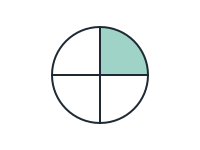 1 3/4; 2 4/1; 3 1/4; 4 1/3 | 1/4 | Count all the equal parts. Then count the shaded parts. | The circle has 4 equal parts and 1 is shaded, so 1/4 is shaded. | `ma.p2.leaf.fraction-of-whole` target `ma.p2.fraction-of-whole` |
| ma-p2-fraction-of-whole.q2 / similar (v2) | What fraction of the bar is shaded? 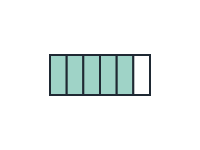 1 1/5; 2 6/5; 3 1/6; 4 5/6 | 5/6 | The bottom number is the number of equal parts in the whole. | The bar has 6 equal parts and 5 are shaded, so 5/6 is shaded. | `ma.p2.leaf.fraction-of-whole` target `ma.p2.fraction-of-whole` |
| ma-p2-fraction-of-whole.q3 / generic (v2) | What fraction of the circle is NOT shaded? 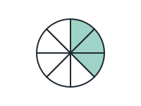 1 5/3; 2 5/8; 3 8/5; 4 3/8 | 5/8 | Count the parts that are white. | The circle has 8 equal parts. 3 are shaded, so 5 are not shaded: 5/8. | `ma.p2.leaf.fraction-of-whole` target `ma.p2.fraction-of-whole` |
| ma-p2-fraction-compare.q1 / exact (v1) | Which fraction is the greatest? 1 1/2; 2 1/8; 3 1/5; 4 1/10 | 1/2 | For unit fractions, fewer equal parts means bigger parts. | Halves are bigger than fifths, eighths or tenths, so 1/2 is greatest. | `ma.p2.leaf.fraction-compare` target `ma.p2.fraction-compare` |
| ma-p2-fraction-compare.q2 / similar (v1) | Which fraction is the smallest? 1 8/9; 2 5/9; 3 2/9; 4 7/9 | 2/9 | All are ninths. Compare the top numbers. | With the same number of equal parts, 2/9 is the smallest. | `ma.p2.leaf.fraction-compare` target `ma.p2.fraction-compare` |
| ma-p2-fraction-compare.q3 / generic (v1) | Ali ate 1/3 of a cake. Ben ate 1/6 of the same-sized cake. Who ate more? 1 Ali; 2 Cannot tell; 3 Ben; 4 They ate the same | Ali | Thirds are bigger pieces than sixths. | 1/3 is greater than 1/6, so Ali ate more. | `ma.p2.leaf.fraction-compare` target `ma.p2.fraction-compare` |
| ma-p2-fraction-order.q1 / exact (v1) | Arrange from smallest to greatest: 1/3, 1/12, 1/7 1 1/7, 1/3, 1/12; 2 1/12, 1/7, 1/3; 3 1/3, 1/7, 1/12; 4 1/3, 1/12, 1/7 | 1/12, 1/7, 1/3 | The more equal parts, the smaller each part. | Twelfths are smallest and thirds are biggest: 1/12, 1/7, 1/3. | `ma.p2.leaf.fraction-order` target `ma.p2.fraction-order` |
| ma-p2-fraction-order.q2 / similar (v1) | Arrange from greatest to smallest: 3/10, 9/10, 6/10 1 3/10, 6/10, 9/10; 2 9/10, 3/10, 6/10; 3 6/10, 9/10, 3/10; 4 9/10, 6/10, 3/10 | 9/10, 6/10, 3/10 | All are tenths. Compare the top numbers. | 9 tenths, then 6 tenths, then 3 tenths. | `ma.p2.leaf.fraction-order` target `ma.p2.fraction-order` |
| ma-p2-fraction-order.q3 / generic (v1) | Three friends drank 1/4, 1/2 and 1/5 of the same-sized bottles. Which amount is the smallest? 1 1/5; 2 1/2; 3 They are equal; 4 1/4 | 1/5 | Fifths are smaller than quarters and halves. | 1/5 is the smallest of these unit fractions. | `ma.p2.leaf.fraction-order` target `ma.p2.fraction-order` |
| ma-p2-fraction-add.q1 / exact (v1) | 2/7 + 3/7 = ? 1 5/14; 2 1/7; 3 5/7; 4 6/7 | 5/7 | The fractions have the same bottom number. Add only the top numbers. | 2/7 + 3/7 = 5/7. The bottom number stays the same. | `ma.p2.leaf.fraction-add` target `ma.p2.fraction-add` |
| ma-p2-fraction-add.q2 / similar (v1) | 1/9 + 4/9 = ? 1 5/18; 2 5/9; 3 4/9; 4 6/9 | 5/9 | Add the top numbers; keep the bottom number. | 1/9 + 4/9 = 5/9. | `ma.p2.leaf.fraction-add` target `ma.p2.fraction-add` |
| ma-p2-fraction-add.q3 / generic (v1) | Siti ate 2/10 of a cake and her sister ate 5/10 of it. What fraction of the cake did they eat altogether? 1 3/10; 2 7/20; 3 7/10; 4 8/10 | 7/10 | Altogether means add. The bottom numbers are the same. | 2/10 + 5/10 = 7/10. | `ma.p2.leaf.fraction-add` target `ma.p2.fraction-add` |
| ma-p2-fraction-subtract.q1 / exact (v1) | 7/8 - 3/8 = ? 1 4/8; 2 10/8; 3 3/8; 4 4/16 | 4/8 | Subtract only the top numbers. | 7/8 - 3/8 = 4/8. The bottom number stays the same. | `ma.p2.leaf.fraction-subtract` target `ma.p2.fraction-subtract` |
| ma-p2-fraction-subtract.q2 / similar (v1) | 5/6 - 4/6 = ? 1 1/12; 2 9/6; 3 1/6; 4 2/6 | 1/6 | The bottom number does not change. | 5/6 - 4/6 = 1/6. | `ma.p2.leaf.fraction-subtract` target `ma.p2.fraction-subtract` |
| ma-p2-fraction-subtract.q3 / generic (v2) | A tank was 11/12 full. Water equal to 5/12 of the tank's full capacity was used. What fraction of the tank is full now? 1 5/12; 2 6/24; 3 6/12; 4 16/12 | 6/12 | Both fractions describe parts of the same full tank. Subtract the amount used. | The full tank is the whole in both fractions: 11/12 - 5/12 = 6/12. The tank is now 6/12 full. | `ma.p2.leaf.fraction-subtract` target `ma.p2.fraction-subtract` |
| ma-p2-fraction-equal-parts.q1 / exact (v2) | In which figure is exactly one half shaded? 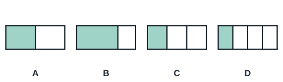 1 A; 2 C; 3 D; 4 B | A | For a half, the whole must be cut into 2 EQUAL parts. | In A the bar is cut into 2 equal parts and 1 is shaded: one half. B has 2 parts that are not equal; C shows 1/3 and D shows 1/4. | `ma.p2.leaf.fraction-equal-parts` target `ma.p2.fraction-equal-parts` |
| ma-p2-fraction-equal-parts.q2 / similar (v2) | What fraction of the circle is shaded? 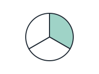 1 3/1; 2 2/3; 3 1/2; 4 1/3 | 1/3 | Check that the parts are equal, then count them. | The circle has 3 equal parts and 1 is shaded, so 1/3 is shaded. | `ma.p2.leaf.fraction-equal-parts` target `ma.p2.fraction-equal-parts` |
| ma-p2-fraction-equal-parts.q3 / generic (v2) | A ribbon is folded into equal parts. The shaded part is cut off. What fraction of the ribbon is cut off? 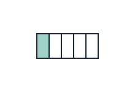 1 1/4; 2 4/5; 3 1/5; 4 5/1 | 1/5 | Count all the equal parts of the ribbon, including the shaded one. | The ribbon has 5 equal parts and 1 is cut off, so 1/5 of the ribbon is cut off. | `ma.p2.leaf.fraction-equal-parts` target `ma.p2.fraction-equal-parts` |

## P2 · Money: counting, decimal notation, converting between dollars and cents, adding/subtracting in dollars only or cents only (`ma.p2.money`)

| ID / stage | Question and options | Key | Hint | Explanation | Leaf → repair route |
| --- | --- | --- | --- | --- | --- |
| ma-p2-money-count.q1 / exact (v1) | Sam has two $5 notes and three 50-cent coins. How much money does he have? 1 $11.50; 2 $13.00; 3 $10.50; 4 $8.50 | $11.50 | Add the dollars and the cents separately. | $10 + $1.50 = $11.50. | `ma.p2.leaf.money-count` target `ma.p2.money-count` |
| ma-p2-money-count.q2 / similar (v1) | How much is one $10 note, one $2 note and four 20-cent coins? 1 $16.20; 2 $12.80; 3 $12.40; 4 $13.20 | $12.80 | Count the notes, then the coins. | $12 + 80 cents = $12.80. | `ma.p2.leaf.money-count` target `ma.p2.money-count` |
| ma-p2-money-count.q3 / generic (v1) | Mei has 3 one-dollar coins and 5 ten-cent coins. How much does she have? 1 $3.05; 2 $5.30; 3 $8.00; 4 $3.50 | $3.50 | Five 10-cent coins make 50 cents. | $3 + 50 cents = $3.50. | `ma.p2.leaf.money-count` target `ma.p2.money-count` |
| ma-p2-money-notation.q1 / exact (v1) | How is "4 dollars and 25 cents" written? 1 $425; 2 $25.4; 3 $4.25; 4 $4.025 | $4.25 | Dollars come before the dot; cents after. | 4 dollars and 25 cents is $4.25. | `ma.p2.leaf.money-notation` target `ma.p2.money-notation` |
| ma-p2-money-notation.q2 / similar (v1) | How is "9 dollars and 5 cents" written? 1 $9.50; 2 $9.05; 3 $95; 4 $9.5 | $9.05 | Cents always use two digits. | 5 cents is written 05, so $9.05. | `ma.p2.leaf.money-notation` target `ma.p2.money-notation` |
| ma-p2-money-notation.q3 / generic (v1) | A toy costs $16.40. How much is that in dollars and cents? 1 40 dollars and 16 cents; 2 16 dollars and 40 cents; 3 164 dollars; 4 16 dollars and 4 cents | 16 dollars and 40 cents | The digits after the dot are cents. | $16.40 is 16 dollars and 40 cents. | `ma.p2.leaf.money-notation` target `ma.p2.money-notation` |
| ma-p2-money-word.q1 / exact (v1) | A book costs $8 and a pen costs $3. How much do they cost altogether? 1 $11; 2 $5; 3 $24; 4 $10 | $11 | Altogether means add. | $8 + $3 = $11. | `ma.p2.leaf.money-word` target `ma.p2.money-word` |
| ma-p2-money-word.q2 / similar (v1) | Ali had 90 cents. He bought a sweet for 45 cents. How much money did he have left? 1 135 cents; 2 45 cents; 3 50 cents; 4 55 cents | 45 cents | Take away what he spent. | 90 cents - 45 cents = 45 cents. | `ma.p2.leaf.money-word` target `ma.p2.money-word` |
| ma-p2-money-word.q3 / generic (v1) | Mum paid $20 for a toy that costs $13. How much change did she get? 1 $13; 2 $17; 3 $7; 4 $33 | $7 | Change = money paid - cost. | $20 - $13 = $7. | `ma.p2.leaf.money-word` target `ma.p2.money-word` |
| ma-p2-money-compare.q1 / exact (v1) | Which amount is the greatest? 1 $5.02; 2 $0.52; 3 $5.20; 4 $2.50 | $5.20 | Compare the dollars first, then the cents. | $5.20 has 5 dollars and 20 cents, more than $5.02. | `ma.p2.leaf.money-compare` target `ma.p2.money-compare` |
| ma-p2-money-compare.q2 / similar (v1) | Which amount is the smallest? 1 $1.09; 2 $1.19; 3 $1.90; 4 $9.10 | $1.09 | All the dollars are the same except one. Then compare cents. | $1.09 has only 9 cents after the dollar. | `ma.p2.leaf.money-compare` target `ma.p2.money-compare` |
| ma-p2-money-compare.q3 / generic (v1) | A pen costs $3.40 and a ruler costs $3.15. Which costs more? 1 cannot tell; 2 the pen; 3 the ruler; 4 they cost the same | the pen | The dollars are the same. Compare the cents. | 40 cents is more than 15 cents, so the pen costs more. | `ma.p2.leaf.money-compare` target `ma.p2.money-compare` |
| ma-p2-money-to-cents.q1 / exact (v1) | $3.45 = ___ cents 1 3045 cents; 2 345 cents; 3 3450 cents; 4 34 cents | 345 cents | $1 = 100 cents. Change the dollars to cents first, then add the cents. | $3 = 300 cents, and 300 cents + 45 cents = 345 cents. | `ma.p2.leaf.money-to-cents` target `ma.p2.money-to-cents` |
| ma-p2-money-to-cents.q2 / similar (v1) | $2.05 = ___ cents 1 25 cents; 2 2005 cents; 3 250 cents; 4 205 cents | 205 cents | How many cents are in $2? Then add the cents after the dot. | $2 = 200 cents, and 200 cents + 5 cents = 205 cents. | `ma.p2.leaf.money-to-cents` target `ma.p2.money-to-cents` |
| ma-p2-money-to-cents.q3 / generic (v1) | A pen costs $1.80. How many cents is that? 1 108 cents; 2 1080 cents; 3 18 cents; 4 180 cents | 180 cents | $1 = 100 cents, and the 80 after the dot is 80 cents. | $1.80 = 100 cents + 80 cents = 180 cents. | `ma.p2.leaf.money-to-cents` target `ma.p2.money-to-cents` |
| ma-p2-cents-to-dollars.q1 / exact (v1) | 275 cents = ? 1 $275.00; 2 $27.50; 3 $2.57; 4 $2.75 | $2.75 | Every 100 cents makes $1. How many whole dollars are in 275 cents? | 275 cents = 200 cents + 75 cents = $2 and 75 cents, written $2.75. | `ma.p2.leaf.cents-to-dollars` target `ma.p2.cents-to-dollars` |
| ma-p2-cents-to-dollars.q2 / similar (v1) | 608 cents = ? 1 $6.08; 2 $6.80; 3 $60.80; 4 $0.68 | $6.08 | Take out the whole dollars first. Then write the cents with two digits. | 608 cents = 600 cents + 8 cents = $6 and 8 cents, written $6.08. | `ma.p2.leaf.cents-to-dollars` target `ma.p2.cents-to-dollars` |
| ma-p2-cents-to-dollars.q3 / generic (v1) | Mei has 450 cents in her money box. How much is that in dollars and cents? 1 $4.50; 2 $0.45; 3 $45.00; 4 $4.05 | $4.50 | How many groups of 100 cents are in 450 cents? | 450 cents = 400 cents + 50 cents = $4 and 50 cents, written $4.50. | `ma.p2.leaf.cents-to-dollars` target `ma.p2.cents-to-dollars` |

## P2 · Length in m and cm: measuring, comparing, word problems (`ma.p2.length`)

| ID / stage | Question and options | Key | Hint | Explanation | Leaf → repair route |
| --- | --- | --- | --- | --- | --- |
| ma-p2-length-units.q1 / exact (v1) | Which unit should we use to measure the length of a classroom? 1 kilograms (kg); 2 centimetres (cm); 3 metres (m); 4 litres (ℓ) | metres (m) | A classroom is long. Choose the bigger unit of length. | Long lengths such as a classroom are measured in metres. | `ma.p2.leaf.length-units` target `ma.p2.length-units` |
| ma-p2-length-units.q2 / similar (v1) | Which unit should we use to measure the length of an eraser? 1 metres (m); 2 grams (g); 3 centimetres (cm); 4 litres (ℓ) | centimetres (cm) | An eraser is short. | Short lengths such as an eraser are measured in centimetres. | `ma.p2.leaf.length-units` target `ma.p2.length-units` |
| ma-p2-length-units.q3 / generic (v1) | Jun wants to find the length of his pencil case. Which is the most sensible answer? 1 20 m; 2 2 m; 3 200 cm; 4 20 cm | 20 cm | Think about how big a pencil case is. | A pencil case is about 20 cm long. | `ma.p2.leaf.length-units` target `ma.p2.length-units` |
| ma-p2-length-ruler.q1 / exact (v2) | Look at the ruler. How long is the pencil? 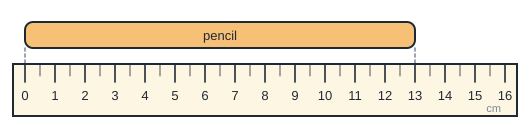 1 13 cm; 2 12 cm; 3 14 cm; 4 0 cm | 13 cm | Find the mark where the pencil starts and the mark where it ends. | The pencil starts at 0 cm and ends at 13 cm, so it is 13 cm long. | `ma.p2.leaf.length-ruler` target `ma.p2.length-ruler` |
| ma-p2-length-ruler.q2 / similar (v2) | Look at the ruler. How long is the crayon? 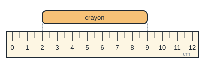 1 9 cm; 2 2 cm; 3 7 cm; 4 11 cm | 7 cm | The crayon does not start at 0. Count the centimetres from its left end to its right end. | The crayon goes from the 2 cm mark to the 9 cm mark. 9 − 2 = 7, so it is 7 cm long. | `ma.p2.leaf.length-ruler` target `ma.p2.length-ruler` |
| ma-p2-length-ruler.q3 / generic (v2) | Look at the ruler. How long is the ribbon? 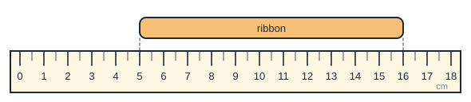 1 5 cm; 2 16 cm; 3 11 cm; 4 21 cm | 11 cm | Where does the ribbon start? Where does it end? Find the difference. | The ribbon goes from the 5 cm mark to the 16 cm mark. 16 − 5 = 11, so it is 11 cm long. | `ma.p2.leaf.length-ruler` target `ma.p2.length-ruler` |
| ma-p2-length-compare.q1 / exact (v1) | Rope A is 3 m long. Rope B is 5 m long. Rope C is 2 m long. Which rope is the longest? 1 Rope B; 2 Rope C; 3 All are the same; 4 Rope A | Rope B | Compare the numbers of metres. | 5 m is the greatest length, so Rope B is the longest. | `ma.p2.leaf.length-compare` target `ma.p2.length-compare` |
| ma-p2-length-compare.q2 / similar (v1) | Rod P is 45 cm, Rod Q is 54 cm and Rod R is 40 cm. Which rod is the shortest? 1 Rod Q; 2 Rod P; 3 Rod R; 4 They are equal | Rod R | Find the smallest length. | 40 cm is the shortest length. | `ma.p2.leaf.length-compare` target `ma.p2.length-compare` |
| ma-p2-length-compare.q3 / generic (v1) | A scarf is 85 cm long. A belt is 58 cm long. How much longer is the scarf than the belt? 1 143 cm; 2 33 cm; 3 27 cm; 4 37 cm | 27 cm | Find the difference. | 85 cm - 58 cm = 27 cm. | `ma.p2.leaf.length-compare` target `ma.p2.length-compare` |
| ma-p2-length-word.q1 / exact (v1) | Siti walked 125 m to the park and then 68 m to the library. How far did she walk altogether? 1 203 m; 2 193 m; 3 57 m; 4 183 m | 193 m | Altogether means add. | 125 m + 68 m = 193 m. | `ma.p2.leaf.length-word` target `ma.p2.length-word` |
| ma-p2-length-word.q2 / similar (v1) | A ribbon was 90 cm long. Mum cut off 35 cm. How long is the ribbon now? 1 55 cm; 2 125 cm; 3 45 cm; 4 65 cm | 55 cm | Cut off means take away. | 90 cm - 35 cm = 55 cm. | `ma.p2.leaf.length-word` target `ma.p2.length-word` |
| ma-p2-length-word.q3 / generic (v1) | A fence has 4 parts. Each part is 5 m long. How long is the fence? 1 9 m; 2 1 m; 3 45 m; 4 20 m | 20 m | Equal parts: multiply. | 4 × 5 m = 20 m. | `ma.p2.leaf.length-word` target `ma.p2.length-word` |

## P2 · Mass in kg and g: measuring, comparing, word problems (`ma.p2.mass`)

| ID / stage | Question and options | Key | Hint | Explanation | Leaf → repair route |
| --- | --- | --- | --- | --- | --- |
| ma-p2-mass-units.q1 / exact (v1) | Which unit should we use to find the mass of a watermelon? 1 kilograms (kg); 2 grams (g); 3 metres (m); 4 litres (ℓ) | kilograms (kg) | A watermelon is heavy. | Heavy things are measured in kilograms. | `ma.p2.leaf.mass-units` target `ma.p2.mass-units` |
| ma-p2-mass-units.q2 / similar (v1) | Which unit should we use to find the mass of a paper clip? 1 kilograms (kg); 2 grams (g); 3 litres (ℓ); 4 centimetres (cm) | grams (g) | A paper clip is very light. | Light things are measured in grams. | `ma.p2.leaf.mass-units` target `ma.p2.mass-units` |
| ma-p2-mass-units.q3 / generic (v1) | Which is the most sensible mass of a school bag with books inside? 1 30 kg; 2 3 g; 3 300 kg; 4 3 kg | 3 kg | Think about whether you can carry it easily. | A school bag with books has a mass of about 3 kg. | `ma.p2.leaf.mass-units` target `ma.p2.mass-units` |
| ma-p2-mass-scale.q1 / exact (v2) | The scale shows the mass of a bag of flour. What is its mass? 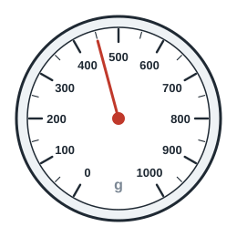 1 450 g; 2 400 g; 3 405 g; 4 500 g | 450 g | Each big mark is 100 g. What is each small mark worth? | The pointer is halfway between 400 g and 500 g, on the small mark. Each small mark is 50 g, so the mass is 450 g. | `ma.p2.leaf.mass-scale` target `ma.p2.mass-scale` |
| ma-p2-mass-scale.q2 / similar (v2) | The scale shows the mass of a pumpkin. What is its mass? 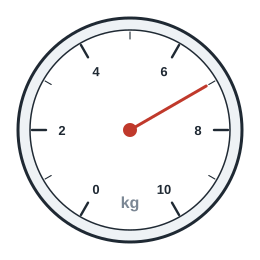 1 8 kg; 2 14 kg; 3 7 kg; 4 6 kg | 7 kg | Only every second mark has a number. What is each unmarked step worth? | The numbers go up in 2s, so each mark is 1 kg. The pointer is one mark after 6 kg, so the mass is 7 kg. | `ma.p2.leaf.mass-scale` target `ma.p2.mass-scale` |
| ma-p2-mass-scale.q3 / generic (v2) | The scale shows the mass of some grapes. What is their mass? 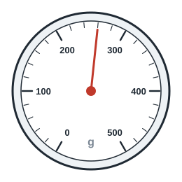 1 250 g; 2 206 g; 3 280 g; 4 260 g | 260 g | Count how many small steps make 100 g on this scale. | There are 5 steps between 200 g and 300 g, so each step is 20 g. The pointer is 3 steps after 200 g: 200 + 60 = 260 g. | `ma.p2.leaf.mass-scale` target `ma.p2.mass-scale` |
| ma-p2-mass-word.q1 / exact (v1) | A box of books has a mass of 18 kg. The empty box has a mass of 3 kg. What is the mass of the books? 1 21 kg; 2 15 kg; 3 6 kg; 4 54 kg | 15 kg | Take away the mass of the box. | 18 kg - 3 kg = 15 kg. | `ma.p2.leaf.mass-word` target `ma.p2.mass-word` |
| ma-p2-mass-word.q2 / similar (v1) | Each packet of flour has a mass of 2 kg. What is the mass of 6 packets? 1 12 kg; 2 4 kg; 3 3 kg; 4 8 kg | 12 kg | Equal masses: multiply. | 6 × 2 kg = 12 kg. | `ma.p2.leaf.mass-word` target `ma.p2.mass-word` |
| ma-p2-mass-word.q3 / generic (v1) | Ken has a mass of 28 kg. His brother is 9 kg heavier. What is his brother's mass? 1 27 kg; 2 37 kg; 3 19 kg; 4 36 kg | 37 kg | "Heavier" means more. | 28 kg + 9 kg = 37 kg. | `ma.p2.leaf.mass-word` target `ma.p2.mass-word` |
| ma-p2-mass-compare.q1 / exact (v1) | Which is the heaviest? 1 a bag of 5 kg; 2 a bag of 2 kg; 3 a bag of 6 kg; 4 a bag of 4 kg | a bag of 6 kg | Compare the numbers of kilograms. | 6 kg is the greatest mass. | `ma.p2.leaf.mass-compare` target `ma.p2.mass-compare` |
| ma-p2-mass-compare.q2 / similar (v1) | Arrange from lightest to heaviest: 300 g, 30 g, 130 g 1 130 g, 30 g, 300 g; 2 30 g, 130 g, 300 g; 3 30 g, 300 g, 130 g; 4 300 g, 130 g, 30 g | 30 g, 130 g, 300 g | Find the smallest mass first. | 30 g < 130 g < 300 g. | `ma.p2.leaf.mass-compare` target `ma.p2.mass-compare` |
| ma-p2-mass-compare.q3 / generic (v1) | A box of crayons is 250 g and a box of pencils is 175 g. How much lighter is the box of pencils? 1 75 g; 2 125 g; 3 425 g; 4 85 g | 75 g | "Lighter by" means find the difference. | 250 g - 175 g = 75 g. | `ma.p2.leaf.mass-compare` target `ma.p2.mass-compare` |

## P2 · Volume of liquid in litres: measuring, comparing, word problems (`ma.p2.volume`)

| ID / stage | Question and options | Key | Hint | Explanation | Leaf → repair route |
| --- | --- | --- | --- | --- | --- |
| ma-p2-volume-litres.q1 / exact (v1) | Which container is most likely to hold about 1 litre of water? 1 a cup of yoghurt; 2 a teaspoon; 3 a large water bottle; 4 a swimming pool | a large water bottle | One litre is a bottle of drink. | A large water bottle holds about 1 litre. | `ma.p2.leaf.volume-litres` target `ma.p2.volume-litres` |
| ma-p2-volume-litres.q2 / similar (v1) | Jug A holds 4 ℓ. Jug B holds 7 ℓ. Jug C holds 5 ℓ. Which jug holds the most? 1 They hold the same; 2 Jug B; 3 Jug C; 4 Jug A | Jug B | Compare the numbers of litres. | 7 ℓ is the most. | `ma.p2.leaf.volume-litres` target `ma.p2.volume-litres` |
| ma-p2-volume-litres.q3 / generic (v1) | A pail had 10 ℓ of water. Dad used 4 ℓ to wash the car. How much water was left? 1 6 ℓ; 2 4 ℓ; 3 14 ℓ; 4 40 ℓ | 6 ℓ | Used means take away. | 10 ℓ - 4 ℓ = 6 ℓ. | `ma.p2.leaf.volume-litres` target `ma.p2.volume-litres` |
| ma-p2-volume-compare.q1 / exact (v1) | Bottle P holds 3 ℓ more than Bottle Q. Bottle Q holds 5 ℓ. How much does Bottle P hold? 1 8 ℓ; 2 2 ℓ; 3 15 ℓ; 4 5 ℓ | 8 ℓ | "More than" means add. | 5 ℓ + 3 ℓ = 8 ℓ. | `ma.p2.leaf.volume-compare` target `ma.p2.volume-compare` |
| ma-p2-volume-compare.q2 / similar (v1) | A tank holds 20 ℓ. A pail holds 5 ℓ. How many pails of water are needed to fill the tank? 1 25; 2 100; 3 4; 4 15 | 4 | How many 5s make 20? | 20 ℓ ÷ 5 ℓ = 4 pails. | `ma.p2.leaf.volume-compare` target `ma.p2.volume-compare` |
| ma-p2-volume-compare.q3 / generic (v1) | Mum pours 2 ℓ of soup into each of 4 pots. How much soup does she pour altogether? 1 2 ℓ; 2 24 ℓ; 3 8 ℓ; 4 6 ℓ | 8 ℓ | Equal amounts: multiply. | 4 × 2 ℓ = 8 ℓ. | `ma.p2.leaf.volume-compare` target `ma.p2.volume-compare` |
| ma-p2-volume-read.q1 / exact (v1) | How much water is in the container? 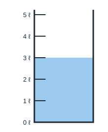 1 5 ℓ; 2 2 ℓ; 3 4 ℓ; 4 3 ℓ | 3 ℓ | Look at the mark that the top of the water reaches. | The water reaches the 3 ℓ mark, so there are 3 ℓ of water. | `ma.p2.leaf.volume-read` target `ma.p2.volume-read` |
| ma-p2-volume-read.q2 / similar (v1) | Read the scale. How much water is in this container? 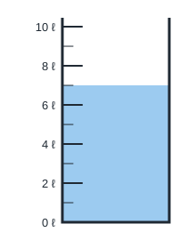 1 7 ℓ; 2 6 ℓ; 3 14 ℓ; 4 8 ℓ | 7 ℓ | The numbers go up in 2s. What is the short mark between them worth? | The short mark between 6 ℓ and 8 ℓ is 7 ℓ. The water reaches that mark, so there are 7 ℓ. | `ma.p2.leaf.volume-read` target `ma.p2.volume-read` |
| ma-p2-volume-read.q3 / generic (v1) | How much more water is needed to fill the container up to the 8 ℓ mark? 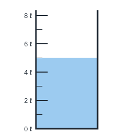 1 13 ℓ; 2 3 ℓ; 3 5 ℓ; 4 8 ℓ | 3 ℓ | First read how much water is in it now. | The water is at 5 ℓ. 8 ℓ − 5 ℓ = 3 ℓ more is needed. | `ma.p2.leaf.volume-read` target `ma.p2.volume-read` |

## P2 · Time: telling time to the minute, a.m./p.m., hours and minutes, duration (`ma.p2.time`)

| ID / stage | Question and options | Key | Hint | Explanation | Leaf → repair route |
| --- | --- | --- | --- | --- | --- |
| ma-p2-time-read.q1 / exact (v2) | What time does the clock show? 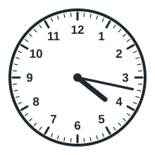 1 4.17; 2 5.17; 3 3.17; 4 4.20 | 4.17 | Count the minutes past the hour in fives, then in ones. | The hour hand is just past 4. The minute hand is 2 small marks after 3 (15 minutes), so it is 17 minutes past 4: 4.17. | `ma.p2.leaf.time-read` target `ma.p2.time-read` |
| ma-p2-time-read.q2 / similar (v2) | What time is shown on this clock? 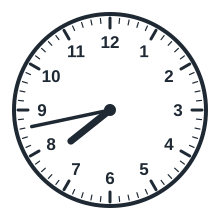 1 8.35; 2 7.43; 3 8.43; 4 7.48 | 7.43 | The hour hand has not reached 8 yet. Which hour has passed? | The hour hand is between 7 and 8, so the hour is 7. The minute hand is 3 small marks after 8 (40 minutes), so it is 7.43. | `ma.p2.leaf.time-read` target `ma.p2.time-read` |
| ma-p2-time-read.q3 / generic (v2) | Lunch starts at the time on this clock. What time does lunch start? 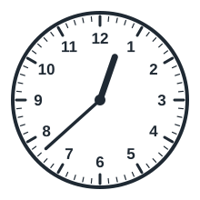 1 7.38; 2 12.38; 3 1.38; 4 12.08 | 12.38 | The short hand shows the hour. The long hand shows the minutes. | The hour hand is just past 12. The minute hand is 3 small marks after 7 (35 minutes), so it is 12.38. | `ma.p2.leaf.time-read` target `ma.p2.time-read` |
| ma-p2-time-ampm.q1 / exact (v1) | Mei wakes up at 6.30 in the morning. How do we write this time? 1 6.30 noon; 2 6.30 p.m.; 3 30.6 a.m.; 4 6.30 a.m. | 6.30 a.m. | Morning times use a.m. | Times from midnight to noon are a.m.: 6.30 a.m. | `ma.p2.leaf.time-ampm` target `ma.p2.time-ampm` |
| ma-p2-time-ampm.q2 / similar (v1) | Dinner is at 7 o'clock in the evening. How do we write this time? 1 7.00 noon; 2 7.00 p.m.; 3 19.00 a.m.; 4 7.00 a.m. | 7.00 p.m. | Times after noon use p.m. | Evening times are p.m.: 7.00 p.m. | `ma.p2.leaf.time-ampm` target `ma.p2.time-ampm` |
| ma-p2-time-ampm.q3 / generic (v1) | Which activity most likely happens at 10.00 p.m.? 1 going to school; 2 sleeping; 3 having recess at school; 4 eating breakfast | sleeping | p.m. after 6 is night time. | 10.00 p.m. is at night, when most children are sleeping. | `ma.p2.leaf.time-ampm` target `ma.p2.time-ampm` |
| ma-p2-time-duration.q1 / exact (v1) | A lesson starts at 9.00 a.m. and ends at 10.00 a.m. How long is the lesson? 1 1 hour; 2 10 hours; 3 2 hours; 4 30 minutes | 1 hour | Count the hours from 9 to 10. | From 9.00 a.m. to 10.00 a.m. is 1 hour. | `ma.p2.leaf.time-duration` target `ma.p2.time-duration` |
| ma-p2-time-duration.q2 / similar (v1) | A movie starts at 2.00 p.m. and lasts 2 hours. What time does it end? 1 2.00 a.m.; 2 3.00 p.m.; 3 4.00 p.m.; 4 12.00 p.m. | 4.00 p.m. | Count on 2 hours from 2.00 p.m. | 2.00 p.m. + 2 hours = 4.00 p.m. | `ma.p2.leaf.time-duration` target `ma.p2.time-duration` |
| ma-p2-time-duration.q3 / generic (v1) | Ali started reading at 3.15 p.m. He read for 30 minutes. What time did he stop? 1 4.15 p.m.; 2 3.15 p.m.; 3 3.45 p.m.; 4 3.30 p.m. | 3.45 p.m. | Count on 30 minutes from 3.15. | 3.15 p.m. + 30 minutes = 3.45 p.m. | `ma.p2.leaf.time-duration` target `ma.p2.time-duration` |
| ma-p2-time-convert.q1 / exact (v1) | 1 hour = ___ minutes 1 10; 2 100; 3 24; 4 60 | 60 | Think of the minute hand going all the way round once. | There are 60 minutes in 1 hour. | `ma.p2.leaf.time-convert` target `ma.p2.time-convert` |
| ma-p2-time-convert.q2 / similar (v1) | 1 hour 20 minutes = ___ minutes 1 21; 2 120; 3 80; 4 70 | 80 | Change 1 hour to minutes first. | 60 + 20 = 80 minutes. | `ma.p2.leaf.time-convert` target `ma.p2.time-convert` |
| ma-p2-time-convert.q3 / generic (v1) | A bus ride takes 90 minutes. How long is that in hours and minutes? 1 90 h; 2 1 h 30 min; 3 1 h 90 min; 4 9 h | 1 h 30 min | 60 minutes make 1 hour. How many minutes are left? | 90 minutes = 60 minutes + 30 minutes = 1 h 30 min. | `ma.p2.leaf.time-convert` target `ma.p2.time-convert` |

## P2 · 2D shapes (incl. semicircle, quarter circle), 3D shapes, patterns, composing figures (`ma.p2.shapes`)

| ID / stage | Question and options | Key | Hint | Explanation | Leaf → repair route |
| --- | --- | --- | --- | --- | --- |
| ma-p2-shape-2d.q1 / exact (v2) | Which shape has exactly 4 sides? 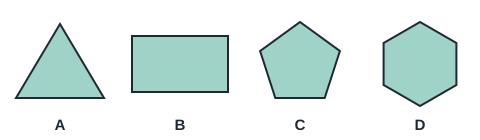 1 B; 2 D; 3 A; 4 C | B | Count the straight sides of each shape. | Shape B is a rectangle with 4 sides. A has 3, C has 5 and D has 6. | `ma.p2.leaf.shape-2d` target `ma.p2.shape-2d` |
| ma-p2-shape-2d.q2 / similar (v2) | Which shape is a semicircle? 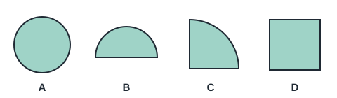 1 C; 2 B; 3 A; 4 D | B | A semicircle is half of a circle. | Shape B is half of a circle: a semicircle. A is a circle, C is a quarter circle and D is a square. | `ma.p2.leaf.shape-2d` target `ma.p2.shape-2d` |
| ma-p2-shape-2d.q3 / generic (v2) | Which shape is a quarter circle? 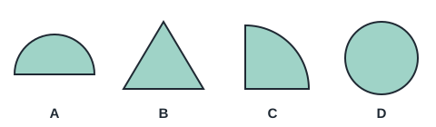 1 D; 2 A; 3 B; 4 C | C | A quarter circle has two straight sides that meet at a square corner, and one curved side. | Shape C is one quarter of a circle. A is a semicircle, B is a triangle and D is a circle. | `ma.p2.leaf.shape-2d` target `ma.p2.shape-2d` |
| ma-p2-shape-3d.q1 / exact (v2) | Which solid has 6 square faces? 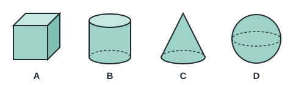 1 C; 2 B; 3 D; 4 A | A | Look for a solid whose faces are all the same square. | Solid A is a cube: it has 6 square faces. B is a cylinder, C is a cone and D is a sphere. | `ma.p2.leaf.shape-3d` target `ma.p2.shape-3d` |
| ma-p2-shape-3d.q2 / similar (v2) | Which solid is a cone? 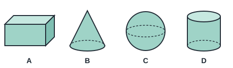 1 C; 2 A; 3 D; 4 B | B | A cone has one flat circle at the bottom and comes to a point. | Solid B is a cone. A is a cuboid, C is a sphere and D is a cylinder. | `ma.p2.leaf.shape-3d` target `ma.p2.shape-3d` |
| ma-p2-shape-3d.q3 / generic (v2) | A tin of soup has the same shape as one of these solids. Which one? 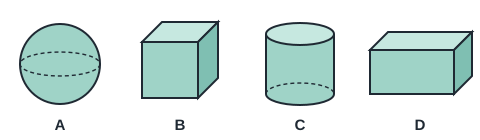 1 A; 2 B; 3 C; 4 D | C | A tin has two flat circle ends and a curved side. | Solid C is a cylinder, the same shape as a tin. A is a sphere, B is a cube and D is a cuboid. | `ma.p2.leaf.shape-3d` target `ma.p2.shape-3d` |
| ma-p2-shape-pattern.q1 / exact (v1) | What comes next? ○ △ □ ○ △ □ ○ △ ___ 1 ○; 2 △; 3 ☆; 4 □ | □ | Find the group of shapes that repeats. | The pattern ○ △ □ repeats, so □ comes next. | `ma.p2.leaf.shape-pattern` target `ma.p2.shape-pattern` |
| ma-p2-shape-pattern.q2 / similar (v1) | What comes next? big ○, small ○, big ○, small ○, ___ 1 big △; 2 small △; 3 small ○; 4 big ○ | big ○ | Look at how the size changes. | Size changes big, small, big, small. Next is big ○. | `ma.p2.leaf.shape-pattern` target `ma.p2.shape-pattern` |
| ma-p2-shape-pattern.q3 / generic (v1) | Beads are threaded red, red, blue, red, red, blue. What colour is the 9th bead? 1 cannot tell; 2 blue; 3 green; 4 red | blue | The pattern repeats every 3 beads. | Beads 3, 6 and 9 are blue. | `ma.p2.leaf.shape-pattern` target `ma.p2.shape-pattern` |
| ma-p2-shape-figures.q1 / exact (v2) | The square is cut along the dashed line. What two shapes are formed? 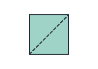 1 2 triangles; 2 2 squares; 3 2 rectangles; 4 2 semicircles | 2 triangles | Imagine cutting from one corner to the opposite corner. | The dashed line joins opposite corners, so each piece has 3 sides: 2 triangles. | `ma.p2.leaf.shape-figures` target `ma.p2.shape-figures` |
| ma-p2-shape-figures.q2 / similar (v2) | These two pieces are the same size. They are put together along their straight edges. What shape is formed? 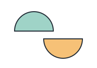 1 quarter circle; 2 triangle; 3 circle; 4 square | circle | Each piece is half of a shape. | Each piece is a semicircle (half a circle). Two equal semicircles joined along their straight edges make a circle. | `ma.p2.leaf.shape-figures` target `ma.p2.shape-figures` |
| ma-p2-shape-figures.q3 / generic (v2) | Two equal squares are placed side by side. What shape is the whole figure? 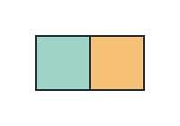 1 triangle; 2 circle; 3 semicircle; 4 rectangle | rectangle | Look at the outline of the whole figure, not the line in the middle. | The outline has 4 straight sides and 4 square corners, with two long sides and two short sides: a rectangle. | `ma.p2.leaf.shape-figures` target `ma.p2.shape-figures` |

## P2 · Picture graphs with scales (`ma.p2.picture-graphs`)

| ID / stage | Question and options | Key | Hint | Explanation | Leaf → repair route |
| --- | --- | --- | --- | --- | --- |
| ma-p2-graph-read.q1 / exact (v2) | Look at the picture graph. How many children chose swimming? 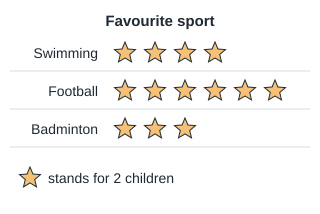 1 4; 2 8; 3 2; 4 6 | 8 | Read the key first. How many children does one picture stand for? | Swimming has 4 stars and each star stands for 2 children. 4 × 2 = 8 children. | `ma.p2.leaf.graph-read` target `ma.p2.graph-read` |
| ma-p2-graph-read.q2 / similar (v2) | Look at the picture graph. How many books were borrowed on Tuesday? 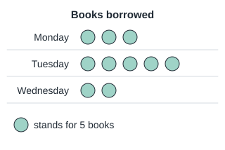 1 20; 2 5; 3 25; 4 10 | 25 | Count the pictures for Tuesday, then use the key. | Tuesday has 5 circles and each circle stands for 5 books. 5 × 5 = 25 books. | `ma.p2.leaf.graph-read` target `ma.p2.graph-read` |
| ma-p2-graph-read.q3 / generic (v2) | Look at the picture graph. How many more stickers does Mei have than Ali? 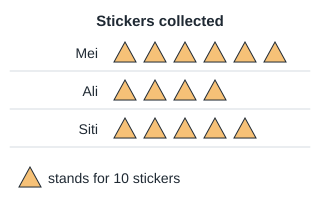 1 20; 2 2; 3 10; 4 100 | 20 | Find the difference in pictures first, then use the key. | Mei has 6 triangles and Ali has 4: 2 more triangles. Each triangle stands for 10 stickers, so Mei has 20 more. | `ma.p2.leaf.graph-read` target `ma.p2.graph-read` |
| ma-p2-graph-interpret.q1 / exact (v2) | How many apples are there in Basket A and Basket B altogether? 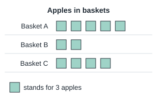 1 21; 2 6; 3 15; 4 7 | 21 | Add the pictures for A and B, then use the key. | A has 5 squares and B has 2: 7 squares. Each square stands for 3 apples. 7 × 3 = 21 apples. | `ma.p2.leaf.graph-interpret` target `ma.p2.graph-interpret` |
| ma-p2-graph-interpret.q2 / similar (v2) | Which colour was chosen by 8 more pupils than Green? 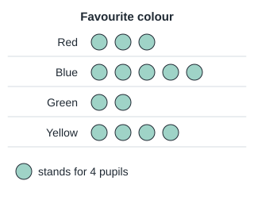 1 Green; 2 Red; 3 Yellow; 4 Blue | Yellow | Each picture stands for 4 pupils. How many more pictures make 8 more pupils? | 8 more pupils is 2 more pictures. Green has 2 circles, so look for 4 circles: Yellow. | `ma.p2.leaf.graph-interpret` target `ma.p2.graph-interpret` |
| ma-p2-graph-interpret.q3 / generic (v2) | There are 12 red cars. How many pictures should be drawn in the Red row? 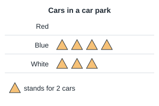 1 24; 2 10; 3 6; 4 12 | 6 | Read the key. How many cars does one picture stand for? | Each picture stands for 2 cars. 12 ÷ 2 = 6 pictures. | `ma.p2.leaf.graph-interpret` target `ma.p2.graph-interpret` |

## P3 · Numbers to 10 000: place value, comparing, ordering, patterns, odd and even (`ma.p3.numbers-10000`)

| ID / stage | Question and options | Key | Hint | Explanation | Leaf → repair route |
| --- | --- | --- | --- | --- | --- |
| ma-p3-place-value.q1 / exact (v1) | In 6385, what is the value of the digit 6? 1 60; 2 600; 3 6000; 4 6 | 6000 | Which place is the 6 in? | The 6 is in the thousands place, so its value is 6000. | `ma.p3.leaf.place-value` target `ma.p3.place-value` |
| ma-p3-place-value.q2 / similar (v1) | In 4907, what is the value of the digit 9? 1 900; 2 9; 3 90; 4 9000 | 900 | Count the places from the right: ones, tens, hundreds. | The 9 is in the hundreds place: 900. | `ma.p3.leaf.place-value` target `ma.p3.place-value` |
| ma-p3-place-value.q3 / generic (v1) | A number has 7 thousands, 0 hundreds, 3 tens and 8 ones. What is the number? 1 738; 2 7038; 3 7380; 4 7308 | 7038 | Remember to write 0 for the hundreds. | 7000 + 30 + 8 = 7038. | `ma.p3.leaf.place-value` target `ma.p3.place-value` |
| ma-p3-number-words.q1 / exact (v1) | Which number is "five thousand and twelve"? 1 5120; 2 50 012; 3 512; 4 5012 | 5012 | Five thousand, no hundreds, then twelve. | Five thousand and twelve is 5012. | `ma.p3.leaf.number-words` target `ma.p3.number-words` |
| ma-p3-number-words.q2 / similar (v1) | Which number is "eight thousand, three hundred and sixty"? 1 83 060; 2 8306; 3 836; 4 8360 | 8360 | There is no word for ones. | 8000 + 300 + 60 = 8360. | `ma.p3.leaf.number-words` target `ma.p3.number-words` |
| ma-p3-number-words.q3 / generic (v1) | How is 9040 written in words? 1 nine thousand and forty; 2 nine hundred and forty; 3 ninety thousand and forty; 4 nine thousand and four | nine thousand and forty | Read the thousands, then the tens. | 9040 is nine thousand and forty. | `ma.p3.leaf.number-words` target `ma.p3.number-words` |
| ma-p3-compare-order.q1 / exact (v1) | Which number is the greatest? 1 6721; 2 7621; 3 7162; 4 7612 | 7621 | Compare thousands, then hundreds, then tens. | 7621 has the greatest hundreds and tens among those with 7 thousands. | `ma.p3.leaf.compare-order` target `ma.p3.compare-order` |
| ma-p3-compare-order.q2 / similar (v1) | Arrange from smallest to greatest: 3480, 3408, 3840 1 3408, 3480, 3840; 2 3480, 3408, 3840; 3 3840, 3480, 3408; 4 3408, 3840, 3480 | 3408, 3480, 3840 | All have 3 thousands. Compare the hundreds. | 3408 < 3480 < 3840. | `ma.p3.leaf.compare-order` target `ma.p3.compare-order` |
| ma-p3-compare-order.q3 / generic (v1) | Three schools have 2856, 2865 and 2586 pupils. Which school has the fewest pupils? 1 the school with 2856 pupils; 2 the school with 2586 pupils; 3 the school with 2865 pupils; 4 they have the same | the school with 2586 pupils | Compare hundreds first. | 2586 has 5 hundreds, fewer than 8 hundreds. | `ma.p3.leaf.compare-order` target `ma.p3.compare-order` |
| ma-p3-number-patterns.q1 / exact (v1) | What is the missing number? 4250, 4500, 4750, ___ 1 4775; 2 5250; 3 4800; 4 5000 | 5000 | How much is added each time? | The numbers go up by 250. 4750 + 250 = 5000. | `ma.p3.leaf.number-patterns` target `ma.p3.number-patterns` |
| ma-p3-number-patterns.q2 / similar (v1) | What is the missing number? 9100, 8100, ___, 6100 1 8000; 2 6200; 3 7000; 4 7100 | 7100 | The numbers go down by the same amount. | They go down by 1000. 8100 - 1000 = 7100. | `ma.p3.leaf.number-patterns` target `ma.p3.number-patterns` |
| ma-p3-number-patterns.q3 / generic (v1) | What is 1000 more than 8956? 1 9056; 2 18 956; 3 9956; 4 8966 | 9956 | Only the thousands digit changes. | 8956 + 1000 = 9956. | `ma.p3.leaf.number-patterns` target `ma.p3.number-patterns` |
| ma-p3-odd-even.q1 / exact (v1) | Which number is odd? 1 3458; 2 3450; 3 3457; 4 3456 | 3457 | Look at the ones digit only. | A number ending in 7 is odd. | `ma.p3.leaf.odd-even` target `ma.p3.odd-even` |
| ma-p3-odd-even.q2 / similar (v1) | Which number is even? 1 5793; 2 5794; 3 5797; 4 5791 | 5794 | Even numbers end in 0, 2, 4, 6 or 8. | 5794 ends in 4, so it is even. | `ma.p3.leaf.odd-even` target `ma.p3.odd-even` |
| ma-p3-odd-even.q3 / generic (v1) | What is the greatest even number that can be made with the digits 3, 8, 1 and 6, each used once? 1 8613; 2 6318; 3 8631; 4 8316 | 8316 | An even number must end in an even digit. Put the biggest digits in front. | 8316 ends with 6 and uses the larger digits in front. | `ma.p3.leaf.odd-even` target `ma.p3.odd-even` |

## P3 · Addition and subtraction within 10 000 (`ma.p3.add-sub-10000`)

| ID / stage | Question and options | Key | Hint | Explanation | Leaf → repair route |
| --- | --- | --- | --- | --- | --- |
| ma-p3-add-4digit.q1 / exact (v1) | 3856 + 2478 = ? 1 6434; 2 6334; 3 6324; 4 7334 | 6334 | Line up the places. Work from the ones and regroup where needed. | 3856 + 2478 = 6334. | `ma.p3.leaf.add-4digit` target `ma.p3.add-4digit` |
| ma-p3-add-4digit.q2 / similar (v1) | 4709 + 3695 = ? 1 8504; 2 9404; 3 8404; 4 8394 | 8404 | Line up the places. Work from the ones and regroup where needed. | 4709 + 3695 = 8404. | `ma.p3.leaf.add-4digit` target `ma.p3.add-4digit` |
| ma-p3-add-4digit.q3 / generic (v1) | A cinema sold 2845 tickets on Saturday and 4376 on Sunday. How many tickets were sold on both days? 1 8221; 2 7221; 3 7321; 4 7211 | 7221 | Line up the places. Work from the ones and regroup where needed. | 2845 + 4376 = 7221. | `ma.p3.leaf.add-4digit` target `ma.p3.add-4digit` |
| ma-p3-sub-4digit.q1 / exact (v1) | 7004 - 2568 = ? 1 4446; 2 4436; 3 9572; 4 4536 | 4436 | Line up the places. Work from the ones and regroup where needed. | 7004 - 2568 = 4436. | `ma.p3.leaf.sub-4digit` target `ma.p3.sub-4digit` |
| ma-p3-sub-4digit.q2 / similar (v1) | 8312 - 4675 = ? 1 12 987; 2 3637; 3 3647; 4 3737 | 3637 | Line up the places. Work from the ones and regroup where needed. | 8312 - 4675 = 3637. | `ma.p3.leaf.sub-4digit` target `ma.p3.sub-4digit` |
| ma-p3-sub-4digit.q3 / generic (v1) | A school raised $6000 for charity. It has given $1847 so far. How much more does it have to give? 1 4153; 2 7847; 3 4163; 4 4253 | 4153 | Line up the places. Work from the ones and regroup where needed. | 6000 - 1847 = 4153. | `ma.p3.leaf.sub-4digit` target `ma.p3.sub-4digit` |

## P3 · Multiplication tables of 6, 7, 8 and 9 and related division (`ma.p3.tables-6-9`)

| ID / stage | Question and options | Key | Hint | Explanation | Leaf → repair route |
| --- | --- | --- | --- | --- | --- |
| ma-p3-table-6.q1 / exact (v1) | 6 × 7 = ? 1 36; 2 42; 3 13; 4 48 | 42 | Use the multiplication table of 6. | 6 × 7 = 42. | `ma.p3.leaf.table-6` target `ma.p3.table-6` |
| ma-p3-table-6.q2 / similar (v1) | 6 × 9 = ? 1 54; 2 60; 3 15; 4 48 | 54 | Use the multiplication table of 6. | 6 × 9 = 54. | `ma.p3.leaf.table-6` target `ma.p3.table-6` |
| ma-p3-table-6.q3 / generic (v1) | A box has 6 cupcakes. How many cupcakes are in 8 boxes? 1 42; 2 14; 3 48; 4 54 | 48 | Use the multiplication table of 6. | 6 × 8 = 48. | `ma.p3.leaf.table-6` target `ma.p3.table-6` |
| ma-p3-table-7.q1 / exact (v1) | 7 × 6 = ? 1 49; 2 35; 3 13; 4 42 | 42 | Use the multiplication table of 7. | 7 × 6 = 42. | `ma.p3.leaf.table-7` target `ma.p3.table-7` |
| ma-p3-table-7.q2 / similar (v1) | 7 × 8 = ? 1 15; 2 56; 3 49; 4 63 | 56 | Use the multiplication table of 7. | 7 × 8 = 56. | `ma.p3.leaf.table-7` target `ma.p3.table-7` |
| ma-p3-table-7.q3 / generic (v1) | There are 7 days in a week. How many days are there in 9 weeks? 1 63; 2 56; 3 16; 4 70 | 63 | Use the multiplication table of 7. | 7 × 9 = 63. | `ma.p3.leaf.table-7` target `ma.p3.table-7` |
| ma-p3-table-8.q1 / exact (v1) | 8 × 4 = ? 1 32; 2 40; 3 24; 4 12 | 32 | Use the multiplication table of 8. | 8 × 4 = 32. | `ma.p3.leaf.table-8` target `ma.p3.table-8` |
| ma-p3-table-8.q2 / similar (v1) | 8 × 7 = ? 1 48; 2 64; 3 56; 4 15 | 56 | Use the multiplication table of 8. | 8 × 7 = 56. | `ma.p3.leaf.table-8` target `ma.p3.table-8` |
| ma-p3-table-8.q3 / generic (v1) | A spider has 8 legs. How many legs do 6 spiders have? 1 56; 2 40; 3 14; 4 48 | 48 | Use the multiplication table of 8. | 8 × 6 = 48. | `ma.p3.leaf.table-8` target `ma.p3.table-8` |
| ma-p3-table-9.q1 / exact (v1) | 9 × 6 = ? 1 63; 2 54; 3 15; 4 45 | 54 | Use the multiplication table of 9. | 9 × 6 = 54. | `ma.p3.leaf.table-9` target `ma.p3.table-9` |
| ma-p3-table-9.q2 / similar (v1) | 9 × 8 = ? 1 81; 2 72; 3 63; 4 17 | 72 | Use the multiplication table of 9. | 9 × 8 = 72. | `ma.p3.leaf.table-9` target `ma.p3.table-9` |
| ma-p3-table-9.q3 / generic (v1) | Each row has 9 seats. How many seats are in 7 rows? 1 72; 2 16; 3 54; 4 63 | 63 | Use the multiplication table of 9. | 9 × 7 = 63. | `ma.p3.leaf.table-9` target `ma.p3.table-9` |
| ma-p3-division-facts.q1 / exact (v1) | 56 ÷ 7 = ? 1 8; 2 49; 3 7; 4 9 | 8 | Which number times 7 gives 56? | 7 × 8 = 56, so 56 ÷ 7 = 8. | `ma.p3.leaf.division-facts` target `ma.p3.division-facts` |
| ma-p3-division-facts.q2 / similar (v1) | 72 ÷ 9 = ? 1 7; 2 8; 3 63; 4 9 | 8 | Think of the table of 9. | 9 × 8 = 72, so 72 ÷ 9 = 8. | `ma.p3.leaf.division-facts` target `ma.p3.division-facts` |
| ma-p3-division-facts.q3 / generic (v1) | 48 children are put into teams of 6. How many teams are there? 1 8; 2 42; 3 6; 4 54 | 8 | How many 6s make 48? | 48 ÷ 6 = 8 teams. | `ma.p3.leaf.division-facts` target `ma.p3.division-facts` |
| ma-p3-mental-calculation.q1 / exact (v1) | What is 7 × 7? 1 14; 2 49; 3 42; 4 56 | 49 | Use the table of 7. | 7 × 7 = 49. | `ma.p3.leaf.mental-calculation` target `ma.p3.mental-calculation` |
| ma-p3-mental-calculation.q2 / similar (v1) | What is 63 ÷ 9? 1 7; 2 6; 3 8; 4 54 | 7 | Which number times 9 is 63? | 9 × 7 = 63, so 63 ÷ 9 = 7. | `ma.p3.leaf.mental-calculation` target `ma.p3.mental-calculation` |
| ma-p3-mental-calculation.q3 / generic (v1) | 8 packs have 6 balloons each. How many balloons are there? 1 42; 2 14; 3 48; 4 56 | 48 | Use a multiplication fact. | 8 × 6 = 48. | `ma.p3.leaf.mental-calculation` target `ma.p3.mental-calculation` |

## P3 · Multiplication and division up to 3 digits by 1 digit, with remainder (`ma.p3.multiplication-division`)

| ID / stage | Question and options | Key | Hint | Explanation | Leaf → repair route |
| --- | --- | --- | --- | --- | --- |
| ma-p3-mult-2digit.q1 / exact (v1) | 47 × 6 = ? 1 276; 2 342; 3 53; 4 282 | 282 | Multiply the ones first, then the tens, then the hundreds. Add any regrouped numbers. | 47 × 6 = 282. | `ma.p3.leaf.mult-2digit` target `ma.p3.mult-2digit` |
| ma-p3-mult-2digit.q2 / similar (v1) | 38 × 9 = ? 1 47; 2 342; 3 432; 4 333 | 342 | Multiply the ones first, then the tens, then the hundreds. Add any regrouped numbers. | 38 × 9 = 342. | `ma.p3.leaf.mult-2digit` target `ma.p3.mult-2digit` |
| ma-p3-mult-2digit.q3 / generic (v1) | A bus can carry 64 passengers. How many passengers can 7 buses carry? 1 441; 2 448; 3 71; 4 518 | 448 | Multiply the ones first, then the tens, then the hundreds. Add any regrouped numbers. | 64 × 7 = 448. | `ma.p3.leaf.mult-2digit` target `ma.p3.mult-2digit` |
| ma-p3-mult-3digit.q1 / exact (v1) | 326 × 4 = ? 1 1304; 2 1344; 3 1300; 4 330 | 1304 | Multiply the ones first, then the tens, then the hundreds. Add any regrouped numbers. | 326 × 4 = 1304. | `ma.p3.leaf.mult-3digit` target `ma.p3.mult-3digit` |
| ma-p3-mult-3digit.q2 / similar (v1) | 507 × 8 = ? 1 4048; 2 515; 3 4136; 4 4056 | 4056 | Multiply the ones first, then the tens, then the hundreds. Add any regrouped numbers. | 507 × 8 = 4056. | `ma.p3.leaf.mult-3digit` target `ma.p3.mult-3digit` |
| ma-p3-mult-3digit.q3 / generic (v1) | Each carton has 245 ml of milk. How much milk is in 6 cartons, in ml? 1 1530; 2 251; 3 1464; 4 1470 | 1470 | Multiply the ones first, then the tens, then the hundreds. Add any regrouped numbers. | 245 × 6 = 1470. | `ma.p3.leaf.mult-3digit` target `ma.p3.mult-3digit` |
| ma-p3-div-no-remainder.q1 / exact (v1) | 84 ÷ 4 = ? 1 21; 2 80; 3 22; 4 210 | 21 | Divide from the greatest place first. | 84 ÷ 4 = 21. | `ma.p3.leaf.div-no-remainder` target `ma.p3.div-no-remainder` |
| ma-p3-div-no-remainder.q2 / similar (v1) | 576 ÷ 8 = ? 1 73; 2 568; 3 720; 4 72 | 72 | Divide from the greatest place first. | 576 ÷ 8 = 72. | `ma.p3.leaf.div-no-remainder` target `ma.p3.div-no-remainder` |
| ma-p3-div-no-remainder.q3 / generic (v1) | 945 stickers are shared equally among 5 classes. How many stickers does each class get? 1 189; 2 190; 3 940; 4 1890 | 189 | Divide from the greatest place first. | 945 ÷ 5 = 189. | `ma.p3.leaf.div-no-remainder` target `ma.p3.div-no-remainder` |
| ma-p3-div-remainder.q1 / exact (v1) | 47 ÷ 5 = ? 1 9 remainder 7; 2 8 remainder 7; 3 9 remainder 2; 4 10 remainder 3 | 9 remainder 2 | Find the biggest multiple of 5 that is not more than 47. | 5 × 9 = 45 and 47 - 45 = 2, so 9 remainder 2. | `ma.p3.leaf.div-remainder` target `ma.p3.div-remainder` |
| ma-p3-div-remainder.q2 / similar (v1) | 83 ÷ 6 = ? 1 12 remainder 11; 2 14 remainder 1; 3 13 remainder 2; 4 13 remainder 5 | 13 remainder 5 | The remainder must be smaller than 6. | 6 × 13 = 78 and 83 - 78 = 5. | `ma.p3.leaf.div-remainder` target `ma.p3.div-remainder` |
| ma-p3-div-remainder.q3 / generic (v1) | 50 pupils go on a trip. Each van holds 8 pupils. What is the least number of vans needed? 1 42; 2 8; 3 7; 4 6 | 7 | 50 ÷ 8 leaves a remainder. The remaining pupils need a van too. | 50 ÷ 8 = 6 remainder 2. The 2 pupils need another van, so 7 vans. | `ma.p3.leaf.div-remainder` target `ma.p3.div-remainder` |

## P3 · Word problems with the four operations, including comparison models (`ma.p3.word-problems`)

| ID / stage | Question and options | Key | Hint | Explanation | Leaf → repair route |
| --- | --- | --- | --- | --- | --- |
| ma-p3-add-sub-2step.q1 / exact (v1) | A farm had 4560 chickens. 1275 were sold and 830 chicks hatched. How many chickens are there now? 1 6665; 2 2455; 3 3285; 4 4115 | 4115 | Subtract the chickens sold, then add the chicks. | 4560 - 1275 = 3285. 3285 + 830 = 4115. | `ma.p3.leaf.add-sub-2step` target `ma.p3.add-sub-2step` |
| ma-p3-add-sub-2step.q2 / similar (v1) | Pen A has 2400 ducks. Pen B has 650 more ducks than Pen A. How many ducks are there altogether? 1 1750; 2 3050; 3 4800; 4 5450 | 5450 | Find Pen B first. | Pen B: 2400 + 650 = 3050. Total: 2400 + 3050 = 5450. | `ma.p3.leaf.add-sub-2step` target `ma.p3.add-sub-2step` |
| ma-p3-add-sub-2step.q3 / generic (v1) | Mr Lim had $8500. He spent $2350 on a sofa and $1890 on a table. How much did he have left? 1 $4260; 2 $6150; 3 $12 740; 4 $4240 | $4260 | Find the total spent first. | $2350 + $1890 = $4240. $8500 - $4240 = $4260. | `ma.p3.leaf.add-sub-2step` target `ma.p3.add-sub-2step` |
| ma-p3-four-ops-word.q1 / exact (v1) | Mrs Tan bought 6 boxes of oranges. Each box had 24 oranges. She gave away 38 oranges. How many oranges did she have left? 1 106; 2 144; 3 68; 4 182 | 106 | Find the total number of oranges first. | 6 × 24 = 144. 144 - 38 = 106. | `ma.p3.leaf.four-ops-word` target `ma.p3.four-ops-word` |
| ma-p3-four-ops-word.q2 / similar (v1) | A shop had 315 pens. It packed them equally into 9 boxes and sold 4 boxes. How many pens were sold? 1 140; 2 175; 3 36; 4 35 | 140 | Find how many pens are in one box first. | 315 ÷ 9 = 35 pens per box. 4 × 35 = 140 pens. | `ma.p3.leaf.four-ops-word` target `ma.p3.four-ops-word` |
| ma-p3-four-ops-word.q3 / generic (v1) | Ali saved $8 a week for 9 weeks. He then spent $25 on a game. How much did he have left? 1 $47; 2 $33; 3 $72; 4 $97 | $47 | Find his total savings first. | 9 × $8 = $72. $72 - $25 = $47. | `ma.p3.leaf.four-ops-word` target `ma.p3.four-ops-word` |
| ma-p3-model-comparison.q1 / exact (v1) | Ben has 3 times as many marbles as Ali. Ali has 45 marbles. How many marbles does Ben have? 1 48; 2 180; 3 135; 4 15 | 135 | Draw 1 unit for Ali and 3 units for Ben. | Ben has 3 × 45 = 135 marbles. | `ma.p3.leaf.model-comparison` target `ma.p3.model-comparison` |
| ma-p3-model-comparison.q2 / similar (v1) | A ribbon is 4 times as long as a string. The ribbon is 92 cm long. How long is the string? 1 96 cm; 2 88 cm; 3 23 cm; 4 368 cm | 23 cm | The ribbon is 4 units. Find 1 unit. | 92 ÷ 4 = 23 cm. | `ma.p3.leaf.model-comparison` target `ma.p3.model-comparison` |
| ma-p3-model-comparison.q3 / generic (v1) | Mei has 5 times as many stamps as Siti. Together they have 240 stamps. How many stamps does Siti have? 1 48; 2 1200; 3 40; 4 200 | 40 | Together there are 1 + 5 = 6 units. | 240 ÷ 6 = 40 stamps for Siti. | `ma.p3.leaf.model-comparison` target `ma.p3.model-comparison` |

## P3 · Money in decimal notation: adding, subtracting, word problems (`ma.p3.money`)

| ID / stage | Question and options | Key | Hint | Explanation | Leaf → repair route |
| --- | --- | --- | --- | --- | --- |
| ma-p3-money-add.q1 / exact (v1) | $12.65 + $4.80 = ? 1 $16.145; 2 $17.45; 3 $17.85; 4 $16.45 | $17.45 | Add the cents and regroup 100 cents as $1. | $12.65 + $4.80 = $17.45. | `ma.p3.leaf.money-add` target `ma.p3.money-add` |
| ma-p3-money-add.q2 / similar (v1) | $25.90 + $8.35 = ? 1 $34.25; 2 $33.25; 3 $33.125; 4 $34.125 | $34.25 | Line up the decimal points. | $25.90 + $8.35 = $34.25. | `ma.p3.leaf.money-add` target `ma.p3.money-add` |
| ma-p3-money-add.q3 / generic (v1) | A shirt costs $18.50 and a cap costs $9.75. How much do they cost together? 1 $28.25; 2 $27.25; 3 $28.75; 4 $8.75 | $28.25 | Add the two prices. | $18.50 + $9.75 = $28.25. | `ma.p3.leaf.money-add` target `ma.p3.money-add` |
| ma-p3-money-sub.q1 / exact (v1) | $20.00 - $7.35 = ? 1 $13.65; 2 $12.65; 3 $13.35; 4 $27.35 | $12.65 | Regroup $1 as 100 cents. | $20.00 - $7.35 = $12.65. | `ma.p3.leaf.money-sub` target `ma.p3.money-sub` |
| ma-p3-money-sub.q2 / similar (v1) | $15.40 - $6.85 = ? 1 $8.55; 2 $9.45; 3 $9.55; 4 $21.25 | $8.55 | There are not enough cents. Regroup. | $15.40 - $6.85 = $8.55. | `ma.p3.leaf.money-sub` target `ma.p3.money-sub` |
| ma-p3-money-sub.q3 / generic (v1) | Ali paid $50 for a bag costing $36.70. How much change did he get? 1 $13.70; 2 $86.70; 3 $14.30; 4 $13.30 | $13.30 | Change = amount paid - cost. | $50.00 - $36.70 = $13.30. | `ma.p3.leaf.money-sub` target `ma.p3.money-sub` |
| ma-p3-money-word.q1 / exact (v1) | Mum bought 3 kg of chicken at $6.50 per kg. How much did she pay? 1 $6.53; 2 $19.50; 3 $9.50; 4 $18.50 | $19.50 | Multiply or add $6.50 three times. | $6.50 + $6.50 + $6.50 = $19.50. | `ma.p3.leaf.money-word` target `ma.p3.money-word` |
| ma-p3-money-word.q2 / similar (v1) | Siti had $40. She bought a book for $12.90 and a pen for $3.45. How much did she have left? 1 $27.10; 2 $16.35; 3 $24.65; 4 $23.65 | $23.65 | Find the total spent first. | $12.90 + $3.45 = $16.35. $40 - $16.35 = $23.65. | `ma.p3.leaf.money-word` target `ma.p3.money-word` |
| ma-p3-money-word.q3 / generic (v1) | A notebook costs $2.80. Jun has $10. How much more money does he need to buy 4 notebooks? 1 $7.20; 2 $0.80; 3 $1.20; 4 $11.20 | $1.20 | Find the cost of 4 notebooks first. | 4 × $2.80 = $11.20. $11.20 - $10 = $1.20. | `ma.p3.leaf.money-word` target `ma.p3.money-word` |

## P3 · Equivalent fractions; comparing/ordering unlike fractions; adding/subtracting related fractions within one whole (`ma.p3.fractions`)

| ID / stage | Question and options | Key | Hint | Explanation | Leaf → repair route |
| --- | --- | --- | --- | --- | --- |
| ma-p3-equivalent.q1 / exact (v1) | Which fraction is equivalent to 1/2? 1 1/6; 2 3/6; 3 2/3; 4 3/5 | 3/6 | Multiply the top and bottom by the same number. | 1/2 = 3/6 because 1 × 3 = 3 and 2 × 3 = 6. | `ma.p3.leaf.equivalent` target `ma.p3.equivalent` |
| ma-p3-equivalent.q2 / similar (v1) | Which fraction is equivalent to 2/3? 1 3/4; 2 8/12; 3 2/6; 4 6/8 | 8/12 | What do you multiply 3 by to get 12? | 2/3 = 8/12 (multiply top and bottom by 4). | `ma.p3.leaf.equivalent` target `ma.p3.equivalent` |
| ma-p3-equivalent.q3 / generic (v1) | Ali ate 4/8 of a pie. Which fraction shows the same amount in simplest form? 1 1/4; 2 2/8; 3 1/2; 4 4/2 | 1/2 | Divide the top and bottom by the same number. | 4/8 = 1/2 (divide top and bottom by 4). | `ma.p3.leaf.equivalent` target `ma.p3.equivalent` |
| ma-p3-compare-unlike.q1 / exact (v1) | Which is greater, 3/4 or 5/8? 1 5/8; 2 They are equal; 3 Cannot tell; 4 3/4 | 3/4 | Change 3/4 into eighths. | 3/4 = 6/8, which is greater than 5/8. | `ma.p3.leaf.compare-unlike` target `ma.p3.compare-unlike` |
| ma-p3-compare-unlike.q2 / similar (v1) | Which fraction is the smallest: 1/2, 2/5, 7/10? 1 7/10; 2 2/5; 3 1/2; 4 They are equal | 2/5 | Change them all into tenths. | 1/2 = 5/10, 2/5 = 4/10, 7/10. 4/10 is smallest. | `ma.p3.leaf.compare-unlike` target `ma.p3.compare-unlike` |
| ma-p3-compare-unlike.q3 / generic (v1) | Siti walked 2/3 km and Mei walked 5/6 km. Who walked further? 1 Mei; 2 Cannot tell; 3 They walked the same; 4 Siti | Mei | Change 2/3 into sixths. | 2/3 = 4/6, which is less than 5/6, so Mei walked further. | `ma.p3.leaf.compare-unlike` target `ma.p3.compare-unlike` |
| ma-p3-add-related.q1 / exact (v1) | 1/4 + 3/8 = ? 1 4/8; 2 4/12; 3 5/8; 4 1/2 | 5/8 | Change 1/4 into eighths first. | 1/4 = 2/8. 2/8 + 3/8 = 5/8. | `ma.p3.leaf.add-related` target `ma.p3.add-related` |
| ma-p3-add-related.q2 / similar (v1) | 1/3 + 1/6 = ? 1 2/9; 2 1/9; 3 2/6; 4 1/2 | 1/2 | Change 1/3 into sixths. | 1/3 = 2/6. 2/6 + 1/6 = 3/6 = 1/2. | `ma.p3.leaf.add-related` target `ma.p3.add-related` |
| ma-p3-add-related.q3 / generic (v1) | Ali painted 1/5 of a wall and Ben painted 3/10 of it. What fraction of the wall did they paint? 1 3/50; 2 4/10; 3 4/15; 4 1/2 | 1/2 | Change 1/5 into tenths. | 1/5 = 2/10. 2/10 + 3/10 = 5/10 = 1/2. | `ma.p3.leaf.add-related` target `ma.p3.add-related` |
| ma-p3-sub-related.q1 / exact (v1) | 5/6 - 1/3 = ? 1 1/2; 2 4/3; 3 4/6; 4 1/6 | 1/2 | Change 1/3 into sixths. | 1/3 = 2/6. 5/6 - 2/6 = 3/6 = 1/2. | `ma.p3.leaf.sub-related` target `ma.p3.sub-related` |
| ma-p3-sub-related.q2 / similar (v1) | 1 - 3/8 = ? 1 5/8; 2 1/8; 3 2/8; 4 3/8 | 5/8 | 1 whole = 8/8. | 8/8 - 3/8 = 5/8. | `ma.p3.leaf.sub-related` target `ma.p3.sub-related` |
| ma-p3-sub-related.q3 / generic (v1) | A ribbon was 9/10 m long. Mei used 2/5 m of it. How much ribbon was left? 1 7/10 m; 2 1/2 m; 3 1/10 m; 4 7/5 m | 1/2 m | Change 2/5 into tenths. | 2/5 = 4/10. 9/10 - 4/10 = 5/10 = 1/2 m. | `ma.p3.leaf.sub-related` target `ma.p3.sub-related` |
| ma-p3-order-fractions.q1 / exact (v1) | Arrange from smallest to greatest: 1/2, 3/8, 3/4 1 3/8, 1/2, 3/4; 2 3/8, 3/4, 1/2; 3 1/2, 3/8, 3/4; 4 3/4, 1/2, 3/8 | 3/8, 1/2, 3/4 | Change all fractions into eighths. | 1/2 = 4/8 and 3/4 = 6/8, so 3/8, 4/8, 6/8. | `ma.p3.leaf.order-fractions` target `ma.p3.order-fractions` |
| ma-p3-order-fractions.q2 / similar (v1) | Arrange from greatest to smallest: 2/3, 5/12, 1/2 1 2/3, 5/12, 1/2; 2 2/3, 1/2, 5/12; 3 1/2, 2/3, 5/12; 4 5/12, 1/2, 2/3 | 2/3, 1/2, 5/12 | Change all fractions into twelfths. | 2/3 = 8/12, 1/2 = 6/12, so 8/12, 6/12, 5/12. | `ma.p3.leaf.order-fractions` target `ma.p3.order-fractions` |
| ma-p3-order-fractions.q3 / generic (v1) | Three jugs hold 3/5 ℓ, 1/2 ℓ and 7/10 ℓ of juice. Which jug holds the least? 1 they hold the same; 2 the jug with 7/10 ℓ; 3 the jug with 3/5 ℓ; 4 the jug with 1/2 ℓ | the jug with 1/2 ℓ | Change all fractions into tenths. | 3/5 = 6/10, 1/2 = 5/10, 7/10. 5/10 is the least. | `ma.p3.leaf.order-fractions` target `ma.p3.order-fractions` |

## P3 · Length (km, m, cm), mass (kg, g), volume (l, ml): compound units and conversion (`ma.p3.length-mass-volume`)

| ID / stage | Question and options | Key | Hint | Explanation | Leaf → repair route |
| --- | --- | --- | --- | --- | --- |
| ma-p3-convert-length.q1 / exact (v1) | 3 m 45 cm = ___ cm 1 3045; 2 3450; 3 345; 4 48 | 345 | 1 m = 100 cm. | 300 cm + 45 cm = 345 cm. | `ma.p3.leaf.convert-length` target `ma.p3.convert-length` |
| ma-p3-convert-length.q2 / similar (v1) | 2 km 80 m = ___ m 1 2080; 2 2800; 3 208; 4 280 | 2080 | 1 km = 1000 m. | 2000 m + 80 m = 2080 m. | `ma.p3.leaf.convert-length` target `ma.p3.convert-length` |
| ma-p3-convert-length.q3 / generic (v1) | A rope is 506 cm long. What is its length in metres and centimetres? 1 50 m 6 cm; 2 5 m 60 cm; 3 5 m 6 cm; 4 506 m | 5 m 6 cm | Each 100 cm is 1 m. | 506 cm = 500 cm + 6 cm = 5 m 6 cm. | `ma.p3.leaf.convert-length` target `ma.p3.convert-length` |
| ma-p3-convert-mass.q1 / exact (v1) | 4 kg 250 g = ___ g 1 42 500; 2 4025; 3 425; 4 4250 | 4250 | 1 kg = 1000 g. | 4000 g + 250 g = 4250 g. | `ma.p3.leaf.convert-mass` target `ma.p3.convert-mass` |
| ma-p3-convert-mass.q2 / similar (v1) | 3070 g = ___ kg ___ g 1 307 kg; 2 30 kg 70 g; 3 3 kg 700 g; 4 3 kg 70 g | 3 kg 70 g | Each 1000 g is 1 kg. | 3070 g = 3000 g + 70 g = 3 kg 70 g. | `ma.p3.leaf.convert-mass` target `ma.p3.convert-mass` |
| ma-p3-convert-mass.q3 / generic (v1) | A bag of rice weighs 5 kg. 1 kg 400 g of rice is used. How much rice is left? 1 6 kg 400 g; 2 3 kg 600 g; 3 3 kg 400 g; 4 4 kg 600 g | 3 kg 600 g | Change 5 kg to 4 kg 1000 g. | 5000 g - 1400 g = 3600 g = 3 kg 600 g. | `ma.p3.leaf.convert-mass` target `ma.p3.convert-mass` |
| ma-p3-convert-volume.q1 / exact (v1) | 2 ℓ 300 ml = ___ ml 1 23 000; 2 230; 3 2030; 4 2300 | 2300 | 1 ℓ = 1000 ml. | 2000 ml + 300 ml = 2300 ml. | `ma.p3.leaf.convert-volume` target `ma.p3.convert-volume` |
| ma-p3-convert-volume.q2 / similar (v1) | 1500 ml = ___ ℓ ___ ml 1 150 ℓ; 2 1 ℓ 500 ml; 3 15 ℓ; 4 1 ℓ 50 ml | 1 ℓ 500 ml | Each 1000 ml is 1 ℓ. | 1500 ml = 1000 ml + 500 ml = 1 ℓ 500 ml. | `ma.p3.leaf.convert-volume` target `ma.p3.convert-volume` |
| ma-p3-convert-volume.q3 / generic (v1) | A jug holds 1 ℓ 200 ml of juice. Mum pours out 450 ml. How much juice is left? 1 1 ℓ 650 ml; 2 750 ml; 3 850 ml; 4 1 ℓ 750 ml | 750 ml | Change 1 ℓ 200 ml to millilitres first. | 1200 ml - 450 ml = 750 ml. | `ma.p3.leaf.convert-volume` target `ma.p3.convert-volume` |
| ma-p3-measure-word.q1 / exact (v1) | A path is 1 km 250 m long. Ali has walked 680 m. How much further must he walk? 1 570 m; 2 1930 m; 3 670 m; 4 1 km 570 m | 570 m | Change 1 km 250 m to metres. | 1250 m - 680 m = 570 m. | `ma.p3.leaf.measure-word` target `ma.p3.measure-word` |
| ma-p3-measure-word.q2 / similar (v1) | Each bottle holds 350 ml of water. How much water do 4 bottles hold? 1 354 ml; 2 1 ℓ 200 ml; 3 14 ℓ; 4 1 ℓ 400 ml | 1 ℓ 400 ml | Multiply, then change to litres and millilitres. | 4 × 350 ml = 1400 ml = 1 ℓ 400 ml. | `ma.p3.leaf.measure-word` target `ma.p3.measure-word` |
| ma-p3-measure-word.q3 / generic (v1) | A box with 6 identical tins has a mass of 2 kg 100 g. The empty box has a mass of 300 g. What is the mass of 1 tin? 1 350 g; 2 300 g; 3 400 g; 4 1800 g | 300 g | Find the mass of all the tins first. | 2100 g - 300 g = 1800 g. 1800 g ÷ 6 = 300 g. | `ma.p3.leaf.measure-word` target `ma.p3.measure-word` |

## P3 · Time: seconds, 24-hour clock, duration, start and end times, conversion (`ma.p3.time`)

| ID / stage | Question and options | Key | Hint | Explanation | Leaf → repair route |
| --- | --- | --- | --- | --- | --- |
| ma-p3-time-seconds.q1 / exact (v1) | Which is the best estimate for the time taken to tie a shoelace? 1 1 second; 2 10 minutes; 3 10 hours; 4 10 seconds | 10 seconds | Think about how quickly you can do it. | Tying a shoelace takes about 10 seconds. | `ma.p3.leaf.time-seconds` target `ma.p3.time-seconds` |
| ma-p3-time-seconds.q2 / similar (v1) | 1 minute = ___ seconds 1 10; 2 24; 3 60; 4 100 | 60 | Think of the second hand going round once. | There are 60 seconds in 1 minute. | `ma.p3.leaf.time-seconds` target `ma.p3.time-seconds` |
| ma-p3-time-seconds.q3 / generic (v1) | Ali ran 100 m in 18 seconds. Ben took 4 seconds longer. How long did Ben take? 1 18 seconds; 2 14 seconds; 3 22 minutes; 4 22 seconds | 22 seconds | "Longer" means more time. | 18 + 4 = 22 seconds. | `ma.p3.leaf.time-seconds` target `ma.p3.time-seconds` |
| ma-p3-time-duration.q1 / exact (v1) | A show starts at 2.40 p.m. and ends at 4.15 p.m. How long is the show? 1 1 h 75 min; 2 2 h 35 min; 3 1 h 35 min; 4 2 h 25 min | 1 h 35 min | Count on to the next hour, then to the end time. | 2.40 to 3.00 is 20 min, 3.00 to 4.00 is 1 h, 4.00 to 4.15 is 15 min: 1 h 35 min. | `ma.p3.leaf.time-duration` target `ma.p3.time-duration` |
| ma-p3-time-duration.q2 / similar (v1) | A lesson starts at 10.50 a.m. and lasts 45 minutes. What time does it end? 1 11.05 a.m.; 2 11.35 a.m.; 3 11.95 a.m.; 4 10.95 a.m. | 11.35 a.m. | Count 10 minutes to 11.00, then the rest. | 10.50 + 10 min = 11.00, + 35 min = 11.35 a.m. | `ma.p3.leaf.time-duration` target `ma.p3.time-duration` |
| ma-p3-time-duration.q3 / generic (v1) | A train journey ended at 1.20 p.m. It took 2 h 30 min. What time did it start? 1 10.50 a.m.; 2 11.10 a.m.; 3 3.50 p.m.; 4 11.50 a.m. | 10.50 a.m. | Count backwards from the end time. | 1.20 p.m. - 2 h = 11.20 a.m., - 30 min = 10.50 a.m. | `ma.p3.leaf.time-duration` target `ma.p3.time-duration` |
| ma-p3-time-convert.q1 / exact (v1) | 2 h 15 min = ___ min 1 125; 2 215; 3 115; 4 135 | 135 | 1 h = 60 min. | 120 min + 15 min = 135 min. | `ma.p3.leaf.time-convert` target `ma.p3.time-convert` |
| ma-p3-time-convert.q2 / similar (v1) | 200 min = ___ h ___ min 1 3 h 2 min; 2 3 h 20 min; 3 2 h 0 min; 4 20 h | 3 h 20 min | How many groups of 60 are in 200? | 200 = 180 + 20, so 3 h 20 min. | `ma.p3.leaf.time-convert` target `ma.p3.time-convert` |
| ma-p3-time-convert.q3 / generic (v1) | Mei practised piano for 95 minutes. How long is that in hours and minutes? 1 1 h 35 min; 2 1 h 95 min; 3 9 h 5 min; 4 2 h 5 min | 1 h 35 min | Take away 60 minutes for 1 hour. | 95 - 60 = 35, so 1 h 35 min. | `ma.p3.leaf.time-convert` target `ma.p3.time-convert` |
| ma-p3-time-start.q1 / exact (v1) | A swimming lesson ended at 5.10 p.m. It lasted 50 minutes. When did it start? 1 6.00 p.m.; 2 4.10 p.m.; 3 4.60 p.m.; 4 4.20 p.m. | 4.20 p.m. | Count back 50 minutes. | 5.10 p.m. - 10 min = 5.00 p.m., - 40 min = 4.20 p.m. | `ma.p3.leaf.time-start` target `ma.p3.time-start` |
| ma-p3-time-start.q2 / similar (v1) | A cake must bake for 1 h 15 min and be ready at 3.00 p.m. When should it go into the oven? 1 1.45 p.m.; 2 4.15 p.m.; 3 1.15 p.m.; 4 2.15 p.m. | 1.45 p.m. | Count back 1 hour, then 15 minutes. | 3.00 p.m. - 1 h = 2.00 p.m., - 15 min = 1.45 p.m. | `ma.p3.leaf.time-start` target `ma.p3.time-start` |
| ma-p3-time-start.q3 / generic (v1) | A ferry trip took 2 h 40 min and arrived at 11.10 a.m. When did it leave? 1 8.70 a.m.; 2 9.30 a.m.; 3 8.30 a.m.; 4 1.50 p.m. | 8.30 a.m. | Count back the hours, then the minutes. | 11.10 a.m. - 2 h = 9.10 a.m., - 40 min = 8.30 a.m. | `ma.p3.leaf.time-start` target `ma.p3.time-start` |
| ma-p3-time-24h.q1 / exact (v1) | What is 3.45 p.m. in 24-hour time? 1 15:45; 2 16:45; 3 13:45; 4 03:45 | 15:45 | For a time after 12 noon, add 12 to the hour. | 3 + 12 = 15, so 3.45 p.m. is 15:45. | `ma.p3.leaf.time-24h` target `ma.p3.time-24h` |
| ma-p3-time-24h.q2 / similar (v1) | A train leaves at 21:10. What is this time in 12-hour time? 1 9.10 p.m.; 2 2.10 p.m.; 3 9.10 a.m.; 4 11.10 p.m. | 9.10 p.m. | For an hour greater than 12, take away 12 and use p.m. | 21 − 12 = 9, so 21:10 is 9.10 p.m. | `ma.p3.leaf.time-24h` target `ma.p3.time-24h` |
| ma-p3-time-24h.q3 / generic (v1) | Which of these 24-hour times is in the morning? 1 13:15; 2 08:30; 3 20:05; 4 18:40 | 08:30 | Morning times are before 12:00. | 08:30 is before 12:00, so it is 8.30 a.m. The other times are after 12 noon. | `ma.p3.leaf.time-24h` target `ma.p3.time-24h` |
| ma-p3-time-24h-duration.q1 / exact (v1) | A film starts at 14:20 and ends at 16:05. How long is the film? 1 2 h 15 min; 2 1 h 15 min; 3 1 h 45 min; 4 2 h 45 min | 1 h 45 min | Count on from 14:20 to 15:20, then to 16:05. | 14:20 to 15:20 is 1 h. 15:20 to 16:05 is 45 min. The film is 1 h 45 min long. | `ma.p3.leaf.time-24h-duration` target `ma.p3.time-24h-duration` |
| ma-p3-time-24h-duration.q2 / similar (v1) | A bus leaves at 09:50. The trip takes 35 minutes. When does the bus arrive? 1 09:85; 2 10:15; 3 10:35; 4 10:25 | 10:25 | First count on to 10:00. How many minutes are left? | 09:50 to 10:00 is 10 min. 35 − 10 = 25 min more, so it arrives at 10:25. | `ma.p3.leaf.time-24h-duration` target `ma.p3.time-24h-duration` |
| ma-p3-time-24h-duration.q3 / generic (v1) | A shop opens at 10:00 and closes at 21:30. How long is it open? 1 10 h 30 min; 2 9 h 30 min; 3 12 h 30 min; 4 11 h 30 min | 11 h 30 min | Count the whole hours from 10:00 to 21:00 first. | 10:00 to 21:00 is 11 h, and 21:00 to 21:30 is 30 min. The shop is open for 11 h 30 min. | `ma.p3.leaf.time-24h-duration` target `ma.p3.time-24h-duration` |

## P3 · Area and perimeter: square units, rectangles and squares (`ma.p3.area-perimeter`)

| ID / stage | Question and options | Key | Hint | Explanation | Leaf → repair route |
| --- | --- | --- | --- | --- | --- |
| ma-p3-area-units.q1 / exact (v2) | What is the area of the shaded figure? 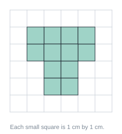 1 14 cm²; 2 12 cm²; 3 12 cm; 4 24 cm² | 12 cm² | Count the 1-cm squares. Area is measured in square centimetres. | The figure covers 12 squares of 1 cm by 1 cm, so its area is 12 cm². | `ma.p3.leaf.area-units` target `ma.p3.area-units` |
| ma-p3-area-units.q2 / similar (v2) | Find the area of the shaded figure. 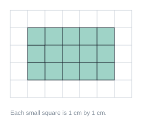 1 8 cm²; 2 15 cm²; 3 15 cm; 4 16 cm² | 15 cm² | Count the squares row by row. | There are 3 rows of 5 squares. 3 × 5 = 15 squares, so the area is 15 cm². | `ma.p3.leaf.area-units` target `ma.p3.area-units` |
| ma-p3-area-units.q3 / generic (v2) | Some squares in this figure are only half shaded. What is the area of the shaded figure? 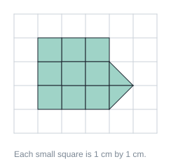 1 9 cm²; 2 11 cm²; 3 20 cm²; 4 10 cm² | 10 cm² | Two half squares make one whole square. | There are 9 whole squares and 2 half squares. 2 halves make 1 whole, so the area is 9 + 1 = 10 cm². | `ma.p3.leaf.area-units` target `ma.p3.area-units` |
| ma-p3-area-rectangle.q1 / exact (v1) | A rectangle is 8 cm long and 5 cm wide. What is its area? 1 40 cm; 2 40 cm²; 3 26 cm²; 4 13 cm² | 40 cm² | Area of a rectangle = length × breadth. | 8 × 5 = 40 cm². | `ma.p3.leaf.area-rectangle` target `ma.p3.area-rectangle` |
| ma-p3-area-rectangle.q2 / similar (v1) | A square has sides of 7 m. What is its area? 1 28 m²; 2 49 m²; 3 49 m; 4 14 m² | 49 m² | Area of a square = side × side. | 7 × 7 = 49 m². | `ma.p3.leaf.area-rectangle` target `ma.p3.area-rectangle` |
| ma-p3-area-rectangle.q3 / generic (v1) | A rectangular garden has an area of 36 m². It is 9 m long. How wide is it? 1 18 m; 2 4 m; 3 27 m; 4 45 m | 4 m | Length × breadth = area. Which number times 9 gives 36? | 36 ÷ 9 = 4 m. | `ma.p3.leaf.area-rectangle` target `ma.p3.area-rectangle` |
| ma-p3-perimeter.q1 / exact (v1) | A rectangle is 9 cm long and 4 cm wide. What is its perimeter? 1 13 cm; 2 36 cm; 3 26 cm²; 4 26 cm | 26 cm | Perimeter is the distance all round: add all four sides. | 9 + 4 + 9 + 4 = 26 cm. | `ma.p3.leaf.perimeter` target `ma.p3.perimeter` |
| ma-p3-perimeter.q2 / similar (v1) | A square has sides of 6 cm. What is its perimeter? 1 24 cm; 2 24 cm²; 3 36 cm; 4 12 cm | 24 cm | A square has 4 equal sides. | 4 × 6 = 24 cm. | `ma.p3.leaf.perimeter` target `ma.p3.perimeter` |
| ma-p3-perimeter.q3 / generic (v1) | A square field has a perimeter of 48 m. What is the length of one side? 1 192 m; 2 24 m; 3 12 m; 4 44 m | 12 m | The 4 sides are equal. | 48 ÷ 4 = 12 m. | `ma.p3.leaf.perimeter` target `ma.p3.perimeter` |
| ma-p3-area-vs-perimeter.q1 / exact (v1) | Rectangle A is 6 cm by 2 cm. Rectangle B is 4 cm by 3 cm. Which statement is true? 1 They have the same area.; 2 A has a bigger area.; 3 B has a bigger perimeter than A.; 4 They have the same perimeter. | They have the same area. | Work out both areas and both perimeters. | Both areas are 12 cm². Perimeters are 16 cm and 14 cm. | `ma.p3.leaf.area-vs-perimeter` target `ma.p3.area-vs-perimeter` |
| ma-p3-area-vs-perimeter.q2 / similar (v1) | A fence goes all round a garden. Which measurement tells the length of the fence? 1 perimeter; 2 mass; 3 volume; 4 area | perimeter | The fence goes around the edge. | The distance around the edge is the perimeter. | `ma.p3.leaf.area-vs-perimeter` target `ma.p3.area-vs-perimeter` |
| ma-p3-area-vs-perimeter.q3 / generic (v1) | Mum wants to cover a table top with cloth. Which measurement does she need? 1 perimeter; 2 volume; 3 area; 4 mass | area | The cloth covers the whole surface. | Covering a surface needs its area. | `ma.p3.leaf.area-vs-perimeter` target `ma.p3.area-vs-perimeter` |
| ma-p3-area-figures.q1 / exact (v2) | The figure is made of two rectangles. What is its area? 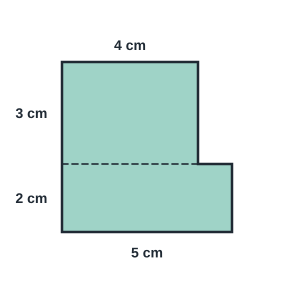 1 30 cm²; 2 22 cm; 3 22 cm²; 4 14 cm² | 22 cm² | Split the figure into two rectangles. Find the area of each, then add. | The top rectangle is 4 cm × 3 cm = 12 cm². The bottom rectangle is 5 cm × 2 cm = 10 cm². 12 + 10 = 22 cm². | `ma.p3.leaf.area-figures` target `ma.p3.area-figures` |
| ma-p3-area-figures.q2 / similar (v2) | A small square is cut out from one corner of a big square. What is the area of the figure left? 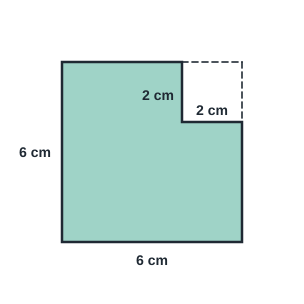 1 36 cm²; 2 4 cm²; 3 40 cm²; 4 32 cm² | 32 cm² | Find the area of the big square, then take away the small square. | The big square is 6 cm × 6 cm = 36 cm². The cut-out square is 2 cm × 2 cm = 4 cm². 36 − 4 = 32 cm². | `ma.p3.leaf.area-figures` target `ma.p3.area-figures` |
| ma-p3-area-figures.q3 / generic (v2) | Three equal rectangular mats are laid side by side. What area do they cover? 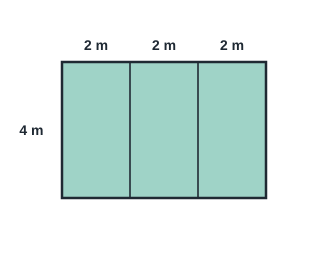 1 24 m²; 2 18 m²; 3 9 m²; 4 8 m² | 24 m² | Find the area of one mat first. | Each mat is 2 m × 4 m = 8 m². 3 mats cover 3 × 8 = 24 m². | `ma.p3.leaf.area-figures` target `ma.p3.area-figures` |
| ma-p3-perimeter-figures.q1 / exact (v2) | What is the perimeter of the figure? 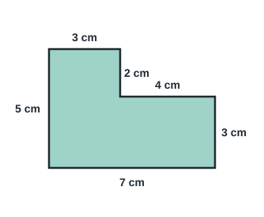 1 24 cm; 2 20 cm; 3 24 cm²; 4 22 cm | 24 cm | Add the lengths of all the sides around the figure. | 7 + 3 + 4 + 2 + 3 + 5 = 24, so the perimeter is 24 cm. | `ma.p3.leaf.perimeter-figures` target `ma.p3.perimeter-figures` |
| ma-p3-perimeter-figures.q2 / similar (v2) | Two squares of side 4 cm are joined to make a rectangle. What is the perimeter of the rectangle? 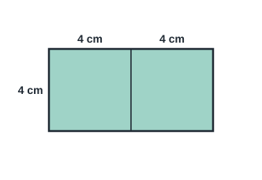 1 16 cm; 2 24 cm; 3 32 cm; 4 28 cm | 24 cm | The line in the middle is not part of the perimeter. | The rectangle is 8 cm long and 4 cm wide. 8 + 4 + 8 + 4 = 24 cm. | `ma.p3.leaf.perimeter-figures` target `ma.p3.perimeter-figures` |
| ma-p3-perimeter-figures.q3 / generic (v2) | A fence goes around the garden, except for a 2 m gate. How long is the fence? 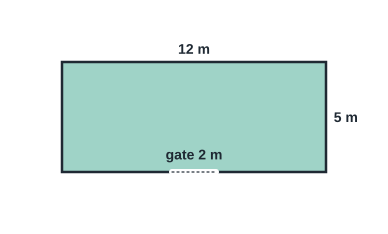 1 30 m; 2 34 m; 3 32 m; 4 60 m | 32 m | Find the perimeter first, then take away the gate. | The perimeter is 12 + 5 + 12 + 5 = 34 m. Without the 2 m gate, the fence is 34 − 2 = 32 m. | `ma.p3.leaf.perimeter-figures` target `ma.p3.perimeter-figures` |

## P3 · Angles: right angles, comparing angles (`ma.p3.angles`)

| ID / stage | Question and options | Key | Hint | Explanation | Leaf → repair route |
| --- | --- | --- | --- | --- | --- |
| ma-p3-right-angle.q1 / exact (v2) | Which angle is a right angle? 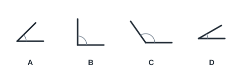 1 C; 2 D; 3 B; 4 A | B | Check each angle with the corner of a square piece of paper. | Angle B fits the square corner exactly, so it is a right angle. A and D are smaller; C is larger. | `ma.p3.leaf.right-angle` target `ma.p3.right-angle` |
| ma-p3-right-angle.q2 / similar (v2) | How many right angles are inside this figure? 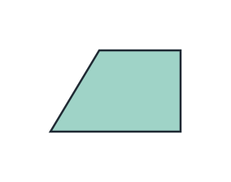 1 4; 2 1; 3 0; 4 2 | 2 | Check each corner inside the figure with a square corner. | The two corners on the right are right angles. The top-left corner is larger and the bottom-left corner is smaller than a right angle. | `ma.p3.leaf.right-angle` target `ma.p3.right-angle` |
| ma-p3-right-angle.q3 / generic (v2) | At which time do the hands of the clock make a right angle? 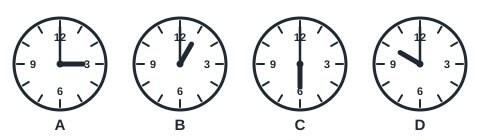 1 C; 2 A; 3 B; 4 D | A | A right angle is a quarter turn. | At 3.00 (clock A) the hands are a quarter turn apart: a right angle. At 1.00 and 10.00 the angle is smaller; at 6.00 the hands form a straight line. | `ma.p3.leaf.right-angle` target `ma.p3.right-angle` |
| ma-p3-compare-angles.q1 / exact (v2) | Which angle is smaller than a right angle? 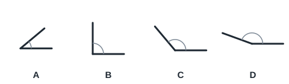 1 B; 2 C; 3 A; 4 D | A | A smaller angle has arms that are closer together than a square corner. | Angle A is less than a quarter turn. B is a right angle; C and D are greater than a right angle. | `ma.p3.leaf.compare-angles` target `ma.p3.compare-angles` |
| ma-p3-compare-angles.q2 / similar (v2) | Compare this angle with a right angle. 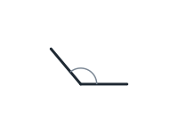 1 It is smaller than a right angle.; 2 It is not an angle.; 3 It is a right angle.; 4 It is greater than a right angle. | It is greater than a right angle. | Imagine placing a square corner on the angle. | The arms open wider than a square corner, so the angle is greater than a right angle. | `ma.p3.leaf.compare-angles` target `ma.p3.compare-angles` |
| ma-p3-compare-angles.q3 / generic (v2) | Which angle is the largest? 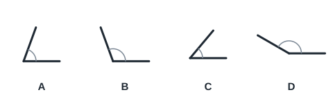 1 B; 2 A; 3 C; 4 D | D | The size of an angle is how far the arms open, not how long they are. | The arms of angle D open the widest, so D is the largest angle. | `ma.p3.leaf.compare-angles` target `ma.p3.compare-angles` |
| ma-p3-count-angles.q1 / exact (v2) | How many angles does this figure have? 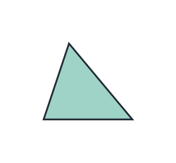 1 4; 2 6; 3 3; 4 2 | 3 | An angle is made where two straight sides meet. Count the corners. | The figure has 3 corners where sides meet, so it has 3 angles. | `ma.p3.leaf.count-angles` target `ma.p3.count-angles` |
| ma-p3-count-angles.q2 / similar (v2) | How many angles are there in this figure? 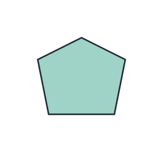 1 10; 2 6; 3 5; 4 4 | 5 | Count each corner once as you go around the figure. | The figure has 5 straight sides and 5 corners, so it has 5 angles. | `ma.p3.leaf.count-angles` target `ma.p3.count-angles` |
| ma-p3-count-angles.q3 / generic (v2) | A square and a triangle are joined to make this figure. How many angles does the outline have?  1 4; 2 5; 3 8; 4 7 | 5 | Count only the corners on the outside of the figure. | Going around the outline there are 5 corners: 1 at the top and 4 more below it. So the outline has 5 angles. | `ma.p3.leaf.count-angles` target `ma.p3.count-angles` |

## P3 · Perpendicular and parallel lines (`ma.p3.perpendicular-parallel`)

| ID / stage | Question and options | Key | Hint | Explanation | Leaf → repair route |
| --- | --- | --- | --- | --- | --- |
| ma-p3-perpendicular.q1 / exact (v2) | Which pair of lines is perpendicular?  1 B; 2 A; 3 C; 4 D | B | Perpendicular lines meet at a right angle. | The lines in B meet at a right angle, so they are perpendicular. A are parallel; C and D meet at angles that are not right angles. | `ma.p3.leaf.perpendicular` target `ma.p3.perpendicular` |
| ma-p3-perpendicular.q2 / similar (v2) | ABCD is a rectangle. Which sides are perpendicular to side AB?  1 DC only; 2 none of the sides; 3 AD and BC; 4 AD and DC | AD and BC | Look for sides that meet AB at a right angle. | AD and BC each meet AB at a right-angled corner, so both are perpendicular to AB. DC is parallel to AB. | `ma.p3.leaf.perpendicular` target `ma.p3.perpendicular` |
| ma-p3-perpendicular.q3 / generic (v2) | Which letter is made only of lines that are perpendicular to each other?  1 D; 2 C; 3 B; 4 A | A | Check each place where two lines of the letter meet. | The two lines of the letter in A meet at a right angle. The other letters have lines that meet at angles smaller or greater than a right angle. | `ma.p3.leaf.perpendicular` target `ma.p3.perpendicular` |
| ma-p3-parallel.q1 / exact (v2) | Which pair of lines is parallel?  1 C; 2 B; 3 A; 4 D | C | Parallel lines stay the same distance apart and never meet. | The lines in C stay the same distance apart, so they are parallel. A and D meet; in B the gap gets smaller, so they would meet if made longer. | `ma.p3.leaf.parallel` target `ma.p3.parallel` |
| ma-p3-parallel.q2 / similar (v2) | ABCD is a rectangle. Which side is parallel to side AB?  1 DC; 2 AD; 3 AB; 4 BC | DC | Look for the side that faces AB and never meets it. | DC is opposite AB and stays the same distance from it, so DC is parallel to AB. BC and AD meet AB. | `ma.p3.leaf.parallel` target `ma.p3.parallel` |
| ma-p3-parallel.q3 / generic (v2) | Which shape has NO parallel sides?  1 C; 2 D; 3 B; 4 A | A | Look for two sides that face each other and stay the same distance apart. | Shape A is a triangle: no two of its sides are parallel. The square, rectangle and hexagon each have pairs of parallel sides. | `ma.p3.leaf.parallel` target `ma.p3.parallel` |

## P3 · Bar graphs: reading, interpreting, completing (`ma.p3.bar-graphs`)

| ID / stage | Question and options | Key | Hint | Explanation | Leaf → repair route |
| --- | --- | --- | --- | --- | --- |
| ma-p3-bar-read.q1 / exact (v2) | How many books were borrowed on Monday?  1 4; 2 50; 3 40; 4 45 | 45 | Follow the top of the bar across to the scale. | The top of the Monday bar is halfway between 40 and 50, so 45 books were borrowed. | `ma.p3.leaf.bar-read` target `ma.p3.bar-read` |
| ma-p3-bar-read.q2 / similar (v2) | How many pupils chose red?  1 24; 2 22; 3 21; 4 20 | 22 | The scale goes up in 4s. What number is halfway between two lines? | The Red bar ends halfway between 20 and 24. Halfway between 20 and 24 is 22. | `ma.p3.leaf.bar-read` target `ma.p3.bar-read` |
| ma-p3-bar-read.q3 / generic (v2) | How many more pupils chose Red than Blue?  1 15; 2 10; 3 45; 4 30 | 15 | Read both bars first, then find the difference. | Red is 30 and Blue is 15. 30 − 15 = 15 more pupils. | `ma.p3.leaf.bar-read` target `ma.p3.bar-read` |
| ma-p3-bar-interpret.q1 / exact (v2) | On which day was the number of visitors the least?  1 Monday; 2 Wednesday; 3 Tuesday; 4 Thursday | Wednesday | Look for the shortest bar. | The Wednesday bar is the shortest (15), so the number of visitors was the least on Wednesday. | `ma.p3.leaf.bar-interpret` target `ma.p3.bar-interpret` |
| ma-p3-bar-interpret.q2 / similar (v2) | How many fruits are there altogether?  1 48; 2 72; 3 40; 4 56 | 72 | Read each bar, then add all three. | Apples 24, pears 16 and mangoes 32. 24 + 16 + 32 = 72 fruits. | `ma.p3.leaf.bar-interpret` target `ma.p3.bar-interpret` |
| ma-p3-bar-interpret.q3 / generic (v2) | Which class collected 4 more cans than Class A?  1 Class A; 2 Class C; 3 none of the classes; 4 Class B | Class C | Read Class A first, then add 4. | Class A collected 28 cans. 28 + 4 = 32, and Class C collected 32 cans. | `ma.p3.leaf.bar-interpret` target `ma.p3.bar-interpret` |
| ma-p3-bar-complete.q1 / exact (v2) | 40 pupils were asked to choose one sport. How tall should the Badminton bar be?  1 28; 2 13; 3 25; 4 27 | 13 | Find the total of the bars that are drawn. How many pupils are left? | Swimming 12 + Football 15 = 27. 40 − 27 = 13, so the Badminton bar should reach 13. | `ma.p3.leaf.bar-complete` target `ma.p3.bar-complete` |
| ma-p3-bar-complete.q2 / similar (v2) | The total for Monday, Tuesday and Wednesday is 90. What value should the Wednesday bar show?  1 30; 2 55; 3 25; 4 60 | 30 | Read Monday and Tuesday first. | Monday 25 + Tuesday 35 = 60. 90 − 60 = 30, so Wednesday should be 30. | `ma.p3.leaf.bar-complete` target `ma.p3.bar-complete` |
| ma-p3-bar-complete.q3 / generic (v2) | Ali’s table says Red 14, Blue 8 and Green 10. Which bar did he draw wrongly?  1 none of the bars; 2 Green; 3 Red; 4 Blue | Blue | Read each bar and compare it with the table. | The Blue bar reaches 10, but the table says 8. Red (14) and Green (10) match the table. | `ma.p3.leaf.bar-complete` target `ma.p3.bar-complete` |
