# Science pool-001 — review view

Generated from `content/science/pool-001.json`; edit the JSON, not this file. Key = correct answer.

## P3 · Diversity of living and non-living things: characteristics of living things (`sc.p3.living-nonliving`)

**Material `sc-p3-needs-of-living-learn` · Learn: what living things need** (teaching)

> Living things need food, water and air to stay alive. Plants make their own food using sunlight; animals eat plants or other animals. A non-living thing, such as a rock, does not need food, water or air.

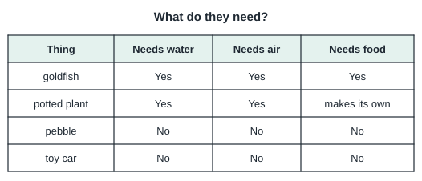

**Material `sc-p3-growth-reproduction-learn` · Learn: living things grow and reproduce** (teaching)

> Living things grow: a kitten becomes a cat and a seed becomes a plant. Living things reproduce: they make young ones of their own kind. Non-living things do not grow or reproduce by themselves.

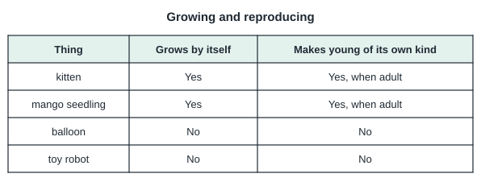

**Material `sc-p3-respond-changes-learn` · Learn: living things respond to changes** (teaching)

> Living things respond to changes around them. A cat runs away from a loud noise. The leaves of a touch-me-not (mimosa) plant fold when touched. A plant on a window ledge bends towards the light.

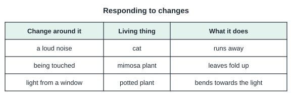

**Material `sc-p3-classify-living-learn` · Learn: deciding if something is living** (teaching)

> To decide whether something is living, check the characteristics: it needs food, water and air; it grows; it reproduces; it responds to changes. Something must have all of these to be living. Fire can "grow" and needs air, but it does not reproduce like living things or need food and water, so it is non-living. A seed is living: it can grow into a new plant.

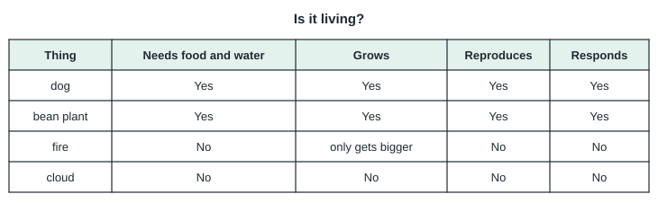

| ID / stage | Question and options | Key | Hint | Explanation | Leaf → repair route |
| --- | --- | --- | --- | --- | --- |
| sc-p3-needs-of-living-learn.q1 (v1) | Which of these needs food, water and air to stay alive? 1 a glass marble; 2 a goldfish; 3 a pebble; 4 a plastic toy fish | a goldfish | Which one is living? | A goldfish is living, so it needs food, water and air. | `sc.p3.leaf.needs-of-living` repairs via `sc.p3.needs-of-living` |
| sc-p3-needs-of-living-learn.q2 (v1) | A plant is kept in a sealed box with no air for many days. What will most likely happen? 1 Nothing will change.; 2 It will die.; 3 It will turn into a rock.; 4 It will grow faster. | It will die. | Think about what all living things need. | Plants need air to stay alive, so it will die. | `sc.p3.leaf.needs-of-living` repairs via `sc.p3.needs-of-living` |
| sc-p3-needs-of-living.q1 / exact (v1) | Which is NOT a need of living things? 1 food; 2 water; 3 air; 4 sand | sand | Living things need three main things to survive. | Living things need food, water and air. Sand is not a need. | `sc.p3.leaf.needs-of-living` target `sc.p3.needs-of-living` |
| sc-p3-needs-of-living.q2 / similar (v1) | A hamster is given food and air but no water for a long time. What will happen to it? 1 It will lay eggs.; 2 It will die.; 3 It will grow bigger.; 4 Nothing will happen. | It will die. | Water is one of the needs of all living things. | Without water the hamster cannot stay alive. | `sc.p3.leaf.needs-of-living` target `sc.p3.needs-of-living` |
| sc-p3-needs-of-living.q3 / generic (v1) | Mei forgot to water her potted plant for two weeks. The leaves dried up. What does this show? 1 Plants are non-living.; 2 Plants do not need water.; 3 Plants need sand to stay alive.; 4 Plants need water to stay alive. | Plants need water to stay alive. | What was missing? | The plant lacked water, showing plants need water to survive. | `sc.p3.leaf.needs-of-living` target `sc.p3.needs-of-living` |
| sc-p3-growth-reproduction-learn.q1 (v1) | Which shows that a kitten is a living thing? 1 It is small.; 2 It grows into a cat.; 3 It has a colour.; 4 It is soft. | It grows into a cat. | Which change happens only to living things? | Growing is a characteristic of living things. | `sc.p3.leaf.growth-reproduction` repairs via `sc.p3.growth-reproduction` |
| sc-p3-growth-reproduction-learn.q2 (v1) | A hen lays eggs that hatch into chicks. Which characteristic of living things does this show? 1 Living things never change.; 2 Living things are big.; 3 Living things reproduce.; 4 Living things are made of metal. | Living things reproduce. | The hen makes young of its own kind. | Making young ones is reproduction. | `sc.p3.leaf.growth-reproduction` repairs via `sc.p3.growth-reproduction` |
| sc-p3-growth-reproduction.q1 / exact (v1) | Which characteristic do all living things have? 1 They reproduce.; 2 They have legs.; 3 They can fly.; 4 They make their own food. | They reproduce. | Think of something true for both plants and animals. | All living things reproduce. Not all can fly or have legs, and only plants make food. | `sc.p3.leaf.growth-reproduction` target `sc.p3.growth-reproduction` |
| sc-p3-growth-reproduction.q2 / similar (v1) | A balloon gets bigger when air is blown into it. Is the balloon a living thing? 1 No, it gets bigger only because air is put in.; 2 Yes, because it needs air.; 3 Yes, because it grows.; 4 No, because it is round. | No, it gets bigger only because air is put in. | Does the balloon grow by itself? | The balloon does not grow by itself or reproduce, so it is non-living. | `sc.p3.leaf.growth-reproduction` target `sc.p3.growth-reproduction` |
| sc-p3-growth-reproduction.q3 / generic (v1) | A small mango tree grows taller and later produces fruits with seeds. Which two characteristics does this show? 1 It floats and it sinks.; 2 It moves and it breathes fire.; 3 It grows and it reproduces.; 4 It is hard and it is green. | It grows and it reproduces. | Taller, then seeds for new plants. | Growing taller is growth; seeds make new plants, which is reproduction. | `sc.p3.leaf.growth-reproduction` target `sc.p3.growth-reproduction` |
| sc-p3-respond-changes-learn.q1 (v1) | The leaves of a mimosa plant fold up when Ali touches them. What does this show? 1 Leaves are made of plastic.; 2 Living things respond to changes.; 3 Plants need sand.; 4 Living things are non-living. | Living things respond to changes. | The plant reacted to being touched. | Folding when touched is a response to change. | `sc.p3.leaf.respond-changes` repairs via `sc.p3.respond-changes` |
| sc-p3-respond-changes-learn.q2 (v1) | Which is an example of a living thing responding to a change? 1 A ball bounces on the floor.; 2 A dog barks when a stranger comes near.; 3 A stone rolls down a slope.; 4 Ice melts in the sun. | A dog barks when a stranger comes near. | Which one involves a living thing? | The dog reacts to a stranger: a response by a living thing. | `sc.p3.leaf.respond-changes` repairs via `sc.p3.respond-changes` |
| sc-p3-respond-changes.q1 / exact (v1) | A plant on a window ledge bends towards the window. What is it responding to? 1 light; 2 sound; 3 smell; 4 music | light | What comes in through a window? | The plant responds to light by growing towards it. | `sc.p3.leaf.respond-changes` target `sc.p3.respond-changes` |
| sc-p3-respond-changes.q2 / similar (v1) | A snail pulls its body into its shell when touched. What does this show? 1 It responds to touch.; 2 It needs sand.; 3 It is reproducing.; 4 It is growing. | It responds to touch. | What happened just before it pulled in? | Pulling in when touched is a response to a change. | `sc.p3.leaf.respond-changes` target `sc.p3.respond-changes` |
| sc-p3-respond-changes.q3 / generic (v1) | When it gets dark, the leaves of some plants close up. Which characteristic of living things is shown? 1 reproducing; 2 responding to changes; 3 needing food; 4 growing | responding to changes | Something around the plant changed. | The change from light to dark caused a response. | `sc.p3.leaf.respond-changes` target `sc.p3.respond-changes` |
| sc-p3-classify-living-learn.q1 (v1) | Which of these is a living thing? 1 fire; 2 a cloud; 3 a seed; 4 a pencil | a seed | Which can grow into a new plant? | A seed is living because it can grow into a new plant. | `sc.p3.leaf.classify-living` repairs via `sc.p3.classify-living` |
| sc-p3-classify-living-learn.q2 (v1) | Ben says fire is living because it gets bigger and needs air. Why is he wrong? 1 Fire does not reproduce or need food and water like living things.; 2 Fire is not green.; 3 Fire cannot be touched.; 4 Fire is too hot. | Fire does not reproduce or need food and water like living things. | Check all the characteristics, not just two. | A living thing must have all the characteristics. Fire does not. | `sc.p3.leaf.classify-living` repairs via `sc.p3.classify-living` |
| sc-p3-classify-living.q1 / exact (v1) | Which group contains only living things? 1 cloud, mushroom, ant; 2 toy car, fern, ant; 3 mushroom, fern, ant; 4 rock, ant, fern | mushroom, fern, ant | Check each item in the group. | A mushroom (fungus), a fern (plant) and an ant (animal) are all living. | `sc.p3.leaf.classify-living` target `sc.p3.classify-living` |
| sc-p3-classify-living.q2 / similar (v1) | Which group contains only non-living things? 1 water, sand, a battery; 2 a seed, sand, water; 3 a snail, a battery, sand; 4 water, moss, sand | water, sand, a battery | Remove any group that has a living thing. | Water, sand and a battery are all non-living. | `sc.p3.leaf.classify-living` target `sc.p3.classify-living` |
| sc-p3-classify-living.q3 / generic (v1) | A robot dog can walk and bark. Is it a living thing? 1 Yes, it can move.; 2 No, because it is small.; 3 No, it cannot grow or reproduce.; 4 Yes, it makes sounds. | No, it cannot grow or reproduce. | Moving and making sounds is not enough. | The robot does not grow or reproduce, so it is non-living. | `sc.p3.leaf.classify-living` target `sc.p3.classify-living` |

## P3 · Classification of living things: plants (flowering/non-flowering), animals, fungi, bacteria (`sc.p3.classification`)

**Material `sc-p3-flowering-nonflowering-learn` · Learn: flowering and non-flowering plants** (teaching)

> Plants can be grouped into flowering and non-flowering plants. Flowering plants (for example rose, hibiscus, rice, mango) produce flowers, and many form fruits with seeds. Non-flowering plants such as ferns and mosses do not produce flowers; they reproduce from spores.

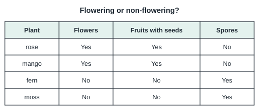

**Material `sc-p3-mammals-learn` · Learn: mammals** (teaching)

> Mammals have hair or fur on their bodies. Most mammals give birth to young ones alive, and all mammals feed their young with milk. Examples: dog, cat, human, whale, bat.

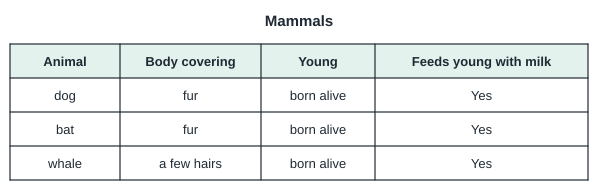

**Material `sc-p3-birds-fish-learn` · Learn: birds and fish** (teaching)

> Birds have feathers, a beak and two wings, and lay eggs with hard shells. Not all birds can fly (a penguin cannot). Fish live in water, breathe with gills, have fins and most have scales.

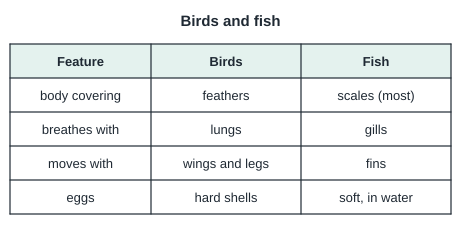

**Material `sc-p3-insects-learn` · Learn: insects** (teaching)

> Insects have three body parts (head, thorax and abdomen) and six legs. Many have wings and feelers. Ants, butterflies, beetles and grasshoppers are insects. A spider has eight legs and two body parts, so it is not an insect.

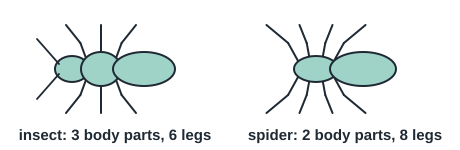

**Material `sc-p3-amphibians-reptiles-learn` · Learn: amphibians and reptiles** (teaching)

> Amphibians (frogs, toads) have moist, smooth skin and lay soft eggs in water; their young live in water. Reptiles (lizards, snakes, crocodiles, turtles) have dry, scaly skin and most lay eggs with leathery shells on land.

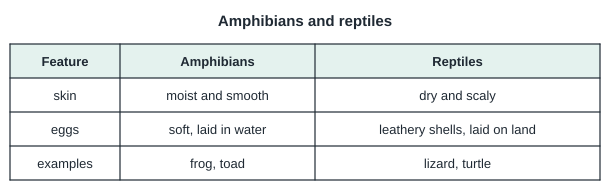

**Material `sc-p3-fungi-learn` · Learn: fungi** (teaching)

> Fungi are living things that are neither plants nor animals. Examples are mushrooms, bread mould and yeast. Fungi cannot make their own food; they feed on dead or rotting things. Many reproduce from spores. They grow well in warm, damp places.

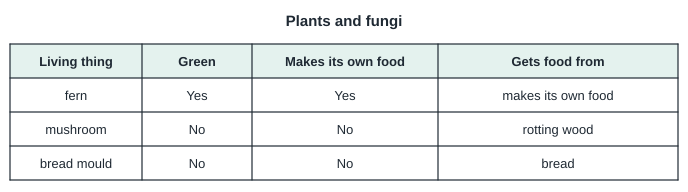

**Material `sc-p3-bacteria-learn` · Learn: bacteria** (teaching)

> Bacteria are tiny living things that can only be seen with a microscope. Some bacteria are useful, for example in making yoghurt. Some are harmful and can cause illness or make food go bad. Washing hands helps to remove harmful bacteria.

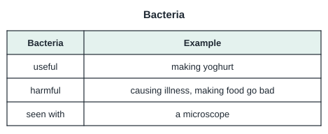

| ID / stage | Question and options | Key | Hint | Explanation | Leaf → repair route |
| --- | --- | --- | --- | --- | --- |
| sc-p3-flowering-nonflowering-learn.q1 (v2) | Look at the table. Which plant is a non-flowering plant? 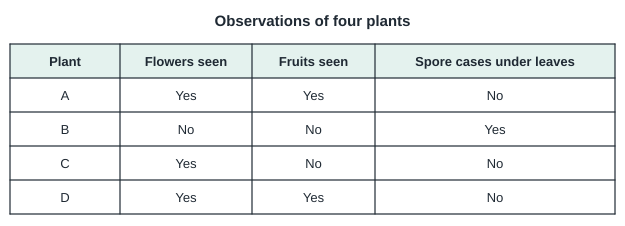 1 C; 2 B; 3 D; 4 A | B | A non-flowering plant has no flowers and reproduces from spores. | Plant B has no flowers or fruits and has spore cases under its leaves, so it is a non-flowering plant. | `sc.p3.leaf.flowering-nonflowering` repairs via `sc.p3.flowering-nonflowering` |
| sc-p3-flowering-nonflowering-learn.q2 (v1) | Moss grows on a damp wall but never produces flowers. How does it reproduce? 1 from spores; 2 from seeds in fruits; 3 from flowers; 4 it does not reproduce | from spores | It has no flowers, so it has no seeds from fruits. | Mosses are non-flowering plants that reproduce from spores. | `sc.p3.leaf.flowering-nonflowering` repairs via `sc.p3.flowering-nonflowering` |
| sc-p3-flowering-nonflowering.q1 / exact (v2) | Plant K never produces flowers and has spore cases under its leaves. Plant L produces flowers and fruits. Which statement is correct? 1 Both are flowering plants.; 2 Both are non-flowering plants.; 3 K is a flowering plant and L is a non-flowering plant.; 4 L is a flowering plant and K is a non-flowering plant. | L is a flowering plant and K is a non-flowering plant. | Use what you can observe on each plant. | L produces flowers, so it is a flowering plant. K has no flowers and reproduces from spores, so it is a non-flowering plant. | `sc.p3.leaf.flowering-nonflowering` target `sc.p3.flowering-nonflowering` |
| sc-p3-flowering-nonflowering.q2 / similar (v1) | Small brown dots are found under the leaves of a plant that never flowers. What are they likely to be? 1 flowers; 2 fruits; 3 seeds; 4 spore cases | spore cases | Non-flowering plants such as ferns have these under their leaves. | Ferns carry spores in small cases under their leaves. | `sc.p3.leaf.flowering-nonflowering` target `sc.p3.flowering-nonflowering` |
| sc-p3-flowering-nonflowering.q3 / generic (v1) | A plant has fruits with seeds inside. Which group does it belong to? 1 flowering plants; 2 non-flowering plants; 3 bacteria; 4 fungi | flowering plants | Fruits come from flowers. | Fruits develop from flowers, so it is a flowering plant. | `sc.p3.leaf.flowering-nonflowering` target `sc.p3.flowering-nonflowering` |
| sc-p3-mammals-learn.q1 (v2) | Look at the table. Which animal is a mammal? 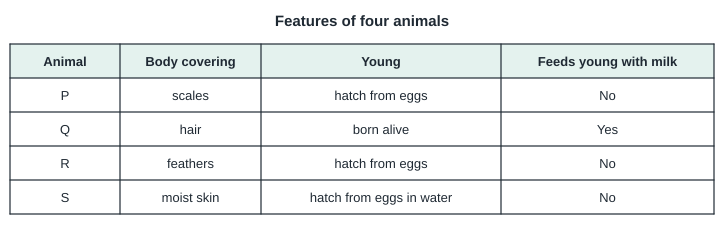 1 S; 2 P; 3 R; 4 Q | Q | Find the animal that feeds its young with milk. | Q has hair, gives birth to live young and feeds its young with milk, so it is a mammal. | `sc.p3.leaf.mammals` repairs via `sc.p3.mammals` |
| sc-p3-mammals-learn.q2 (v1) | Which feature tells us that a bat is a mammal? 1 It is active at night.; 2 It has fur and feeds its young with milk.; 3 It can fly.; 4 It has wings. | It has fur and feeds its young with milk. | Birds can fly too. Look for a mammal feature. | Fur and feeding young with milk are mammal features. | `sc.p3.leaf.mammals` repairs via `sc.p3.mammals` |
| sc-p3-mammals.q1 / exact (v1) | Which is a feature of all mammals? 1 They have scales.; 2 They feed their young with milk.; 3 They lay eggs.; 4 They have feathers. | They feed their young with milk. | Think of how a mother dog feeds her puppies. | All mammals feed their young with milk. | `sc.p3.leaf.mammals` target `sc.p3.mammals` |
| sc-p3-mammals.q2 / similar (v1) | A dolphin lives in the sea and has smooth skin. It breathes air and feeds its young with milk. Which group does it belong to? 1 mammals; 2 fish; 3 reptiles; 4 amphibians | mammals | Feeding young with milk is the key feature. | Dolphins feed their young with milk, so they are mammals. | `sc.p3.leaf.mammals` target `sc.p3.mammals` |
| sc-p3-mammals.q3 / generic (v1) | Ali's pet has fur and gives birth to young ones alive. Which group does it belong to? 1 insects; 2 fish; 3 birds; 4 mammals | mammals | Fur is a clue. | Fur and giving birth to young alive are mammal features. | `sc.p3.leaf.mammals` target `sc.p3.mammals` |
| sc-p3-birds-fish-learn.q1 (v1) | Which feature do ALL birds have? 1 feathers; 2 fur; 3 gills; 4 the ability to fly | feathers | A penguin is a bird but cannot fly. | All birds have feathers; not all birds can fly. | `sc.p3.leaf.birds-fish` repairs via `sc.p3.birds-fish` |
| sc-p3-birds-fish-learn.q2 (v1) | An animal lives in water, has fins and breathes through gills. Which group is it in? 1 mammals; 2 insects; 3 birds; 4 fish | fish | Which group uses gills? | Fins and gills are features of fish. | `sc.p3.leaf.birds-fish` repairs via `sc.p3.birds-fish` |
| sc-p3-birds-fish.q1 / exact (v2) | Look at the table. Which animal is a bird? 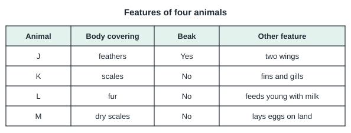 1 K; 2 L; 3 M; 4 J | J | Look for feathers and a beak. | J has feathers and a beak and lays eggs, so it is a bird. K has fins and gills, L has fur and M has dry scales. | `sc.p3.leaf.birds-fish` target `sc.p3.birds-fish` |
| sc-p3-birds-fish.q2 / similar (v1) | How do fish take in air from the water? 1 through fins; 2 through scales; 3 through gills; 4 through lungs | through gills | Look at the openings at the side of a fish's head. | Fish breathe using gills. | `sc.p3.leaf.birds-fish` target `sc.p3.birds-fish` |
| sc-p3-birds-fish.q3 / generic (v1) | A penguin swims well and cannot fly. Why is it still a bird? 1 It can swim.; 2 It has feathers and a beak and lays eggs.; 3 It lives in the sea.; 4 It is black and white. | It has feathers and a beak and lays eggs. | Use bird features, not where it lives. | Feathers, a beak and laying eggs make a penguin a bird. | `sc.p3.leaf.birds-fish` target `sc.p3.birds-fish` |
| sc-p3-insects-learn.q1 (v1) | How many legs does an insect have? 1 6; 2 8; 3 10; 4 4 | 6 | Count the legs of an ant. | All insects have six legs. | `sc.p3.leaf.insects` repairs via `sc.p3.insects` |
| sc-p3-insects-learn.q2 (v1) | Why is a spider not an insect? 1 It can spin silk.; 2 It has eight legs.; 3 It is too small.; 4 It lives in a web. | It has eight legs. | Count its legs. | Insects have six legs; a spider has eight. | `sc.p3.leaf.insects` repairs via `sc.p3.insects` |
| sc-p3-insects.q1 / exact (v2) | Look at the table. Which animal is an insect? 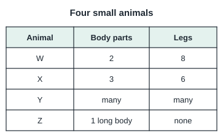 1 Z; 2 W; 3 X; 4 Y | X | Insects have a certain number of body parts and legs. | X has 3 body parts and 6 legs, so it is an insect. W has 8 legs, Y has many legs and Z has no legs. | `sc.p3.leaf.insects` target `sc.p3.insects` |
| sc-p3-insects.q2 / similar (v1) | An animal has 3 body parts, 6 legs and 2 feelers. Which group does it belong to? 1 insects; 2 mammals; 3 spiders; 4 fish | insects | Six legs is the key. | Three body parts and six legs show it is an insect. | `sc.p3.leaf.insects` target `sc.p3.insects` |
| sc-p3-insects.q3 / generic (v1) | Mei found a small creature with 8 legs in the garden. Is it an insect? 1 Yes, all small creatures are insects.; 2 Yes, because it has legs.; 3 No, because it is in the garden.; 4 No, insects have 6 legs. | No, insects have 6 legs. | Count the legs. | With 8 legs, it is not an insect. | `sc.p3.leaf.insects` target `sc.p3.insects` |
| sc-p3-amphibians-reptiles-learn.q1 (v2) | Look at the table. Which animal is a reptile? 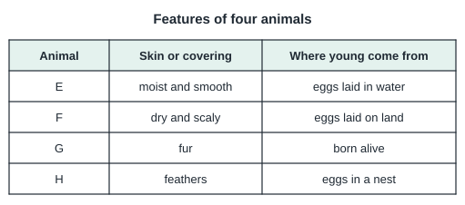 1 F; 2 H; 3 G; 4 E | F | Look for dry, scaly skin and eggs laid on land. | F has dry, scaly skin and lays eggs on land, so it is a reptile. E is an amphibian. | `sc.p3.leaf.amphibians-reptiles` repairs via `sc.p3.amphibians-reptiles` |
| sc-p3-amphibians-reptiles-learn.q2 (v1) | A frog has moist skin and lays eggs in water. Which group does it belong to? 1 fish; 2 reptiles; 3 amphibians; 4 mammals | amphibians | Moist skin and eggs in water are clues. | Frogs are amphibians. | `sc.p3.leaf.amphibians-reptiles` repairs via `sc.p3.amphibians-reptiles` |
| sc-p3-amphibians-reptiles.q1 / exact (v1) | What kind of skin do reptiles have? 1 dry and scaly; 2 moist and smooth; 3 covered with fur; 4 covered with feathers | dry and scaly | Think of a crocodile. | Reptiles have dry, scaly skin. | `sc.p3.leaf.amphibians-reptiles` target `sc.p3.amphibians-reptiles` |
| sc-p3-amphibians-reptiles.q2 / similar (v1) | Where do frogs usually lay their eggs? 1 in sand; 2 inside their body; 3 in water; 4 in a nest on a tree | in water | Think about where tadpoles swim. | Frogs lay their eggs in water. | `sc.p3.leaf.amphibians-reptiles` target `sc.p3.amphibians-reptiles` |
| sc-p3-amphibians-reptiles.q3 / generic (v1) | A turtle has a hard shell and dry, scaly skin, and lays eggs in sand. Which group does it belong to? 1 amphibians; 2 fish; 3 insects; 4 reptiles | reptiles | Dry, scaly skin is a clue. | Dry, scaly skin and eggs laid on land show it is a reptile. | `sc.p3.leaf.amphibians-reptiles` target `sc.p3.amphibians-reptiles` |
| sc-p3-fungi-learn.q1 (v2) | Look at the table. Which living thing is most likely a fungus? 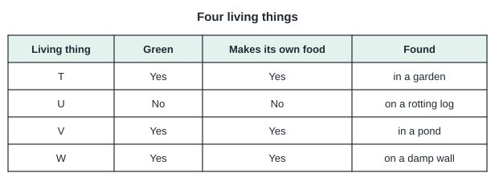 1 W; 2 T; 3 V; 4 U | U | A fungus is not green and cannot make its own food. | U is not green, cannot make its own food and grows on a rotting log, so it is most likely a fungus. | `sc.p3.leaf.fungi` repairs via `sc.p3.fungi` |
| sc-p3-fungi-learn.q2 (v1) | Black fuzzy spots grew on a slice of bread left in a damp cupboard. What are they? 1 dust; 2 mould, a kind of fungus; 3 a kind of insect; 4 a kind of plant | mould, a kind of fungus | It grew on food in a warm, damp place. | Bread mould is a fungus. | `sc.p3.leaf.fungi` repairs via `sc.p3.fungi` |
| sc-p3-fungi.q1 / exact (v1) | How do fungi get their food? 1 They do not need food.; 2 They catch insects with nets.; 3 They make food using sunlight.; 4 They feed on dead or rotting things. | They feed on dead or rotting things. | Fungi are not green plants. | Fungi cannot make food; they feed on dead or rotting matter. | `sc.p3.leaf.fungi` target `sc.p3.fungi` |
| sc-p3-fungi.q2 / similar (v1) | Where is bread mould most likely to grow quickly? 1 in a sealed dry tin; 2 in a warm, damp place; 3 in a cold, dry fridge; 4 in a hot, dry oven | in a warm, damp place | Fungi like warmth and moisture. | Fungi grow well in warm, damp places. | `sc.p3.leaf.fungi` target `sc.p3.fungi` |
| sc-p3-fungi.q3 / generic (v1) | Why are mushrooms not grouped as plants? 1 They cannot make their own food.; 2 They are soft.; 3 They are too small.; 4 They grow in the dark. | They cannot make their own food. | What can plants do that fungi cannot? | Plants make their own food; fungi cannot. | `sc.p3.leaf.fungi` target `sc.p3.fungi` |
| sc-p3-bacteria-learn.q1 (v1) | How can we see bacteria? 1 with our eyes alone; 2 with a microscope; 3 with a magnet; 4 with a ruler | with a microscope | Bacteria are very tiny. | Bacteria are too small to see without a microscope. | `sc.p3.leaf.bacteria` repairs via `sc.p3.bacteria` |
| sc-p3-bacteria-learn.q2 (v1) | Which shows that some bacteria are useful? 1 They are used to make yoghurt.; 2 They cause stomach aches.; 3 They grow on dirty hands.; 4 They make food go bad. | They are used to make yoghurt. | Look for a helpful use. | Some bacteria help to turn milk into yoghurt. | `sc.p3.leaf.bacteria` repairs via `sc.p3.bacteria` |
| sc-p3-bacteria.q1 / exact (v1) | Why should we wash our hands before eating? 1 to make our hands bigger; 2 to grow mould; 3 to feed the bacteria; 4 to remove harmful bacteria | to remove harmful bacteria | Some tiny living things on hands can make us ill. | Washing removes harmful bacteria. | `sc.p3.leaf.bacteria` target `sc.p3.bacteria` |
| sc-p3-bacteria.q2 / similar (v1) | Milk left out on a hot day turned sour. What most likely caused this? 1 plants; 2 magnets; 3 bacteria; 4 sunlight only | bacteria | Tiny living things grow in food. | Bacteria growing in the milk made it go sour. | `sc.p3.leaf.bacteria` target `sc.p3.bacteria` |
| sc-p3-bacteria.q3 / generic (v1) | Which statement about bacteria is correct? 1 All bacteria are useful.; 2 All bacteria are harmful.; 3 Some are useful and some are harmful.; 4 Bacteria are non-living. | Some are useful and some are harmful. | Think of yoghurt and of illness. | Bacteria can be both useful and harmful. | `sc.p3.leaf.bacteria` target `sc.p3.bacteria` |

## P3 · Diversity of materials: types and properties (strength, flexibility, waterproof/absorbent, allowing light through, floating and sinking) (`sc.p3.materials`)

**Material `sc-p3-material-types-learn` · Learn: common materials** (teaching)

> Objects are made of materials such as wood, metal, plastic, glass, ceramic, rubber and fabric. One object can be made of more than one material: a pencil has wood, graphite and sometimes a rubber eraser.

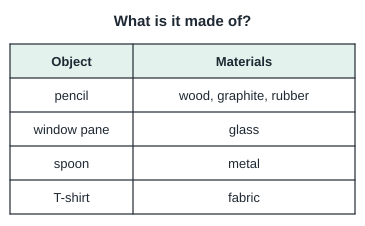

**Material `sc-p3-flexibility-learn` · Learn: flexibility** (teaching)

> A flexible material can bend without breaking. Rubber and fabric are flexible. Glass and ceramic are not flexible: they break if bent.

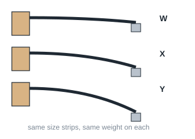

**Material `sc-p3-waterproof-absorbent-learn` · Learn: waterproof and absorbent materials** (teaching)

> A waterproof material does not let water pass through (plastic, rubber, metal, glass). An absorbent material soaks up water (cotton, paper towel, sponge).

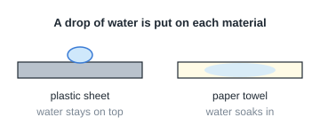

**Material `sc-p3-transparency-learn` · Learn: allowing light through** (teaching)

> Some materials allow most light to pass through (clear glass, clear plastic). Some allow some light through (tracing paper, frosted glass). Some do not allow light through (wood, metal, cardboard).

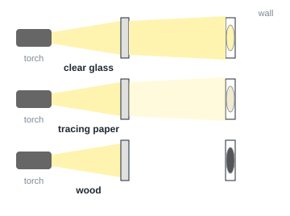

**Material `sc-p3-float-sink-learn` · Learn: floating and sinking** (teaching)

> Some objects float on water and some sink. A cork, a wooden block and many plastic toys float. A metal key and a stone sink. Whether something floats depends on the material and the shape of the object.

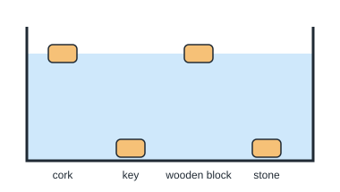

**Material `sc-p3-strength-learn` · Learn: strength of materials** (teaching)

> Strength is how much load a material can hold before it breaks. To compare strength fairly, use strips of the same size and add weights one at a time until each strip breaks. The strip that holds the most weights before breaking is the strongest.

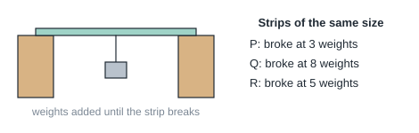

| ID / stage | Question and options | Key | Hint | Explanation | Leaf → repair route |
| --- | --- | --- | --- | --- | --- |
| sc-p3-material-types-learn.q1 (v1) | A spoon is hard, shiny and cold to touch. Which material is it most likely made of? 1 fabric; 2 metal; 3 paper; 4 rubber | metal | Think of cutlery at home. | Shiny, hard spoons are usually made of metal. | `sc.p3.leaf.material-types` repairs via `sc.p3.material-types` |
| sc-p3-material-types-learn.q2 (v1) | Which object is usually made of glass? 1 a window pane; 2 a pillow; 3 a rubber band; 4 a T-shirt | a window pane | Which one lets you see through it? | Window panes are usually made of glass. | `sc.p3.leaf.material-types` repairs via `sc.p3.material-types` |
| sc-p3-material-types.q1 / exact (v1) | What material is a rubber band made of? 1 metal; 2 rubber; 3 glass; 4 ceramic | rubber | Its name is a clue. | Rubber bands are made of rubber. | `sc.p3.leaf.material-types` target `sc.p3.material-types` |
| sc-p3-material-types.q2 / similar (v1) | A cup is hard, breaks easily when dropped and is not see-through. Which material is it most likely made of? 1 fabric; 2 rubber; 3 ceramic; 4 plastic bag material | ceramic | Think of a mug from the kitchen. | Ceramic cups are hard, break easily and do not let light through. | `sc.p3.leaf.material-types` target `sc.p3.material-types` |
| sc-p3-material-types.q3 / generic (v1) | A chair has a seat of fabric, legs of metal and armrests of wood. How many different materials is it made of? 1 3; 2 4; 3 2; 4 1 | 3 | Count the different materials named. | Fabric, metal and wood: 3 materials. | `sc.p3.leaf.material-types` target `sc.p3.material-types` |
| sc-p3-flexibility-learn.q1 (v1) | Which material is the most flexible? 1 stone; 2 ceramic; 3 rubber; 4 glass | rubber | Which can bend and not break? | Rubber can bend easily without breaking. | `sc.p3.leaf.flexibility` repairs via `sc.p3.flexibility` |
| sc-p3-flexibility-learn.q2 (v2) | A garden hose bends around corners without breaking. Which property does it show? 1 transparency; 2 flexibility; 3 magnetism; 4 strength | flexibility | It bends easily. | The hose can bend without breaking, so it is flexible. | `sc.p3.leaf.flexibility` repairs via `sc.p3.flexibility` |
| sc-p3-flexibility.q1 / exact (v1) | Why are swimming caps made of rubber? 1 Rubber is flexible and waterproof.; 2 Rubber is magnetic.; 3 Rubber is hard and brittle.; 4 Rubber is see-through. | Rubber is flexible and waterproof. | The cap must stretch over the head and keep water out. | Flexible, waterproof rubber fits snugly and keeps water out. | `sc.p3.leaf.flexibility` target `sc.p3.flexibility` |
| sc-p3-flexibility.q2 / similar (v1) | Which object would break if you tried to bend it? 1 a plastic straw; 2 a rubber band; 3 a cloth belt; 4 a glass rod | a glass rod | Which material is not flexible? | Glass is not flexible and breaks when bent. | `sc.p3.leaf.flexibility` target `sc.p3.flexibility` |
| sc-p3-flexibility.q3 / generic (v2) | Four strips of different materials have the same length, width and thickness. Each is fixed at one end, with the same small weight hung from the other end. None breaks. W bends down 1 cm, X 3 cm, Y 4 cm and Z 5 cm. Which conclusion is supported? 1 W is the most flexible.; 2 W is the hardest.; 3 W is the least flexible.; 4 W is waterproof. | W is the least flexible. | Compare how far the strips bend under the same load. | W bends the least under the same load. Of these equal-sized strips, W is the least flexible. | `sc.p3.leaf.flexibility` target `sc.p3.flexibility` |
| sc-p3-waterproof-absorbent-learn.q1 (v1) | Which material is best for a raincoat? 1 sponge; 2 paper; 3 plastic; 4 cotton | plastic | A raincoat must stop water getting through. | Plastic is waterproof. | `sc.p3.leaf.waterproof-absorbent` repairs via `sc.p3.waterproof-absorbent` |
| sc-p3-waterproof-absorbent-learn.q2 (v1) | Which material should a towel be made of? 1 metal; 2 glass; 3 cotton; 4 plastic | cotton | A towel must soak up water. | Cotton is absorbent. | `sc.p3.leaf.waterproof-absorbent` repairs via `sc.p3.waterproof-absorbent` |
| sc-p3-waterproof-absorbent.q1 / exact (v1) | Which material is absorbent? 1 plastic sheet; 2 paper towel; 3 glass plate; 4 metal tray | paper towel | Which one soaks up water? | Paper towels absorb water. | `sc.p3.leaf.waterproof-absorbent` target `sc.p3.waterproof-absorbent` |
| sc-p3-waterproof-absorbent.q2 / similar (v1) | Mei spilled water on a table. Which material is best for wiping it up? 1 a glass cup; 2 a metal spoon; 3 a plastic ruler; 4 a sponge | a sponge | Choose the one that soaks up water. | A sponge absorbs water well. | `sc.p3.leaf.waterproof-absorbent` target `sc.p3.waterproof-absorbent` |
| sc-p3-waterproof-absorbent.q3 / generic (v1) | Why is an umbrella made of plastic-coated fabric and not plain paper? 1 Plastic is absorbent.; 2 Paper is too heavy.; 3 Paper is waterproof.; 4 Plastic-coated fabric is waterproof and does not tear easily when wet. | Plastic-coated fabric is waterproof and does not tear easily when wet. | What happens to paper in rain? | Paper absorbs water and tears; the coated fabric is waterproof. | `sc.p3.leaf.waterproof-absorbent` target `sc.p3.waterproof-absorbent` |
| sc-p3-transparency-learn.q1 (v1) | Which material allows most light to pass through? 1 metal; 2 cardboard; 3 clear glass; 4 wood | clear glass | You can see clearly through it. | Clear glass lets most light pass through. | `sc.p3.leaf.transparency` repairs via `sc.p3.transparency` |
| sc-p3-transparency-learn.q2 (v1) | Why is a bathroom window often made of frosted glass? 1 It lets some light in but people cannot see in clearly.; 2 It soaks up water.; 3 It blocks all light.; 4 It is magnetic. | It lets some light in but people cannot see in clearly. | Light is needed, but privacy too. | Frosted glass lets some light through and gives privacy. | `sc.p3.leaf.transparency` repairs via `sc.p3.transparency` |
| sc-p3-transparency.q1 / exact (v1) | Which material does NOT allow light to pass through? 1 tracing paper; 2 clear glass; 3 clear plastic; 4 wood | wood | Which one is not see-through at all? | Wood blocks light. | `sc.p3.leaf.transparency` target `sc.p3.transparency` |
| sc-p3-transparency.q2 / similar (v1) | A torch shines on a sheet. The light on the wall behind is dim but not dark. What does this show? 1 The sheet allows some light through.; 2 The sheet allows all light through.; 3 The sheet allows no light through.; 4 The sheet is magnetic. | The sheet allows some light through. | Some light reached the wall. | Dim light means some, but not all, light passed through. | `sc.p3.leaf.transparency` target `sc.p3.transparency` |
| sc-p3-transparency.q3 / generic (v1) | Which material is best for the window of a toy oven so you can see the cake? 1 cardboard; 2 wood; 3 clear heat-resistant glass; 4 metal | clear heat-resistant glass | You need to see inside. | Clear glass lets light through so the cake can be seen. | `sc.p3.leaf.transparency` target `sc.p3.transparency` |
| sc-p3-float-sink-learn.q1 (v1) | Which object is most likely to float on water? 1 a metal key; 2 a cork; 3 a glass marble; 4 a stone | a cork | Think of corks bobbing on water. | A cork floats. | `sc.p3.leaf.float-sink` repairs via `sc.p3.float-sink` |
| sc-p3-float-sink-learn.q2 (v1) | Ali drops a steel nail and a wooden stick into a tank of water. What happens? 1 The nail floats and the stick sinks.; 2 The nail sinks and the stick floats.; 3 Both sink.; 4 Both float. | The nail sinks and the stick floats. | Think about metal and wood in water. | Steel nails sink; wood floats. | `sc.p3.leaf.float-sink` repairs via `sc.p3.float-sink` |
| sc-p3-float-sink.q1 / exact (v1) | Which material is used for life jackets because it floats? 1 foam; 2 iron; 3 glass; 4 stone | foam | A life jacket must keep you up. | Foam floats and keeps a swimmer up. | `sc.p3.leaf.float-sink` target `sc.p3.float-sink` |
| sc-p3-float-sink.q2 / similar (v1) | A toy boat is made to float. Which material would be the worst choice for it? 1 plastic; 2 wood; 3 stone; 4 foam | stone | Which one sinks? | Stone sinks, so it is the worst choice. | `sc.p3.leaf.float-sink` target `sc.p3.float-sink` |
| sc-p3-float-sink.q3 / generic (v1) | A plastic bottle with its cap on floats. Water is poured in until it is full and the cap is put back on. It now sinks. What changed? 1 It was filled with water instead of air.; 2 It became magnetic.; 3 It became see-through.; 4 It became a different material. | It was filled with water instead of air. | Compare what was inside the bottle. | Replacing the air inside with water made it sink. | `sc.p3.leaf.float-sink` target `sc.p3.float-sink` |
| sc-p3-strength-learn.q1 (v1) | Which material is used for bridges because it is strong? 1 jelly; 2 cotton; 3 paper; 4 steel (a metal) | steel (a metal) | A bridge must hold heavy loads. | Steel can hold very heavy loads without breaking, so it is strong enough for bridges. | `sc.p3.leaf.strength` repairs via `sc.p3.strength` |
| sc-p3-strength-learn.q2 (v1) | Why must the strips in a strength test all be the same size? 1 So that the strips break at the same time.; 2 So that the strips look nice.; 3 So that the strips float.; 4 So that the test is fair and only the material is different. | So that the test is fair and only the material is different. | In a fair test, only one thing is changed. | If the strips were different sizes, a thicker strip might hold more weights because of its size, not its material. | `sc.p3.leaf.strength` repairs via `sc.p3.strength` |
| sc-p3-strength.q1 / exact (v1) | Which property tells us how much load a material can hold before it breaks? 1 transparency; 2 strength; 3 flexibility; 4 ability to float | strength | Think of weights being added until something snaps. | Strength is how much load a material can hold before it breaks. | `sc.p3.leaf.strength` target `sc.p3.strength` |
| sc-p3-strength.q2 / similar (v1) | Strips of different materials of the same size are loaded with weights until they break. What property is being tested? 1 transparency; 2 flexibility; 3 strength; 4 ability to float | strength | Loads are added until the material breaks. | Adding loads until a strip breaks tests how strong each material is. | `sc.p3.leaf.strength` target `sc.p3.strength` |
| sc-p3-strength.q3 / generic (v1) | A shelf must hold heavy books. Look at the results. Which material is best for the shelf? 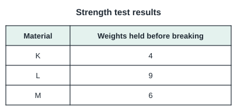 1 material K; 2 They are all the same.; 3 material M; 4 material L | material L | Which strip held the most weights before breaking? | Material L held 9 weights before breaking, more than K (4) or M (6), so it is the strongest. | `sc.p3.leaf.strength` target `sc.p3.strength` |

## P3 · Life cycles of plants: observing and comparing stages (seed, young plant, adult plant, flowers, fruits) (`sc.p3.plant-life-cycle`)

**Material `sc-p3-plant-stages-learn` · Learn: stages of a flowering plant** (teaching)

> A flowering plant grows from a seed into a young plant and then an adult plant. A very young plant with its first leaves is sometimes called a seedling; it is an early young plant, not a separate stage. The adult plant produces flowers, and fruits with seeds form where the flowers were. The seeds can grow into new plants.

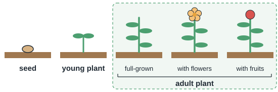

**Material `sc-p3-plant-cycles-compare-learn` · Learn: comparing plant life cycles** (teaching)

> Different flowering plants have the same stages, but the time taken can differ. A balsam plant may complete its life cycle in a few months; a mango tree takes years to produce fruits. Plants that reproduce from spores, like ferns, have a different life cycle.

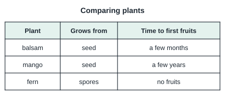

**Material `sc-p3-plant-growth-observe-learn` · Learn: observing a plant grow** (teaching)

> We can observe a plant as it grows from a young plant into an adult plant. We measure its height and count its leaves every few days, and record the results in a table or graph. A growing plant usually gets taller and grows more leaves.

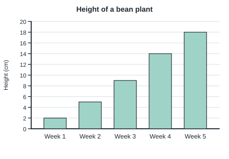

**Material `sc-p3-plant-cycles-timeline-learn` · Learn: recording a plant’s life cycle** (teaching)

> We can record when each stage appears: when the young plant appears, when the first flower opens and when the first fruit forms. Comparing records shows that different kinds of plants can take different lengths of time to go through the same stages.

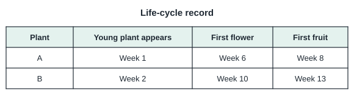

| ID / stage | Question and options | Key | Hint | Explanation | Leaf → repair route |
| --- | --- | --- | --- | --- | --- |
| sc-p3-plant-stages-learn.q1 (v2) | What is the correct order of these stages in the life cycle of a flowering plant? 1 seed → adult plant → young plant; 2 seed → young plant → adult plant; 3 adult plant → young plant → seed; 4 young plant → seed → adult plant | seed → young plant → adult plant | Start with what is planted in the soil. | A seed grows into a young plant, which grows into an adult plant. | `sc.p3.leaf.plant-stages` repairs via `sc.p3.plant-stages` |
| sc-p3-plant-stages-learn.q2 (v2) | Ali cuts open a ripe papaya. What does he find inside that can grow into new papaya plants? 1 seeds; 2 flowers; 3 roots; 4 leaves | seeds | Look at the black parts inside the fruit. | The seeds inside the fruit can grow into new plants. | `sc.p3.leaf.plant-stages` repairs via `sc.p3.plant-stages` |
| sc-p3-plant-stages.q1 / exact (v2) | The pictures show a plant at different stages. Which picture shows the young plant? 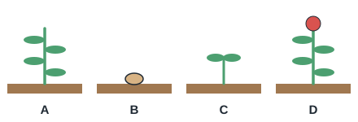 1 B; 2 C; 3 A; 4 D | C | A young plant is small and has only a few leaves. | Picture C shows a small plant with its first few leaves: the young plant. B is a seed, A is an adult plant and D has fruits. | `sc.p3.leaf.plant-stages` target `sc.p3.plant-stages` |
| sc-p3-plant-stages.q2 / similar (v2) | A small green tomato appears on a tomato plant where a flower used to be. Which stage of the plant does the tomato show? 1 seed; 2 flower; 3 fruit; 4 young plant | fruit | What forms where a flower was? | The tomato is a fruit. Fruits form where the flowers were. | `sc.p3.leaf.plant-stages` target `sc.p3.plant-stages` |
| sc-p3-plant-stages.q3 / generic (v2) | Which order shows the life cycle of the plant correctly? 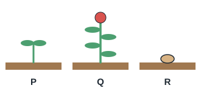 1 P → Q → R; 2 Q → R → P; 3 R → P → Q; 4 R → Q → P | R → P → Q | Start with the stage that is put into the soil. | R is a seed, P is a young plant and Q is an adult plant with fruits, so the order is R → P → Q. | `sc.p3.leaf.plant-stages` target `sc.p3.plant-stages` |
| sc-p3-plant-cycles-compare-learn.q1 (v1) | Which stage do a balsam plant and a mango tree both have? 1 a tadpole stage; 2 spores under the leaves; 3 a pupa stage; 4 flowers that become fruits | flowers that become fruits | Both are flowering plants. | Both are flowering plants, so both produce flowers and fruits. | `sc.p3.leaf.plant-cycles-compare` repairs via `sc.p3.plant-cycles-compare` |
| sc-p3-plant-cycles-compare-learn.q2 (v1) | Why might a farmer grow balsam rather than mango to show children a whole life cycle in one school term? 1 Balsam is not a plant.; 2 Balsam completes its life cycle much faster.; 3 Mango trees have no seeds.; 4 Mango trees never flower. | Balsam completes its life cycle much faster. | Compare how long each takes. | Balsam completes its life cycle in months; mango takes years. | `sc.p3.leaf.plant-cycles-compare` repairs via `sc.p3.plant-cycles-compare` |
| sc-p3-plant-cycles-compare.q1 / exact (v1) | Which plant does NOT grow from a seed? 1 rice plant; 2 balsam; 3 fern; 4 chilli plant | fern | Which one reproduces from spores? | Ferns reproduce from spores, not seeds. | `sc.p3.leaf.plant-cycles-compare` target `sc.p3.plant-cycles-compare` |
| sc-p3-plant-cycles-compare.q2 / similar (v1) | Which statement about flowering plants is correct? 1 They all reproduce from spores.; 2 They do not produce seeds.; 3 They have the same stages but may take different lengths of time.; 4 They all take one week to grow. | They have the same stages but may take different lengths of time. | Compare balsam and mango. | Same stages, different durations. | `sc.p3.leaf.plant-cycles-compare` target `sc.p3.plant-cycles-compare` |
| sc-p3-plant-cycles-compare.q3 / generic (v2) | A chilli plant produced its first fruits 3 months after the seed was planted. Which stage came just before the fruits? 1 flowers; 2 young plant; 3 seed; 4 spores | flowers | Fruits form where something else was before. | Fruits form where the flowers were, so the flowers came just before the fruits. | `sc.p3.leaf.plant-cycles-compare` target `sc.p3.plant-cycles-compare` |
| sc-p3-plant-growth-observe-learn.q1 (v1) | Look at the graph in the card. How much did the plant grow from Week 1 to Week 5? 1 18 cm; 2 20 cm; 3 2 cm; 4 16 cm | 16 cm | Read the height in Week 1 and in Week 5, then find the difference. | The plant was 2 cm tall in Week 1 and 18 cm in Week 5. 18 − 2 = 16 cm. | `sc.p3.leaf.plant-growth-observe` repairs via `sc.p3.plant-growth-observe` |
| sc-p3-plant-growth-observe-learn.q2 (v1) | Ali counted the leaves on his plant and recorded them. What does his record show? 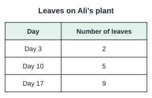 1 The number of leaves stayed the same.; 2 The plant stopped growing.; 3 The number of leaves increased as the plant grew.; 4 The number of leaves decreased. | The number of leaves increased as the plant grew. | Compare the first and last counts. | The plant had 2 leaves on Day 3, 5 on Day 10 and 9 on Day 17, so the number of leaves increased. | `sc.p3.leaf.plant-growth-observe` repairs via `sc.p3.plant-growth-observe` |
| sc-p3-plant-growth-observe.q1 / exact (v1) | Between which two weeks did the plant grow the most? 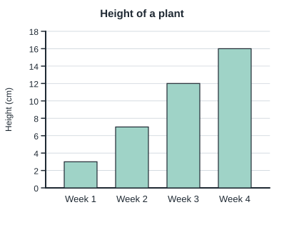 1 Week 1 and Week 2; 2 Week 3 and Week 4; 3 It grew the same amount each week.; 4 Week 2 and Week 3 | Week 2 and Week 3 | Work out how much it grew between each pair of weeks. | Week 1→2: 4 cm. Week 2→3: 5 cm. Week 3→4: 4 cm. It grew the most between Week 2 and Week 3. | `sc.p3.leaf.plant-growth-observe` target `sc.p3.plant-growth-observe` |
| sc-p3-plant-growth-observe.q2 / similar (v1) | Which plant grew more in 14 days? 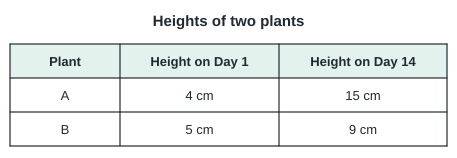 1 Neither plant grew.; 2 They grew the same amount.; 3 Plant B; 4 Plant A | Plant A | Find how much each plant grew, not which one is taller. | Plant A grew 15 − 4 = 11 cm. Plant B grew 9 − 5 = 4 cm. Plant A grew more. | `sc.p3.leaf.plant-growth-observe` target `sc.p3.plant-growth-observe` |
| sc-p3-plant-growth-observe.q3 / generic (v1) | Siti wants to find out how her plant changes as it grows. What should she do? 1 Look at it once and guess.; 2 Pull it out every day to look at the roots.; 3 Paint its leaves a different colour.; 4 Measure its height and count its leaves every few days, and record the results. | Measure its height and count its leaves every few days, and record the results. | Good observations are repeated and written down. | Measuring and counting every few days, and recording the results, shows how the plant changes without harming it. | `sc.p3.leaf.plant-growth-observe` target `sc.p3.plant-growth-observe` |
| sc-p3-plant-cycles-timeline-learn.q1 (v1) | Look at the record in the card. Which plant had its first flower earlier? 1 Plant B; 2 Both at the same time; 3 Plant A; 4 Neither plant flowered | Plant A | Compare the weeks in the "First flower" column. | Plant A flowered in Week 6 and Plant B in Week 10, so Plant A flowered earlier. | `sc.p3.leaf.plant-cycles-timeline` repairs via `sc.p3.plant-cycles-timeline` |
| sc-p3-plant-cycles-timeline-learn.q2 (v1) | Look at the record of a chilli plant. Which stage appeared last? 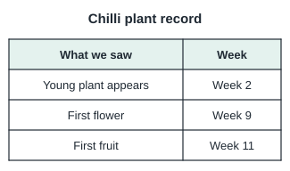 1 none of the stages; 2 the first fruit; 3 the first flower; 4 the young plant | the first fruit | Find the latest week in the record. | The first fruit appeared in Week 11, after the young plant (Week 2) and the first flower (Week 9). | `sc.p3.leaf.plant-cycles-timeline` repairs via `sc.p3.plant-cycles-timeline` |
| sc-p3-plant-cycles-timeline.q1 / exact (v1) | Which plant produced fruits first? 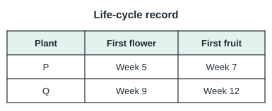 1 Plant P; 2 Both at the same time; 3 Neither plant; 4 Plant Q | Plant P | Compare the weeks for the first fruit. | Plant P produced its first fruit in Week 7 and Plant Q in Week 12, so Plant P was first. | `sc.p3.leaf.plant-cycles-timeline` target `sc.p3.plant-cycles-timeline` |
| sc-p3-plant-cycles-timeline.q2 / similar (v1) | How many weeks after the first flower did the first fruit form? 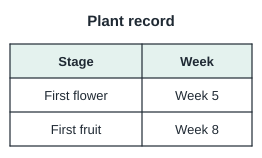 1 13 weeks; 2 3 weeks; 3 8 weeks; 4 5 weeks | 3 weeks | Find the difference between the two weeks. | The first flower opened in Week 5 and the first fruit formed in Week 8. 8 − 5 = 3 weeks. | `sc.p3.leaf.plant-cycles-timeline` target `sc.p3.plant-cycles-timeline` |
| sc-p3-plant-cycles-timeline.q3 / generic (v1) | Two different kinds of plants are planted on the same day. Ali says they will flower in the same week. What do life-cycle records usually show? 1 All plants flower in the same week.; 2 Different kinds of plants can take different lengths of time.; 3 Only the taller plant can flower.; 4 Plants planted on the same day never flower. | Different kinds of plants can take different lengths of time. | Look back at the records of Plant A and Plant B. | Records of different plants show the same stages happening at different times, so they may not flower in the same week. | `sc.p3.leaf.plant-cycles-timeline` target `sc.p3.plant-cycles-timeline` |

## P3 · Life cycles of animals: three- and four-stage cycles, frog, mosquito control (`sc.p3.animal-life-cycle`)

**Material `sc-p3-four-stage-learn` · Learn: four-stage life cycles** (teaching)

> Some animals have four stages in their life cycle: egg → larva → pupa → adult. A butterfly is an example: the larva is a caterpillar and the pupa is a chrysalis. Mosquitoes and beetles also have four stages. The young looks very different from the adult.

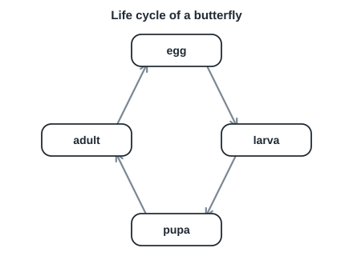

**Material `sc-p3-three-stage-learn` · Learn: three-stage life cycles** (teaching)

> Some animals have three stages: egg → young → adult. A cockroach and a grasshopper have egg → nymph → adult; the nymph looks like a small adult without wings. A chicken has egg → chick → adult.

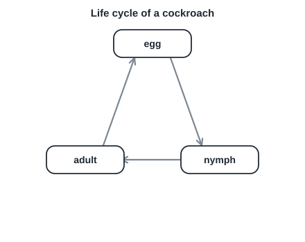

**Material `sc-p3-frog-cycle-learn` · Learn: the life cycle of a frog** (teaching)

> A frog has the life cycle egg → tadpole → young frog → adult frog. Tadpoles live in water and breathe with gills. As they grow, they grow legs and lose their tails; young frogs can then live on land.

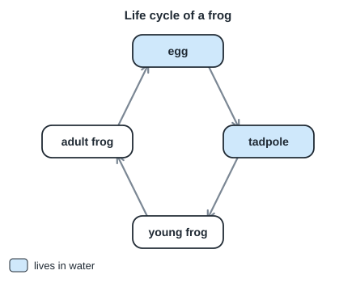

**Material `sc-p3-mosquito-control-learn` · Learn: mosquitoes and stagnant water** (teaching)

> Mosquitoes lay eggs in stagnant (still) water. The larvae and pupae live in the water. Removing stagnant water from flowerpot plates, pails and drains stops mosquitoes from completing their life cycle and helps to prevent dengue.

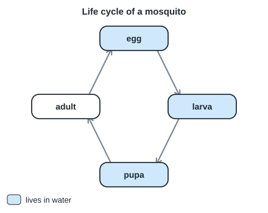

**Material `sc-p3-young-like-adult-learn` · Learn: does the young look like the adult?** (teaching)

> In some life cycles the young looks like the adult (cockroach nymph, chick). In others the young looks very different (butterfly larva, mosquito larva, tadpole). Animals with a pupa stage have young that look very different from the adult.

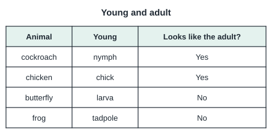

| ID / stage | Question and options | Key | Hint | Explanation | Leaf → repair route |
| --- | --- | --- | --- | --- | --- |
| sc-p3-four-stage-learn.q1 (v1) | What is the correct order of a butterfly's life cycle? 1 egg → pupa → larva → adult; 2 egg → larva → pupa → adult; 3 egg → nymph → adult; 4 larva → egg → adult → pupa | egg → larva → pupa → adult | The caterpillar comes before the chrysalis. | Egg, larva (caterpillar), pupa (chrysalis), adult. | `sc.p3.leaf.four-stage` repairs via `sc.p3.four-stage` |
| sc-p3-four-stage-learn.q2 (v1) | At which stage does a butterfly eat a lot of leaves? 1 larva; 2 adult; 3 egg; 4 pupa | larva | Caterpillars are hungry eaters. | The larva (caterpillar) feeds on leaves. | `sc.p3.leaf.four-stage` repairs via `sc.p3.four-stage` |
| sc-p3-four-stage.q1 / exact (v1) | What is the pupa stage of a butterfly also called? 1 chrysalis; 2 tadpole; 3 caterpillar; 4 nymph | chrysalis | It is the hard case where the change happens. | A butterfly's pupa is called a chrysalis. | `sc.p3.leaf.four-stage` target `sc.p3.four-stage` |
| sc-p3-four-stage.q2 / similar (v1) | Which animal has a four-stage life cycle? 1 dog; 2 mosquito; 3 cockroach; 4 chicken | mosquito | Look for a larva and a pupa stage. | Mosquitoes go through egg, larva, pupa and adult. | `sc.p3.leaf.four-stage` target `sc.p3.four-stage` |
| sc-p3-four-stage.q3 / generic (v1) | A beetle's young looks like a worm and does not look like the adult. Which stage is this? 1 larva; 2 nymph; 3 adult; 4 pupa | larva | In a four-stage life cycle, the worm-like young is the... | The worm-like young of a beetle is the larva. | `sc.p3.leaf.four-stage` target `sc.p3.four-stage` |
| sc-p3-three-stage-learn.q1 (v1) | What is the young of a cockroach called? 1 nymph; 2 tadpole; 3 larva; 4 pupa | nymph | It looks like a small adult without wings. | A young cockroach is a nymph. | `sc.p3.leaf.three-stage` repairs via `sc.p3.three-stage` |
| sc-p3-three-stage-learn.q2 (v1) | Which animal has a three-stage life cycle? 1 mosquito; 2 grasshopper; 3 butterfly; 4 beetle | grasshopper | It has no pupa stage. | A grasshopper goes through egg, nymph and adult. | `sc.p3.leaf.three-stage` repairs via `sc.p3.three-stage` |
| sc-p3-three-stage.q1 / exact (v1) | How is a cockroach nymph different from an adult cockroach? 1 It is a caterpillar.; 2 It has no wings and is smaller.; 3 It lives in water.; 4 It has no legs. | It has no wings and is smaller. | The nymph looks like a small adult. | A nymph is smaller and has no wings. | `sc.p3.leaf.three-stage` target `sc.p3.three-stage` |
| sc-p3-three-stage.q2 / similar (v1) | Which life cycle has only three stages? 1 mosquito; 2 chicken; 3 butterfly; 4 beetle | chicken | Which one has no larva or pupa? | A chicken goes egg → chick → adult. | `sc.p3.leaf.three-stage` target `sc.p3.three-stage` |
| sc-p3-three-stage.q3 / generic (v1) | An insect's young looks like a small adult but has no wings. How many stages does its life cycle most likely have? 1 4; 2 5; 3 2; 4 3 | 3 | There is no pupa stage when the young already looks like the adult. | Egg, nymph, adult: three stages. | `sc.p3.leaf.three-stage` target `sc.p3.three-stage` |
| sc-p3-frog-cycle-learn.q1 (v1) | What hatches from a frog's egg? 1 a nymph; 2 a tadpole; 3 a caterpillar; 4 a young frog with legs | a tadpole | It lives in water and has a tail. | A tadpole hatches from a frog's egg. | `sc.p3.leaf.frog-cycle` repairs via `sc.p3.frog-cycle` |
| sc-p3-frog-cycle-learn.q2 (v1) | What happens to a tadpole's tail as it grows into a frog? 1 It grows longer.; 2 It turns into a wing.; 3 It becomes a leg.; 4 It gets shorter and disappears. | It gets shorter and disappears. | Adult frogs do not have tails. | The tail shortens and disappears. | `sc.p3.leaf.frog-cycle` repairs via `sc.p3.frog-cycle` |
| sc-p3-frog-cycle.q1 / exact (v1) | What is the correct order of a frog's life cycle? 1 egg → larva → pupa → adult frog; 2 egg → young frog → tadpole → adult frog; 3 tadpole → egg → adult frog → young frog; 4 egg → tadpole → young frog → adult frog | egg → tadpole → young frog → adult frog | The tadpole comes before the frog with legs. | Egg, tadpole, young frog, adult frog. | `sc.p3.leaf.frog-cycle` target `sc.p3.frog-cycle` |
| sc-p3-frog-cycle.q2 / similar (v1) | Where do tadpoles live? 1 in water; 2 in nests; 3 in sand; 4 in trees | in water | They have tails for swimming. | Tadpoles live in water. | `sc.p3.leaf.frog-cycle` target `sc.p3.frog-cycle` |
| sc-p3-frog-cycle.q3 / generic (v1) | A young frog has four legs and a short tail. Which stage came just before it? 1 tadpole; 2 pupa; 3 adult frog; 4 egg | tadpole | What does a frog look like before it has legs? | Before growing legs, it was a tadpole. | `sc.p3.leaf.frog-cycle` target `sc.p3.frog-cycle` |
| sc-p3-mosquito-control-learn.q1 (v1) | Where do mosquitoes lay their eggs? 1 inside fruits; 2 in dry sand; 3 on leaves only; 4 in still water | in still water | Their larvae live in water. | Mosquitoes lay eggs in stagnant water. | `sc.p3.leaf.mosquito-control` repairs via `sc.p3.mosquito-control` |
| sc-p3-mosquito-control-learn.q2 (v1) | Why should we turn over pails after use? 1 so that birds can drink; 2 so that the pail dries faster for painting; 3 so that the pail floats; 4 so that water does not collect for mosquitoes to breed | so that water does not collect for mosquitoes to breed | Think about where mosquitoes lay eggs. | Removing stagnant water stops mosquitoes breeding. | `sc.p3.leaf.mosquito-control` repairs via `sc.p3.mosquito-control` |
| sc-p3-mosquito-control.q1 / exact (v1) | In which stages does a mosquito live in water? 1 none of its stages; 2 larva and pupa; 3 egg only; 4 adult only | larva and pupa | The adult flies; the young stages need water. | Mosquito larvae and pupae live in water. | `sc.p3.leaf.mosquito-control` target `sc.p3.mosquito-control` |
| sc-p3-mosquito-control.q2 / similar (v1) | Which action helps to prevent dengue? 1 emptying water from flowerpot plates; 2 keeping drains blocked; 3 leaving pails of water outside; 4 collecting rainwater in open tins | emptying water from flowerpot plates | Stop mosquitoes from breeding. | Removing stagnant water prevents mosquito breeding. | `sc.p3.leaf.mosquito-control` target `sc.p3.mosquito-control` |
| sc-p3-mosquito-control.q3 / generic (v1) | Wriggling creatures are seen in a pail of rainwater left outside for a week. What are they most likely to be? 1 tadpoles from the tap; 2 caterpillars; 3 mosquito larvae; 4 earthworms | mosquito larvae | Which insect breeds in still water? | Mosquito larvae wriggle in stagnant water. | `sc.p3.leaf.mosquito-control` target `sc.p3.mosquito-control` |
| sc-p3-young-like-adult-learn.q1 (v1) | Which young animal looks most like its adult? 1 a cockroach nymph; 2 a mosquito larva; 3 a caterpillar; 4 a tadpole | a cockroach nymph | Which young has the same body shape as the adult? | A cockroach nymph looks like a small adult without wings. | `sc.p3.leaf.young-like-adult` repairs via `sc.p3.young-like-adult` |
| sc-p3-young-like-adult-learn.q2 (v1) | Which young animal looks very different from its adult? 1 a chick; 2 a caterpillar; 3 a cockroach nymph; 4 a kitten | a caterpillar | Think of the animal that later forms a chrysalis. | A caterpillar looks very different from a butterfly. | `sc.p3.leaf.young-like-adult` repairs via `sc.p3.young-like-adult` |
| sc-p3-young-like-adult.q1 / exact (v1) | Animals with a pupa stage have young that ___. 1 have wings at birth; 2 look very different from the adult; 3 are born alive; 4 look exactly like the adult | look very different from the adult | Think of the butterfly. | Young with a pupa stage look very different from the adult. | `sc.p3.leaf.young-like-adult` target `sc.p3.young-like-adult` |
| sc-p3-young-like-adult.q2 / similar (v1) | Which pair has young that look different from their adults? 1 butterfly and frog; 2 grasshopper and chicken; 3 chicken and cockroach; 4 cat and dog | butterfly and frog | Caterpillars and tadpoles. | Caterpillars and tadpoles look very different from their adults. | `sc.p3.leaf.young-like-adult` target `sc.p3.young-like-adult` |
| sc-p3-young-like-adult.q3 / generic (v1) | A young animal lives in water and the adult lives on land and hops. Which animal is it? 1 butterfly; 2 frog; 3 chicken; 4 cockroach | frog | Which young lives in water? | A tadpole lives in water and grows into a hopping frog. | `sc.p3.leaf.young-like-adult` target `sc.p3.young-like-adult` |

## P3 · Properties of magnets: magnetic materials, poles, attraction and repulsion, force through materials (`sc.p3.magnets-properties`)

**Material `sc-p3-magnetic-materials-learn` · Learn: magnetic and non-magnetic materials** (teaching)

> Magnets attract magnetic materials such as iron and steel. Magnets do not attract non-magnetic materials such as copper, aluminium, plastic, wood, glass and paper. Not all metals are magnetic.

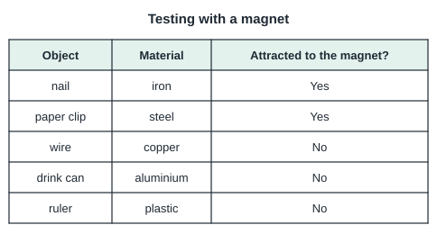

**Material `sc-p3-poles-learn` · Learn: the poles of a magnet** (teaching)

> Every magnet has two poles, a north pole (N) and a south pole (S). The magnetic force is strongest at the poles. If a bar magnet is dipped into paper clips, most clips stick near its two ends.

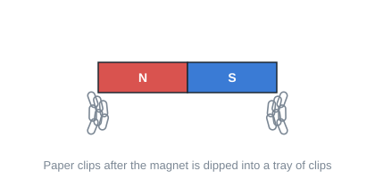

**Material `sc-p3-attract-repel-learn` · Learn: like and unlike poles** (teaching)

> Unlike poles attract: N and S pull towards each other. Like poles repel: N and N, or S and S, push each other away.

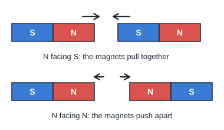

**Material `sc-p3-test-magnet-learn` · Learn: how to tell if something is a magnet** (teaching)

> A magnet attracts magnetic materials, so attraction alone does not prove that an object is a magnet: an iron bar is attracted too. Only repulsion proves it: if an object repels a magnet, the object must be a magnet.

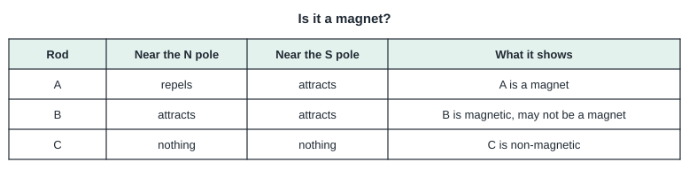

**Material `sc-p3-force-through-learn` · Learn: magnetic force through materials** (teaching)

> Magnetic force can act through non-magnetic materials such as paper, plastic, glass and water. A magnet under a table can move a paper clip on top of the table.

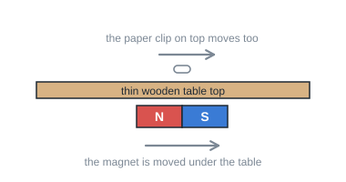

**Material `sc-p3-north-south-learn` · Learn: a freely suspended magnet** (teaching)

> A bar magnet hung freely from a string comes to rest pointing in the north-south direction. Its north pole points north. A compass needle is a small magnet that works in this way.

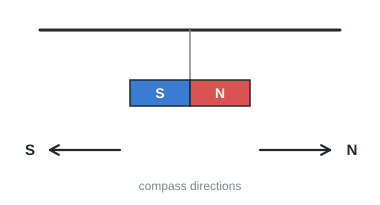

| ID / stage | Question and options | Key | Hint | Explanation | Leaf → repair route |
| --- | --- | --- | --- | --- | --- |
| sc-p3-magnetic-materials-learn.q1 (v1) | Which object will be attracted to a magnet? 1 a plastic ruler; 2 a copper coin; 3 an iron nail; 4 an aluminium can | an iron nail | Which metal is magnetic? | Iron is a magnetic material. | `sc.p3.leaf.magnetic-materials` repairs via `sc.p3.magnetic-materials` |
| sc-p3-magnetic-materials-learn.q2 (v2) | Ali says all metals are attracted to magnets. Which object shows he is wrong? 1 a steel paper clip; 2 an iron key; 3 an iron washer; 4 an aluminium can | an aluminium can | Find a metal that is not magnetic. | Aluminium is a metal but is not magnetic. | `sc.p3.leaf.magnetic-materials` repairs via `sc.p3.magnetic-materials` |
| sc-p3-magnetic-materials.q1 / exact (v2) | Which material is magnetic? 1 copper; 2 wood; 3 steel; 4 glass | steel | Some metals are magnetic, but not all metals are. | Steel is magnetic. | `sc.p3.leaf.magnetic-materials` target `sc.p3.magnetic-materials` |
| sc-p3-magnetic-materials.q2 / similar (v2) | A magnet is moved over a pile of objects. Which object stays behind? 1 an iron screw; 2 a copper wire; 3 a steel pin; 4 a steel nut | a copper wire | Which material is non-magnetic? | Copper is non-magnetic, so it stays behind. | `sc.p3.leaf.magnetic-materials` target `sc.p3.magnetic-materials` |
| sc-p3-magnetic-materials.q3 / generic (v1) | Mei wants to pick up spilled pins quickly. Why does using a magnet work? 1 The pins are made of copper.; 2 The pins are made of plastic.; 3 Magnets attract all materials.; 4 The pins are made of steel, a magnetic material. | The pins are made of steel, a magnetic material. | What are pins usually made of? | Steel pins are attracted to the magnet. | `sc.p3.leaf.magnetic-materials` target `sc.p3.magnetic-materials` |
| sc-p3-poles-learn.q1 (v1) | Where is the magnetic force of a bar magnet strongest? 1 at its two ends (poles); 2 in the middle; 3 equally everywhere; 4 only at the north pole | at its two ends (poles) | Where do most paper clips stick? | The force is strongest at the poles. | `sc.p3.leaf.poles` repairs via `sc.p3.poles` |
| sc-p3-poles-learn.q2 (v1) | A bar magnet is dipped into iron filings. Where will most filings collect? 1 at one end only; 2 at the middle; 3 at both ends; 4 nowhere | at both ends | Think about the poles. | Most filings collect at the poles, at both ends. | `sc.p3.leaf.poles` repairs via `sc.p3.poles` |
| sc-p3-poles.q1 / exact (v1) | How many poles does a bar magnet have? 1 1; 2 2; 3 3; 4 4 | 2 | One is north, one is south. | A magnet has a north pole and a south pole. | `sc.p3.leaf.poles` target `sc.p3.poles` |
| sc-p3-poles.q2 / similar (v1) | A ring magnet attracts most pins at its two flat faces. What does this show? 1 It has no poles.; 2 The poles are at the flat faces.; 3 It is not a magnet.; 4 The poles are at its edge only. | The poles are at the flat faces. | The force is strongest at the poles. | Most pins stick where the poles are, at the flat faces. | `sc.p3.leaf.poles` target `sc.p3.poles` |
| sc-p3-poles.q3 / generic (v1) | A bar magnet is broken in half. How many poles does each piece have? 1 4; 2 0; 3 1; 4 2 | 2 | Every magnet has two poles. | Each piece becomes a magnet with its own N and S poles. | `sc.p3.leaf.poles` target `sc.p3.poles` |
| sc-p3-attract-repel-learn.q1 (v1) | What happens when the N pole of one magnet is brought near the S pole of another? 1 Nothing happens.; 2 Both magnets lose their magnetism.; 3 They attract.; 4 They repel. | They attract. | Unlike poles... | Unlike poles attract. | `sc.p3.leaf.attract-repel` repairs via `sc.p3.attract-repel` |
| sc-p3-attract-repel-learn.q2 (v1) | Two magnets push each other away. Which poles are facing each other? 1 S and S; 2 the middle of each magnet; 3 N and S; 4 S and N | S and S | Like poles repel. | Like poles, such as S and S, repel. | `sc.p3.leaf.attract-repel` repairs via `sc.p3.attract-repel` |
| sc-p3-attract-repel.q1 / exact (v1) | Which pair of poles repel? 1 N and N; 2 S and N; 3 N and S; 4 none of these | N and N | Like poles... | Like poles repel: N and N. | `sc.p3.leaf.attract-repel` target `sc.p3.attract-repel` |
| sc-p3-attract-repel.q2 / similar (v1) | Two ring magnets on a pencil float one above the other without touching. Why? 1 The pencil is magnetic.; 2 Unlike poles face each other and attract.; 3 Gravity has stopped working.; 4 Like poles face each other and repel. | Like poles face each other and repel. | Something is pushing the top magnet up. | Facing like poles repel, holding the top magnet up. | `sc.p3.leaf.attract-repel` target `sc.p3.attract-repel` |
| sc-p3-attract-repel.q3 / generic (v1) | Magnet P's north pole attracts end X of magnet Q. What is end X? 1 a south pole; 2 cannot be a magnet; 3 a north pole; 4 not a pole | a south pole | Unlike poles attract. | A north pole attracts a south pole, so X is S. | `sc.p3.leaf.attract-repel` target `sc.p3.attract-repel` |
| sc-p3-test-magnet-learn.q1 (v1) | Which observation proves that bar X is a magnet? 1 X is made of metal.; 2 X is attracted to a magnet.; 3 X is shiny.; 4 One end of X repels the N pole of a magnet. | One end of X repels the N pole of a magnet. | Can an iron bar repel a magnet? | Only a magnet can repel a magnet. | `sc.p3.leaf.test-magnet` repairs via `sc.p3.test-magnet` |
| sc-p3-test-magnet-learn.q2 (v1) | Bar Y is attracted to both poles of a magnet. What can you conclude? 1 Y is made of copper.; 2 Y is plastic.; 3 Y is a magnetic material but not necessarily a magnet.; 4 Y is definitely a magnet. | Y is a magnetic material but not necessarily a magnet. | A magnet would repel one of the poles. | Being attracted to both poles means Y is magnetic, not a magnet. | `sc.p3.leaf.test-magnet` repairs via `sc.p3.test-magnet` |
| sc-p3-test-magnet.q1 / exact (v1) | Why can attraction alone not prove that an object is a magnet? 1 Magnetic materials are also attracted to magnets.; 2 Magnets never attract.; 3 Attraction only happens in water.; 4 Only plastic is attracted. | Magnetic materials are also attracted to magnets. | Think of an iron nail. | Iron is attracted to magnets but is not a magnet. | `sc.p3.leaf.test-magnet` target `sc.p3.test-magnet` |
| sc-p3-test-magnet.q2 / similar (v1) | Ali tests three rods. Rod A repels a magnet. Rod B is attracted to both poles. Rod C is not attracted. Which rod is a magnet? 1 Rod B; 2 all three; 3 Rod A; 4 Rod C | Rod A | Look for repulsion. | Only rod A shows repulsion. | `sc.p3.leaf.test-magnet` target `sc.p3.test-magnet` |
| sc-p3-test-magnet.q3 / generic (v1) | A steel bar is attracted to the N pole of a magnet. What test should be done next to find out if it is a magnet? 1 Paint the bar.; 2 Put the bar in water.; 3 Weigh the bar.; 4 Bring the other end of the bar near the same N pole and check for repulsion. | Bring the other end of the bar near the same N pole and check for repulsion. | A magnet shows repulsion with like poles. | Checking for repulsion confirms whether it is a magnet. | `sc.p3.leaf.test-magnet` target `sc.p3.test-magnet` |
| sc-p3-force-through-learn.q1 (v1) | A magnet under a thin wooden table moves a paper clip on top. What does this show? 1 Magnets only work in air.; 2 Magnetic force can pass through wood.; 3 Wood is magnetic.; 4 The paper clip is wooden. | Magnetic force can pass through wood. | The table is between them. | The magnetic force acted through the non-magnetic wood. | `sc.p3.leaf.force-through` repairs via `sc.p3.force-through` |
| sc-p3-force-through-learn.q2 (v1) | A paper clip in a glass of water is pulled up the side by a magnet outside the glass. What does this show? 1 Glass is magnetic.; 2 Water is a magnet.; 3 The clip is plastic.; 4 Magnetic force can pass through glass and water. | Magnetic force can pass through glass and water. | What is between the magnet and the clip? | The force acted through glass and water. | `sc.p3.leaf.force-through` repairs via `sc.p3.force-through` |
| sc-p3-force-through.q1 / exact (v1) | Through which material can magnetic force act? 1 none of them; 2 only metal; 3 paper; 4 only air | paper | Think of fridge magnets holding notes. | Fridge magnets hold paper because the force acts through paper. | `sc.p3.leaf.force-through` target `sc.p3.force-through` |
| sc-p3-force-through.q2 / similar (v1) | A magnet holds a sheet of paper on a steel fridge door. Which statement is correct? 1 The magnetic force passes through the paper to the steel door.; 2 The paper is attracted to the magnet.; 3 The paper is magnetic.; 4 Glue holds the paper. | The magnetic force passes through the paper to the steel door. | Is paper magnetic? | The force passes through the paper to the steel door. | `sc.p3.leaf.force-through` target `sc.p3.force-through` |
| sc-p3-force-through.q3 / generic (v1) | Mei adds sheets of paper between a magnet and a paper clip one at a time. The clip falls after 20 sheets. What does this show? 1 Magnets get stronger with more paper.; 2 Paper clips are not magnetic.; 3 The magnetic force gets weaker with greater distance.; 4 Paper is magnetic. | The magnetic force gets weaker with greater distance. | More sheets means the magnet is further away. | The force weakens as the distance increases. | `sc.p3.leaf.force-through` target `sc.p3.force-through` |
| sc-p3-north-south-learn.q1 (v1) | A bar magnet hangs freely from a string. Which direction does it come to rest in? 1 up-down; 2 north-south; 3 any direction; 4 east-west | north-south | This is how a compass works. | A freely suspended magnet points north-south. | `sc.p3.leaf.north-south` repairs via `sc.p3.north-south` |
| sc-p3-north-south-learn.q2 (v1) | Why does a compass needle point north? 1 It is heavy at one end.; 2 Wind pushes it.; 3 It is made of plastic.; 4 It is a small magnet. | It is a small magnet. | What kind of object behaves like a hanging bar magnet? | A compass needle is a magnet, so it points north-south. | `sc.p3.leaf.north-south` repairs via `sc.p3.north-south` |
| sc-p3-north-south.q1 / exact (v1) | Which end of a freely hanging magnet points north? 1 its south pole; 2 its north pole; 3 its middle; 4 any end | its north pole | The poles are named after this. | The north pole points north. | `sc.p3.leaf.north-south` target `sc.p3.north-south` |
| sc-p3-north-south.q2 / similar (v1) | An iron bar hangs freely and stops in different directions each time. What does this show? 1 The iron bar is a magnet.; 2 Iron is non-magnetic.; 3 The string is magnetic.; 4 The iron bar is not a magnet. | The iron bar is not a magnet. | A magnet would always stop north-south. | Not settling north-south shows it is not a magnet. | `sc.p3.leaf.north-south` target `sc.p3.north-south` |
| sc-p3-north-south.q3 / generic (v1) | Hikers use a compass to find their way. Which property of magnets do they use? 1 Magnets float.; 2 A freely moving magnet points north-south.; 3 Magnets are heavy.; 4 Magnets attract copper. | A freely moving magnet points north-south. | The needle is a magnet. | The compass needle points north-south, showing direction. | `sc.p3.leaf.north-south` target `sc.p3.north-south` |

## P3 · Making and using magnets: stroke and electrical methods, temporary/permanent magnets, uses (`sc.p3.making-magnets`)

**Material `sc-p3-stroke-method-learn` · Learn: making a magnet by stroking** (teaching)

> A magnet can be made by stroking a steel or iron object with one pole of a magnet, in the same direction, many times. Lift the magnet away at the end of each stroke. More strokes usually make a stronger magnet. Only magnetic materials can be made into magnets.

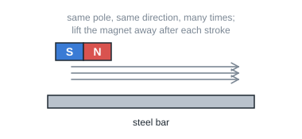

**Material `sc-p3-electrical-method-learn` · Learn: making an electromagnet** (teaching)

> A magnet can also be made using electricity: wind insulated wire around an iron nail and connect it to a battery. The nail becomes a magnet only while the current flows; this is an electromagnet. More turns of wire or more batteries make it stronger.

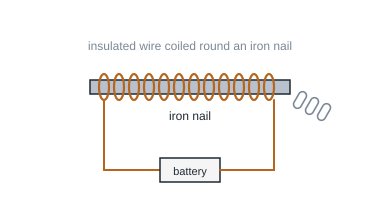

**Material `sc-p3-temporary-permanent-learn` · Learn: temporary and permanent magnets** (teaching)

> Permanent magnets keep their magnetism for a long time. An electromagnet made with a soft iron core is a temporary magnet: it attracts steel when switched on and loses its magnetism when switched off. Dropping or heating a magnet can make it weaker.

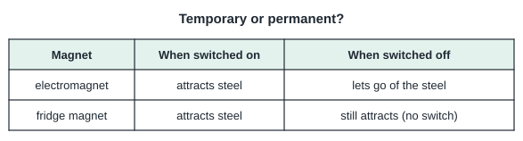

**Material `sc-p3-uses-learn` · Learn: uses of magnets** (teaching)

> Magnets are used in daily life: fridge door seals, magnetic cupboard catches, compasses, pencil-case clasps, magnetic toys and sorting steel cans from aluminium cans for recycling.

| ID / stage | Question and options | Key | Hint | Explanation | Leaf → repair route |
| --- | --- | --- | --- | --- | --- |
| sc-p3-stroke-method-learn.q1 (v1) | Which object can be made into a magnet by stroking? 1 a plastic straw; 2 a steel needle; 3 a wooden stick; 4 a copper wire | a steel needle | Only magnetic materials can become magnets. | Steel is magnetic, so it can be magnetised. | `sc.p3.leaf.stroke-method` repairs via `sc.p3.stroke-method` |
| sc-p3-stroke-method-learn.q2 (v1) | How should a steel bar be stroked to make it a magnet? 1 with a cloth, in circles; 2 with both poles, back and forth; 3 once only, very hard; 4 with one pole, in one direction, many times | with one pole, in one direction, many times | The strokes must all go the same way. | Stroke with one pole in one direction many times. | `sc.p3.leaf.stroke-method` repairs via `sc.p3.stroke-method` |
| sc-p3-stroke-method.q1 / exact (v1) | Why can a copper rod not be made into a magnet? 1 Copper is too shiny.; 2 Copper is non-magnetic.; 3 Copper is too heavy.; 4 Copper is a liquid. | Copper is non-magnetic. | Which materials can become magnets? | Only magnetic materials can be magnetised. | `sc.p3.leaf.stroke-method` target `sc.p3.stroke-method` |
| sc-p3-stroke-method.q2 / similar (v1) | Ali stroked steel nail A 10 times and steel nail B 40 times in the same way. Which is likely to pick up more pins? 1 nail B; 2 nail A; 3 both the same; 4 neither | nail B | More strokes... | More strokes usually make a stronger magnet. | `sc.p3.leaf.stroke-method` target `sc.p3.stroke-method` |
| sc-p3-stroke-method.q3 / generic (v1) | Mei stroked a steel pin back and forth with a magnet. It did not become a magnet. What did she do wrong? 1 She did not stroke in one direction only.; 2 She stroked too many times.; 3 She used a steel pin.; 4 She used a magnet. | She did not stroke in one direction only. | The direction of stroking matters. | Strokes must be in one direction only. | `sc.p3.leaf.stroke-method` target `sc.p3.stroke-method` |
| sc-p3-electrical-method-learn.q1 (v1) | What is needed to make an electromagnet? 1 an iron nail, wire coiled round it and a battery; 2 a wooden stick and glue; 3 a glass rod and paper; 4 a plastic straw and string | an iron nail, wire coiled round it and a battery | Electricity must flow around a magnetic material. | A coil of wire around an iron nail connected to a battery makes an electromagnet. | `sc.p3.leaf.electrical-method` repairs via `sc.p3.electrical-method` |
| sc-p3-electrical-method-learn.q2 (v1) | What happens when the battery of an electromagnet is disconnected? 1 It turns into copper.; 2 It loses most of its magnetism.; 3 It becomes stronger.; 4 Nothing changes. | It loses most of its magnetism. | It works only while current flows. | An electromagnet works only while current flows. | `sc.p3.leaf.electrical-method` repairs via `sc.p3.electrical-method` |
| sc-p3-electrical-method.q1 / exact (v1) | How can an electromagnet be made stronger? 1 by using a plastic core; 2 by adding more turns of wire; 3 by using fewer turns; 4 by removing the battery | by adding more turns of wire | Think about the coil. | More turns of wire make it stronger. | `sc.p3.leaf.electrical-method` target `sc.p3.electrical-method` |
| sc-p3-electrical-method.q2 / similar (v1) | Why is an iron nail used inside the coil instead of a wooden stick? 1 Wood is too light.; 2 Wood conducts electricity.; 3 Iron is a magnetic material.; 4 Iron is cheaper. | Iron is a magnetic material. | Which material can become a magnet? | Iron can be magnetised; wood cannot. | `sc.p3.leaf.electrical-method` target `sc.p3.electrical-method` |
| sc-p3-electrical-method.q3 / generic (v1) | A crane in a scrapyard lifts cars with a large electromagnet and drops them when it switches off. Why is an electromagnet used and not a permanent magnet? 1 It is lighter.; 2 It attracts copper.; 3 It can be switched off to release the cars.; 4 It is made of plastic. | It can be switched off to release the cars. | Think about letting go of the load. | Switching off the current releases the load. | `sc.p3.leaf.electrical-method` target `sc.p3.electrical-method` |
| sc-p3-temporary-permanent-learn.q1 (v1) | Which is a temporary magnet? 1 a fridge magnet; 2 a bar magnet in a box; 3 a compass needle; 4 an electromagnet | an electromagnet | Which one stops working when switched off? | An electromagnet is a temporary magnet. | `sc.p3.leaf.temporary-permanent` repairs via `sc.p3.temporary-permanent` |
| sc-p3-temporary-permanent-learn.q2 (v2) | A scrapyard crane has an electromagnet. It picks up steel cans when switched on and releases them when switched off. Which description fits this magnet? 1 It stays magnetic after it is switched off.; 2 It is a permanent magnet.; 3 It cannot attract steel.; 4 It is a temporary magnet. | It is a temporary magnet. | Think about what changes when the power is switched off. | The electromagnet loses its magnetism when switched off, so it is a temporary magnet. | `sc.p3.leaf.temporary-permanent` repairs via `sc.p3.temporary-permanent` |
| sc-p3-temporary-permanent.q1 / exact (v1) | Which action can weaken a magnet? 1 painting it; 2 keeping it in a box; 3 dropping it many times; 4 using it to pick up pins | dropping it many times | Rough handling affects magnets. | Dropping a magnet can weaken it. | `sc.p3.leaf.temporary-permanent` target `sc.p3.temporary-permanent` |
| sc-p3-temporary-permanent.q2 / similar (v2) | Which is a permanent magnet? 1 a wooden ruler; 2 a fridge magnet; 3 an iron nail with no magnetism; 4 an electromagnet | a fridge magnet | Which keeps its magnetism for a long time? | Fridge magnets are permanent magnets. | `sc.p3.leaf.temporary-permanent` target `sc.p3.temporary-permanent` |
| sc-p3-temporary-permanent.q3 / generic (v1) | A magnet that was left near a hot stove became weaker. What caused this? 1 heating; 2 the plastic handle; 3 the colour of the stove; 4 the smell of food | heating | Think about what weakens magnets. | Heating can weaken a magnet. | `sc.p3.leaf.temporary-permanent` target `sc.p3.temporary-permanent` |
| sc-p3-uses-learn.q1 (v1) | Why does a fridge door close tightly? 1 The door is made of glass.; 2 The fridge is cold.; 3 There are magnets in the door seal.; 4 Glue holds it. | There are magnets in the door seal. | The seal sticks to the steel body. | Magnetic strips in the seal hold the door closed. | `sc.p3.leaf.uses` repairs via `sc.p3.uses` |
| sc-p3-uses-learn.q2 (v1) | At a recycling centre, how can steel cans be separated from aluminium cans? 1 by using a large magnet; 2 by using water; 3 by colour; 4 by using glue | by using a large magnet | Which metal is magnetic? | Steel cans are attracted to a magnet; aluminium cans are not. | `sc.p3.leaf.uses` repairs via `sc.p3.uses` |
| sc-p3-uses.q1 / exact (v1) | Which item uses a magnet? 1 a glass cup; 2 a cotton towel; 3 a compass; 4 a pencil | a compass | It shows direction. | A compass needle is a magnet. | `sc.p3.leaf.uses` target `sc.p3.uses` |
| sc-p3-uses.q2 / similar (v1) | A cupboard door stays shut because a magnet holds a small steel plate. Which property of magnets is used? 1 Magnets float.; 2 Magnets are transparent.; 3 Magnets attract aluminium.; 4 Magnets attract magnetic materials. | Magnets attract magnetic materials. | The plate is steel. | The magnet attracts the steel plate. | `sc.p3.leaf.uses` target `sc.p3.uses` |
| sc-p3-uses.q3 / generic (v1) | A toy train's carriages join with magnets at each end. Sometimes two carriages push apart. Why? 1 Like poles are facing each other.; 2 The carriages are made of copper.; 3 Unlike poles are facing each other.; 4 The magnets have no poles. | Like poles are facing each other. | Like poles... | Facing like poles repel, so the carriages push apart. | `sc.p3.leaf.uses` target `sc.p3.uses` |
